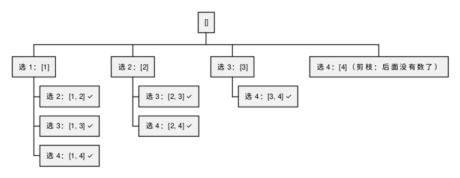

:PROPERTIES:
:ID:       3c0f22b4-1dd8-433c-aec4-13eda95dffea
:ROAM_ALIASES: "回溯"
:VERIFIED_WITH: Python 3.14 (2026-10-27)
:END:
#+title: Backtracking
#+filetags: :Algorithms:

* TOC :TOC_1:
- [[#recognition][Recognition]]
- [[#core-idea][Core Idea]]
- [[#][[]]]
- [[#template][Template]]
- [[#去重][去重]]
- [[#complexity][Complexity]]
- [[#pitfalls][Pitfalls]]
- [[#practice][Practice]]

* Recognition
题目要求 *列出所有* 满足条件的方案，或判断是否存在方案，而规模不大（n 通常不超过 20 左右）→ 回溯。五类典型问题：
- 组合：从 N 个数里按规则选 k 个（LT77、LT39、LT40）
- 切割：一个字符串按规则有几种切法（LT131 分割回文串）
- 子集：N 个数的集合有哪些符合条件的子集（LT78、LT90）
- 排列：N 个数按规则全排列（LT46、LT47）
- 棋盘：N 皇后、解数独（LT51、LT37）

只求方案 *数量* 或 *最优值* 、且子问题重叠时，通常该用动态规划。

* Core Idea
回溯就是在一棵树上做深度优先搜索，穷举所有路径：

以 ~combine(4, 2)~ （1..4 中选 2 个）为例，每个节点是当前路径，边上是本层的选择：

#+begin_src plantuml :file images/backtracking_tree.png
@startwbs
* []
** 选 1：[1]
*** 选 2：[1, 2] ✓
*** 选 3：[1, 3] ✓
*** 选 4：[1, 4] ✓
** 选 2：[2]
*** 选 3：[2, 3] ✓
*** 选 4：[2, 4] ✓
** 选 3：[3]
*** 选 4：[3, 4] ✓
** 选 4：[4]（剪枝：后面没有数了）
@endwbs
#+end_src

#+RESULTS:

- 每层的 ~for~ 循环横向遍历本层的选择，集合的大小是树的宽度。
- 递归纵向深入，递归深度是树的深度；有终止条件，所以树的高度有限。
- 「回溯」指递归返回后撤销本层做的选择，让下一个选择从同样的状态出发。

递归函数本身的写法见 [[id:c2cf012a-4f1d-4d6a-993b-721e20cee9dc][Recursive Problem Solving]]。

* Template
#+begin_src python :results output
def backtrack_template():
    """结构示意（不运行）：
    def backtrack(路径, 选择列表):
        if 满足终止条件:
            结果.append(路径的副本)
            return
        for 选择 in 本层的选择列表:
            if 剪枝条件:
                continue
            做选择（加入路径）
            backtrack(路径, 下一层的选择列表)
            撤销选择（从路径中移除）
    """

def combine(n, k):
    """LT77：1..n 中选 k 个数的所有组合。"""
    res, path = [], []
    def bt(start):
        if len(path) == k:
            res.append(path[:])               # 存副本，path 之后还会变
            return
        for i in range(start, n - (k - len(path)) + 2):   # 剪枝：剩下的数不够凑满 k 个就不试
            path.append(i)
            bt(i + 1)
            path.pop()
    bt(1)
    return res

def combination_sum2(candidates, target):
    """LT40：每个数只能用一次，候选中有重复，结果不能有重复组合。"""
    candidates.sort()                         # 去重第 1 步：排序，让相同的数相邻
    res, path = [], []
    def bt(start, remain):
        if remain == 0:
            res.append(path[:])
            return
        for i in range(start, len(candidates)):
            if candidates[i] > remain:
                break                         # 已排序，后面的更大
            if i > start and candidates[i] == candidates[i - 1]:
                continue                      # 同一树层跳过相同的数
            path.append(candidates[i])
            bt(i + 1, remain - candidates[i])
            path.pop()
    bt(0, target)
    return res

def permute_unique(nums):
    """LT47：有重复数字的全排列，用 used 数组去重。"""
    nums.sort()
    res, path, used = [], [], [False] * len(nums)
    def bt():
        if len(path) == len(nums):
            res.append(path[:])
            return
        for i in range(len(nums)):
            if used[i]:
                continue
            # used[i-1] 为 False：nums[i-1] 在同一树层已经用过并被撤销，跳过
            if i > 0 and nums[i] == nums[i - 1] and not used[i - 1]:
                continue
            used[i] = True
            path.append(nums[i])
            bt()
            path.pop()
            used[i] = False
    bt()
    return res

assert combine(4, 2) == [[1, 2], [1, 3], [1, 4], [2, 3], [2, 4], [3, 4]]
assert combination_sum2([10, 1, 2, 7, 6, 1, 5], 8) == [[1, 1, 6], [1, 2, 5], [1, 7], [2, 6]]
assert permute_unique([1, 1, 2]) == [[1, 1, 2], [1, 2, 1], [2, 1, 1]]
print("ok")
#+end_src

#+RESULTS:
: ok

* 去重
输入有重复元素、结果不能重复时：
1. 先排序，让相同的元素相邻。
2. 区分「同一树枝」和「同一树层」：同一条路径上（树枝）可以出现相同的值，因为它们是不同位置的元素；同一层的兄弟选择中（树层）相同的值只能试一次，否则会生成重复结果。
   - 组合、子集按 ~start~ 推进，用 ~i > start and a[i] == a[i-1]~ 跳过同层重复。
   - 排列每层都从头扫，需要 ~used~ 数组： ~used[i-1]~ 为 ~True~ 说明 ~a[i-1]~ 在当前树枝上，可以继续用 ~a[i]~ ；为 ~False~ 说明 ~a[i-1]~ 在同一树层已经试过并撤销，跳过 ~a[i]~ 。

* Complexity
指数级：子集 O(2ⁿ)，排列 O(n!)，每个结果还要 O(n) 复制。剪枝只减小常数和实际搜索量，不改变最坏情况。

* Pitfalls
- 结果里存 ~path~ 本身而不是副本：最后所有结果都是同一个（已被清空的）列表。
- 组合问题忘了用 ~start~ ：会得到 [1, 2] 和 [2, 1] 这样的重复组合。
- 撤销选择和做选择不对称（ ~append~ 后没有 ~pop~ 、 ~used~ 没有复位）。
- 子问题重复时（例如只求方案数）回溯会重复计算；加缓存后就变成记忆化搜索，即动态规划。

* Practice
- 组合：LT77、LT39、LT40、LT216；子集：LT78、LT90；排列：LT46、LT47
- 切割：LT131、LT93；棋盘：LT51、LT37
