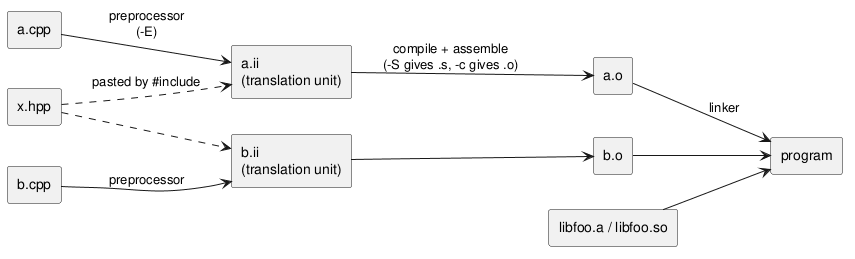

:PROPERTIES:
:ID:       726f8c7e-5021-4247-b502-70a38c5b3173
:ROAM_ALIASES: "C++ 编译与链接"
:VERIFIED_WITH: GCC 16.2.1, GNU ar (2026-10-26)
:END:
#+title: C++ Compilation and Linking
#+filetags: :C++:

* Pipeline
#+begin_src plantuml :file images/cpp_compilation_pipeline.png
@startuml
left to right direction
rectangle "a.cpp" as a
rectangle "b.cpp" as b
rectangle "x.hpp" as h
rectangle "a.ii\n(translation unit)" as ai
rectangle "b.ii\n(translation unit)" as bi
rectangle "a.o" as ao
rectangle "b.o" as bo
rectangle "libfoo.a / libfoo.so" as lib
rectangle "program" as exe
a --> ai : preprocessor\n(-E)
h ..> ai : pasted by #include
b --> bi : preprocessor
h ..> bi
ai --> ao : compile + assemble\n(-S gives .s, -c gives .o)
bi --> bo
ao --> exe : linker
bo --> exe
lib --> exe
@enduml
#+end_src

#+RESULTS:

- The *preprocessor* pastes headers in and expands macros. Its output, one per ~.cpp~, is a *translation unit*. Each unit is compiled in isolation, which is why every unit must see a declaration of everything it uses.
- The *compiler* turns each unit into an object file with a symbol table: symbols it defines and symbols it still needs.
- The *linker* matches needed symbols to definitions across object files and libraries.
- ~-save-temps~ keeps the intermediate ~.ii~ (preprocessed) and ~.s~ (assembly) files; useful to see what a macro or template really produced.

* Headers and the One Definition Rule
- ~#include~ is textual pasting, so a header included twice in one unit is pasted twice. Guard every header with ~#pragma once~ (non-standard but supported everywhere) or ~#ifndef X_H / #define X_H / ... #endif~.
- *One Definition Rule (ODR)*: a non-inline function or variable has exactly one definition in the whole program. A plain function defined in a header included by two ~.cpp~ files fails to link with =multiple definition of `bar()'=.
- ~inline~ means "this definition may appear in several units; they are all the same". That is what allows defining functions (and, since C++17, variables) in headers. Member functions defined inside the class, templates, and ~constexpr~ functions are implicitly inline. Whether a call is actually inlined is the optimizer's decision, independent of the keyword.

* Libraries
| Kind                | File               | Linked                                   | Trade-off                                                     |
|---------------------+--------------------+------------------------------------------+---------------------------------------------------------------|
| static              | ~libfoo.a~ (an archive of ~.o~ files: ~ar rcs libfoo.a foo.o~) | copied into the executable at link time | self-contained binary; every user carries a copy; relink to update |
| shared (dynamic)    | ~libfoo.so~        | resolved at load time by the dynamic loader | one copy in memory; can be updated separately; must be found at run time |

- Link with ~g++ main.cpp -L<dir> -lfoo~. *Order matters for static libraries*: the linker scans left to right and pulls from an archive only symbols already needed, so ~g++ -L. -lfoo main.cpp~ fails with =undefined reference to `foo()'=. Put libraries after the objects that use them.
- Shared libraries must be locatable at run time: an ~rpath~ baked in at link time (~-Wl,-rpath,...~; CMake does this for build trees), the system paths, or ~LD_LIBRARY_PATH~. ~ldd ./program~ shows what resolves where.

* Reading Linker Errors
| Error                              | Usual cause                                                                     |
|------------------------------------+---------------------------------------------------------------------------------|
| =undefined reference to X=         | definition not compiled or not linked; library order; template defined only in a ~.cpp~; C function called without ~extern "C"~ |
| =multiple definition of X=         | non-inline definition in a header                                               |
| error while loading shared libraries | ~.so~ not on the runtime search path                                          |
