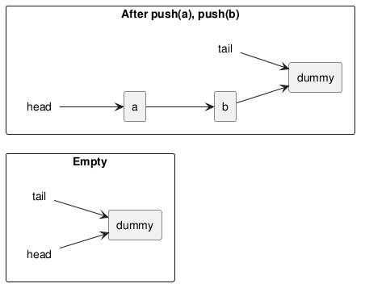

:PROPERTIES:
:ID:       f8a4353c-d3ec-4439-824a-23c454a71a31
:ROAM_ALIASES: "C++ 基于锁的并发数据结构"
:VERIFIED_WITH: GCC 16.2.1, -std=c++23, -fsanitize=thread (2026-10-26)
:END:
#+title: C++ Lock-based Concurrent Data Structures
#+filetags: :C++:Concurrency:

* TOC :TOC_1:
- [[#design-rules][Design Rules]]
- [[#overview][Overview]]
- [[#queue-with-a-condition-variable][Queue with a Condition Variable]]
- [[#fine-grained-queue][Fine-grained Queue]]
- [[#lookup-table][Lookup Table]]
- [[#linked-list-with-per-node-locks][Linked List with Per-node Locks]]
- [[#pitfalls][Pitfalls]]

* Design Rules
A thread-safe container has two goals that pull against each other: *safe* access and *genuine* concurrency.

Safety:
- No thread ever sees a broken invariant.
- The interface has no check-then-act races: operations are complete units (~try_pop~, ~wait_and_pop~, ~value_for(key, default)~), not ~empty()~ + ~top()~ + ~pop()~. See [[id:d0df6e46-ba6c-4edc-9105-01a8d7692d68][C++ Mutexes, Locks and Deadlock]].
- Exception safety: if an operation throws, the structure is unchanged. Allocate (~make_shared~, new nodes) *before* taking the lock or before modifying anything; return popped values as ~std::shared_ptr<T>~ so the copy cannot fail after the element was removed.
- No user code under a lock where avoidable. The element type's copy / move / ~operator new~ is user code too; containers usually document that these must not touch the container.

Concurrency:
- The smaller the locked region, the fewer operations serialize.
- Ask whether every operation needs the same protection: readers vs writers (~shared_mutex~), head vs tail (two mutexes), bucket vs bucket (lock striping).

* Overview
| Structure               | Locking                                    | Concurrency obtained                                  | Cost                                         |
|-------------------------+--------------------------------------------+-------------------------------------------------------+----------------------------------------------|
| stack over ~std::stack~ | one mutex                                  | none; all operations serialize                         | simplest; no way to wait for an element      |
| queue over ~std::queue~ | one mutex + condition variable             | none, but consumers can block waiting                  | allocation under the lock                    |
| fine-grained queue      | head mutex + tail mutex + dummy node       | one ~push~ and one ~pop~ in parallel                   | own linked list                              |
| lookup table            | fixed buckets, a ~shared_mutex~ each       | different buckets in parallel; readers of one bucket in parallel | no iterators, no resizing          |
| linked list             | one mutex per node, hand-over-hand         | threads work on different parts of the list            | a lock per node; long lock chains            |

* Queue with a Condition Variable
Wrap ~std::queue~ with a mutex and a [[id:890f2b58-21c3-48b7-a975-c532eedc01ec][condition variable]]; offer ~try_pop~ (non-blocking) and ~wait_and_pop~ (blocking), each as a ~T&~ overload and a ~shared_ptr<T>~ overload.

Store ~std::shared_ptr<T>~ in the queue rather than ~T~:
- ~push~ allocates the ~shared_ptr~ *outside* the lock, shortening the critical section.
- ~wait_and_pop~ just moves the pointer out, which cannot throw. With ~T~ stored, building the returned ~shared_ptr~ after waking can throw; the woken consumer then exits with the item still queued while other consumers keep sleeping (~notify_one~ woke only one).

* Fine-grained Queue
A singly linked list with ~head~ and ~tail~ pointers would let ~push~ (touches ~tail~) and ~pop~ (touches ~head~) use separate mutexes, except for a single-element list, where ~head~ and ~tail~ are the same node. A *dummy node* removes that case: the list always ends in an empty dummy, so ~push~ never touches the node ~pop~ removes.

#+begin_src plantuml :file images/cpp_fine_grained_queue.png
@startuml
left to right direction
rectangle "Empty" {
  rectangle "dummy" as d0
  label "head" as h0
  label "tail" as t0
  h0 --> d0
  t0 --> d0
}
rectangle "After push(a), push(b)" {
  rectangle "a" as a
  rectangle "b" as b
  rectangle "dummy" as d2
  label "head" as h2
  label "tail" as t2
  h2 --> a
  a --> b
  b --> d2
  t2 --> d2
}
@enduml
#+end_src

#+RESULTS:

- Empty means ~head == tail~.
- ~push~ writes the value into the *current* dummy, appends a fresh dummy and moves ~tail~ to it. It locks only ~tail_mutex~.
- ~pop~ locks ~head_mutex~, reads ~tail~ (under ~tail_mutex~, briefly) to test emptiness, then unlinks the head node. The only place holding two locks always takes ~head~ then ~tail~, so no deadlock.

#+begin_src cpp
void push(T v) {
  auto data = std::make_shared<T>(std::move(v));   // may throw: before any change
  auto dummy = std::make_unique<node>();
  node* const new_tail = dummy.get();
  {
    std::lock_guard lk(tail_mutex);
    tail->data = std::move(data);
    tail->next = std::move(dummy);
    tail = new_tail;
  }
  data_cond.notify_one();
}

std::shared_ptr<T> try_pop() {
  std::lock_guard lk(head_mutex);
  if (head.get() == get_tail()) return nullptr;     // get_tail() locks tail_mutex
  return pop_head()->data;                          // unlink; old head freed on return
}
#+end_src

~wait_and_pop~ waits on ~data_cond~ with the ~head_mutex~ lock and the predicate ~head.get() != get_tail()~. Reading ~tail~ *inside* the head lock matters: read outside, ~tail~ could be stale by the time ~head~ is compared with it.

A bounded version makes ~push~ wait on a second condition, "not full".

* Lookup Table
Mutexes do not fit the ~std::map~ interface: an iterator is a reference into the structure that outlives any lock. Cut the interface down to:
~value_for(key, default)~, ~add_or_update(key, value)~, ~remove(key)~, and, if needed, a ~snapshot()~ that copies everything under all locks.

Choice of internal structure for fine-grained locking:
| Structure      | Problem                                                                                  |
|----------------+------------------------------------------------------------------------------------------|
| balanced tree  | every operation starts at the root, so the root lock serializes everything               |
| sorted array   | position of a key is unknown before searching, so one lock for the whole array            |
| hash table     | each key maps to one bucket; with a *fixed* number of buckets, pick the bucket without any lock and lock only that bucket |

Each bucket is a ~std::list<pair<K, V>>~ guarded by a ~std::shared_mutex~: ~value_for~ takes a ~shared_lock~, writers a ~unique_lock~. A prime bucket count (e.g. 19) spreads poor hashes better. The price is no resizing; resizing would need a table-wide lock.

* Linked List with Per-node Locks
Each node has its own mutex. Traversal uses *hand-over-hand locking*: lock the next node before releasing the current one, so the next node cannot be deleted or relinked while the thread moves onto it.

#+begin_src cpp
template <typename F> void for_each(F f) {
  node* current = &head;
  std::unique_lock lk(head.m);
  while (node* const next = current->next.get()) {
    std::unique_lock next_lk(next->m);   // lock next first
    lk.unlock();                          // then release current
    f(*next->data);
    current = next;
    lk = std::move(next_lk);
  }
}
#+end_src

- Threads can work on different parts of the list at the same time, but they can never pass each other.
- All threads traverse in the same direction, so the lock order is consistent and no deadlock occurs.
- ~for_each~ and ~find_first_if~ call user code while holding a node lock; acceptable only if the callback does not touch the list.
- This list can serve as the bucket type of the lookup table for even finer locking.

* Pitfalls
- Copy constructor that locks ~other.m~ and copies elements → user code under a lock; and the new object must not be visible to other threads until constructed.
- Exposing iterators or references to elements → no lock protects them.
- Checking emptiness against a ~tail~ read outside the head lock → stale comparison.
