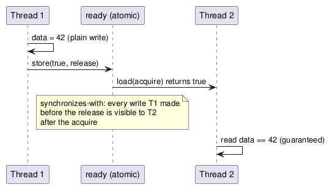

:PROPERTIES:
:ID:       9fb084bb-ba72-4136-8e91-60f0b7ba216f
:ROAM_ALIASES: "C++ 内存模型与原子操作"
:VERIFIED_WITH: GCC 16.2.1, -std=c++23, x86-64 (2026-10-26)
:END:
#+title: C++ Memory Model and Atomics
#+filetags: :C++:Concurrency:

* TOC :TOC_1:
- [[#mental-model][Mental Model]]
- [[#memory-orders][Memory Orders]]
- [[#stdatomict][~std::atomic<T>~]]
- [[#compare-and-swap][Compare-and-Swap]]
- [[#performance][Performance]]
- [[#spin-lock][Spin Lock]]
- [[#pitfalls][Pitfalls]]

* Mental Model
** Memory Locations
- Every object occupies one or more *memory locations*. A scalar (~int~, pointer, ~double~) is exactly one location whatever its size; an ~std::string~ is several; adjacent bit-fields share one, and a zero-width bit-field (~int :0~) starts a new one.
- The rules are stated per location: two threads touching *different* locations never conflict. Two threads touching the *same* location, at least one writing, need an ordering between the accesses: a lock, or atomic operations. Otherwise it is a *data race*, which is undefined behavior.
- Consequence: two threads may update ~s.a~ and ~s.b~ of the same struct without locks; they may not update two bit-fields packed into one location.

** Two Problems Atomics Solve
1. *Atomicity*: an operation on one variable happens entirely or not at all; nobody sees half a write or loses an increment.
2. *Visibility and ordering of other memory*: without help, the compiler and the CPU reorder plain loads and stores, and other cores can observe a thread's writes in a different order. Memory orders on atomic operations say which *other* writes must be visible when an atomic value is seen.

An atomic is rarely interesting on its own. Typically it is an *index into, or a flag guarding, non-atomic memory*: a ready flag for a buffer, a count of published slots. The memory order expresses that relationship.

** Release / Acquire
#+begin_src plantuml :file images/cpp_release_acquire.png
@startuml
participant "Thread 1" as T1
participant "ready (atomic)" as R
participant "Thread 2" as T2
T1 -> T1 : data = 42 (plain write)
T1 -> R : store(true, release)
R -> T2 : load(acquire) returns true
note over R : synchronizes-with: every write T1 made\nbefore the release is visible to T2\nafter the acquire
T2 -> T2 : read data == 42 (guaranteed)
@enduml
#+end_src

#+RESULTS:

A release store /publishes/: nothing written before it in program order may become visible after it. An acquire load that reads that value /subscribes/: nothing read after it may be satisfied from before it. Together they give a *happens-before* edge from everything Thread 1 did to everything Thread 2 does next. A mutex is built on exactly this: ~lock()~ is an acquire, ~unlock()~ a release.

* Memory Orders
| Order              | Guarantees                                                                 | Use when                                                        |
|--------------------+----------------------------------------------------------------------------+-----------------------------------------------------------------|
| ~relaxed~          | atomicity of this variable only; no ordering of other memory               | statistics counters, ids: no other memory depends on the value  |
| ~release~ (stores) / ~acquire~ (loads) | publication as above                                        | flags and indices that guard data; locks                         |
| ~acq_rel~          | both, for read-modify-write                                                | a RMW that both consumes and publishes (e.g. a CAS in a lock-free list) |
| ~seq_cst~ (default) | acquire/release plus *one total order* of all ~seq_cst~ operations that every thread agrees on | several atomics whose relative order matters across threads; or when unsure |

Writing the order is documentation: ~count.fetch_add(1, std::memory_order_relaxed)~ says "just a counter"; ~fetch_add(1, std::memory_order_release)~ says "this index makes a slot I prepared visible". A bare ~++count~ means seq_cst, which says either "I need the total order" or "I did not think about it".

Free-standing fences (~std::atomic_thread_fence(std::memory_order_release)~ before a relaxed store) give the same ordering as putting the order on the operation. They are needed only when one fence must cover several relaxed operations.

** On x86-64
Checked against GCC 16 ~-O2~ output:

| Operation              | Instruction             |
|------------------------+-------------------------|
| store, relaxed / release | ~mov~                 |
| store, seq_cst         | ~xchg~ (implicit full barrier) |
| load, any order        | ~mov~                   |
| ~fetch_add~, any order | ~lock xadd~             |

x86 already gives acquire on every load and release on every store, and every read-modify-write is a full barrier. So only seq_cst *stores* cost extra on x86. On ARM and POWER every stronger order costs instructions, which is why code that "works on x86" with too-weak orders breaks there. The compiler can still reorder relaxed operations even on x86.

* ~std::atomic<T>~
- ~T~ must be *trivially copyable*: copy = ~memcpy~, no virtual functions, no user-written copy/move/destructor.
- Integral and pointer specializations add ~fetch_add~ / ~fetch_sub~ (and ~fetch_and~ / ~or~ / ~xor~ for integers) and the matching ~++~, ~--~, ~+=~, ~-=~ operators. C++20 adds ~fetch_add~ for floating point.
- Each operator is one atomic operation; an expression is not. ~x = x + 1~ is an atomic load followed by an atomic store, and another thread's increment can land between them. ~x *= 2~ does not compile. Use ~fetch_add~, or a CAS loop for anything without a ~fetch_~ form.
- ~std::atomic_flag~ is the only type guaranteed lock-free; ~test_and_set()~ and ~clear()~ (C++20 adds ~test()~ and ~wait~ / ~notify~).

** Is It Lock-free?
Large or oddly sized ~T~ are implemented with a hidden lock. Measured with GCC 16 on x86-64 (link with ~-latomic~):

| ~T~                         | ~is_lock_free()~ |
|-----------------------------+------------------|
| ~struct { long x; }~         | true             |
| ~struct { long x, y; }~ (16 B) | false: GCC routes 16-byte atomics through libatomic, even though ~cmpxchg16b~ exists |
| ~struct { int x, y, z; }~ (12 B) | false        |

~std::atomic<T>::is_always_lock_free~ (C++17) answers at compile time; the run-time ~is_lock_free()~ exists because alignment can differ per object.

* Compare-and-Swap
~x.compare_exchange_strong(expected, desired)~: if ~x == expected~, store ~desired~ and return true; otherwise copy the current value of ~x~ *into ~expected~* and return false. Because ~expected~ is refreshed on failure, the retry loop needs no extra load:

#+begin_src cpp
std::atomic<int> x{3};
int expected = x.load();
while (!x.compare_exchange_weak(expected, expected * 2)) {}
// x == 6; works for any update without a fetch_ form
#+end_src

| ~_weak~                                                        | ~_strong~                                     |
|----------------------------------------------------------------+-----------------------------------------------|
| may fail spuriously even when equal (LL/SC machines like ARM)  | fails only when the value differs (it loops internally on LL/SC) |
| use in a loop where computing ~desired~ is cheap               | use when not looping, or when recomputing ~desired~ is expensive |

* Performance
- An uncontended atomic RMW costs a few nanoseconds; under contention every operation needs exclusive ownership of the cache line, which then bounces between cores (coherence and a false-sharing measurement in [[id:d734bb0e-c8fc-4cd7-a1d9-5432aed0c7d0][CPU Cache Hierarchy]]).
- *False sharing*: per-thread data that happens to share a cache line contends as if it were shared. Pad or align per-thread slots to ~std::hardware_destructive_interference_size~ (64 on this machine; GCC warns that the value may change between compiler versions, so ABI-visible types should use a literal 64). On NUMA machines, also keep per-thread data on separate pages.
- Atomics do not make code fast. A mutex is often as fast under low contention and much easier to reason about.

* Spin Lock
#+begin_src cpp
class spinlock {
  std::atomic_flag flag;   // C++20: default-initialized to clear
public:
  void lock()   { while (flag.test_and_set(std::memory_order_acquire)) std::this_thread::yield(); }
  void unlock() { flag.clear(std::memory_order_release); }
};
#+end_src
Non-blocking (no OS sleep) but not lock-free: if the holder is descheduled, everyone spins. Worth it only for very short critical sections with cores to spare.

* Pitfalls
- "It is just a flag, a plain ~bool~ is fine" → data race; the compiler may hoist the load out of the loop and spin forever.
- ~volatile~ for thread communication → no atomicity, no ordering. ~volatile~ is for memory-mapped I/O.
- Relaxed flag guarding data → the data may not be visible yet on ARM even if it works on x86.
- ~std::atomic<std::shared_ptr<T>>~ (C++20) replaces the free functions ~std::atomic_load(&sp)~ / ~std::atomic_store(&sp, ...)~, which are deprecated in C++20. It is usually not lock-free.
