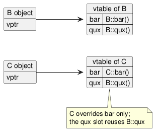

:PROPERTIES:
:ID:       9bb46372-40a5-416c-9a00-b00009a3e663
:ROAM_ALIASES: "C++ 多态与对象布局"
:VERIFIED_WITH: GCC 16.2.1, -std=c++23, x86-64 (2026-10-26)
:END:
#+title: C++ Polymorphism and Object Layout
#+filetags: :C++:

* TOC :TOC_1:
- [[#static-vs-dynamic-dispatch][Static vs Dynamic Dispatch]]
- [[#virtual-tables][Virtual Tables]]
- [[#virtual-destructor][Virtual Destructor]]
- [[#casts][Casts]]
- [[#layout-categories][Layout Categories]]
- [[#pitfalls][Pitfalls]]

* Static vs Dynamic Dispatch
#+begin_src cpp
struct Base    { void print(); virtual void v(); virtual ~Base() = default; };
struct Derived : Base { void print(); void v() override; };

Derived d;
Base* pb = &d;
pb->print();       // Base::print    : non-virtual, chosen by the static type Base*
pb->v();           // Derived::v     : virtual, chosen by the dynamic type
Base sliced = d;
sliced.v();        // Base::v        : slicing, the copy is a real Base
#+end_src

Polymorphism needs a pointer or reference; a by-value copy into a base type *slices* off the derived part.

- ~override~ makes the compiler check that a matching virtual function exists in a base; without it a typo in the signature silently declares a new function. Always write it.
- ~final~ on a virtual function forbids further overriding; on a class, further derivation. It also lets the compiler devirtualize calls.

* Virtual Tables
The common implementation (the standard does not mandate it):
- Each class with virtual functions has one *vtable*: an array of function pointers, one slot per virtual function, shared by all objects of that class.
- Each object stores a hidden *vptr* to its class's vtable, normally as the first word. An empty class with one virtual function has ~sizeof~ 8 on x86-64: just the vptr.
- A virtual call loads the vptr, loads the slot, and calls indirectly. Costs: two dependent loads, no inlining unless devirtualized, and a possible branch mispredict. This is why hot paths in low-latency code prefer templates (static polymorphism, CRTP) or ~std::variant~.

#+begin_src plantuml :file images/cpp_vtables.png
@startuml
left to right direction
object "B object" as bo {
  vptr
}
object "C object" as co {
  vptr
}
map "vtable of B" as vb {
  bar => B::bar()
  qux => B::qux()
}
map "vtable of C" as vc {
  bar => C::bar()
  qux => B::qux()
}
bo --> vb
co --> vc
note bottom of vc : C overrides bar only;\nthe qux slot reuses B::qux
@enduml
#+end_src

#+RESULTS:

During construction and destruction the vptr points to the vtable of the class *currently being constructed*, so a virtual call from a base constructor or destructor never reaches the derived override.

* Virtual Destructor
If a class is meant to be deleted through a base pointer, the base destructor must be ~virtual~. Otherwise ~delete base_ptr~ is undefined behavior; in practice only the base part is destroyed. With a virtual destructor, the derived destructor runs first, then the base one. Rule of thumb: a class with any virtual function gets a ~virtual~ (or ~protected~ non-virtual) destructor.

* Casts
| Cast               | Checked                  | Use                                                                                      |
|--------------------+--------------------------+------------------------------------------------------------------------------------------|
| ~static_cast~      | compile time             | conversions the compiler can verify: numeric, upcast, downcast you /know/ is right, ~void*~ back to ~T*~ |
| ~dynamic_cast~     | run time, needs RTTI     | downcast when unsure: returns ~nullptr~ for pointers, throws ~std::bad_cast~ for references; base must be polymorphic |
| ~const_cast~       | —                        | remove ~const~ to call a legacy API that does not modify. *Writing to an object that was defined ~const~ is undefined behavior* |
| ~reinterpret_cast~ | —                        | reinterpret bits: pointer ↔ integer, unrelated pointer types. Reading an object through an unrelated type breaks strict aliasing; use ~std::memcpy~ or ~std::bit_cast~ (C++20) to view bytes as another type |
| C-style ~(T)x~     | —                        | tries the above in turn, including ones you did not intend; avoid                          |

Upcasts need no cast at all. RTTI (also behind ~typeid~) can be disabled with ~-fno-rtti~, which also disables ~dynamic_cast~; some code bases do this for size and speed.

* Layout Categories
Both properties are checked with type traits and matter when bytes are copied, shared with C, or sent over the wire.

| Property                                     | Requires                                                                                   | Allows                                                     |
|----------------------------------------------+--------------------------------------------------------------------------------------------+------------------------------------------------------------|
| trivially copyable (~std::is_trivially_copyable~) | no virtual functions or bases; copy/move/destructor not user-provided (and not all deleted); members trivially copyable | copying with ~memcpy~; ~std::atomic<T>~; ~std::bit_cast~ |
| standard layout (~std::is_standard_layout~)  | no virtual functions or bases; all non-static members with the same access; base/member layout rules | layout compatible with a C struct; pointer to the object = pointer to its first member |

Measured: ~struct { int x; double y; }~ has both; adding a ~virtual~ function removes both; ~std::string~ is not trivially copyable; mixing ~public~ and ~private~ data members loses standard layout.

A ~union~ is as large as its largest member (~union { long l; char c[8]; ... }~ is 8 bytes) and only one member is active at a time; reading another member is undefined behavior in C++ (unlike C). ~std::variant~ is the type-safe replacement.

* Pitfalls
- Missing ~override~ → signature typo creates a new function; the "override" is never called.
- Calling a virtual function from a constructor or destructor expecting the derived version.
- Non-virtual destructor in a polymorphic base, deleted through a base pointer.
- ~dynamic_cast~ on a non-polymorphic base → compile error; to a derived type from a plain base object → always fails (GCC warns: "can never succeed").
