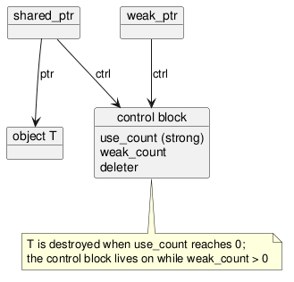

:PROPERTIES:
:ID:       474df27e-ed1f-42f0-997f-633339b91cb5
:ROAM_ALIASES: "C++ RAII 与智能指针"
:VERIFIED_WITH: GCC 16.2.1, -std=c++23 (2026-10-26)
:END:
#+title: C++ RAII and Smart Pointers
#+filetags: :C++:

* RAII
*Resource Acquisition Is Initialization*: tie every resource (memory, file, socket, lock, thread) to the lifetime of an object. The constructor acquires it, the destructor releases it. Destructors run on every exit from a scope, including exceptions and early returns, so release can no longer be forgotten or skipped.

- Rule that follows: code that did not acquire a resource directly never releases it directly. Ownership lives in exactly one place, the managing object; users of the class never see ~delete~, ~close~ or ~unlock~.
- Standard RAII types: containers and ~std::string~ (memory), smart pointers, ~std::lock_guard~ / ~std::scoped_lock~ (mutexes), ~std::jthread~ (threads), ~std::fstream~ (files).
- A raw ~new~ / ~delete~ pair is acceptable only in a small scope where performance is critical and ownership is obvious, and should be hidden inside a class.

* Choosing a Smart Pointer
| Need                                                   | Use                     |
|--------------------------------------------------------+-------------------------|
| one owner (the default)                                | ~std::unique_ptr<T>~    |
| several owners; lifetime ends with the last one        | ~std::shared_ptr<T>~    |
| observe a ~shared_ptr~-managed object without keeping it alive; break cycles | ~std::weak_ptr<T>~ |
| use an object you do not own, for the duration of a call | ~T&~ or ~T*~          |

- ~unique_ptr~ has no overhead over a raw pointer (8 bytes here), is move-only, and converts to ~shared_ptr~ by move. That makes it the right return type for factories: the caller decides whether to share.
- ~shared_ptr~ is two pointers (16 bytes): one to the object, one to a *control block* holding the strong count, the weak count and the deleter. Copying it increments the count *atomically*.
- Create with ~std::make_unique~ / ~std::make_shared~. ~make_shared~ allocates the object and the control block in one block (counted: 1 allocation vs 2 for ~shared_ptr<int>(new int)~), and neither leaks if another argument's evaluation throws.

#+begin_src plantuml :file images/cpp_shared_ptr_layout.png
@startuml
object "shared_ptr" as sp
object "object T" as obj
object "control block" as cb {
  use_count (strong)
  weak_count
  deleter
}
object "weak_ptr" as wp
sp --> obj : ptr
sp --> cb : ctrl
wp --> cb : ctrl
note bottom of cb : T is destroyed when use_count reaches 0;\nthe control block lives on while weak_count > 0
@enduml
#+end_src

#+RESULTS:

With ~make_shared~, object and control block share one allocation, so the memory of a large ~T~ is not freed until the last ~weak_ptr~ is gone as well.

* ~weak_ptr~ and Cycles
Two objects holding ~shared_ptr~ to each other keep both counts above zero forever: a leak. In the check, a pair of objects linked by ~shared_ptr~ in both directions never ran either destructor; changing one direction to ~weak_ptr~ destroyed both at scope exit.

Make the back-pointer (child → parent, observer → subject) the ~weak_ptr~. To use it: ~if (auto sp = w.lock()) { ... }~. ~lock()~ atomically checks and obtains a ~shared_ptr~; checking ~expired()~ or ~use_count()~ first and then using the pointer is a race.

* Passing Smart Pointers
| Signature                         | Says                                                            |
|-----------------------------------+-----------------------------------------------------------------|
| ~f(T&)~ / ~f(T*)~                 | uses the object, no interest in ownership (the usual case)      |
| ~f(std::unique_ptr<T>)~           | takes ownership (caller writes ~std::move(p)~)                  |
| ~f(std::unique_ptr<T>&)~          | may reseat or reset the caller's pointer                        |
| ~f(std::shared_ptr<T>)~           | shares ownership: keeps the object alive (e.g. stores it)       |
| ~f(const std::shared_ptr<T>&)~    | might copy it to share ownership; otherwise prefer ~T&~         |

Return smart pointers by value; moves are cheap and copy elision applies. Return a raw pointer or reference only when the caller just needs the object.

C++ Core Guidelines R.20–R.37 cover these rules.

* Pitfalls
- Two ~shared_ptr~ created from the same raw pointer (~shared_ptr<T>(p)~ twice, or ~shared_ptr<T>(this)~) → two control blocks, double delete. Inside a class, derive from ~std::enable_shared_from_this<T>~ and call ~shared_from_this()~.
- Deleting or wrapping the pointer obtained from ~get()~ → same problem.
- "~shared_ptr~ is thread-safe": only the *control block* is. Concurrent reads and writes of the pointed-to object still need a lock, and assigning to one ~shared_ptr~ variable from two threads is a data race; use ~std::atomic<std::shared_ptr<T>>~ (C++20).
- Casting: ~std::dynamic_pointer_cast<Derived>(base_sp)~ / ~std::static_pointer_cast~ keep sharing the control block; ~dynamic_cast~ on ~get()~ followed by wrapping in a new ~shared_ptr~ does not.
