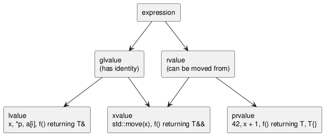

:PROPERTIES:
:ID:       83aa38f7-a6de-42f0-bf0e-b4e2c9114869
:ROAM_ALIASES: "C++ 值类别与移动语义"
:VERIFIED_WITH: GCC 16.2.1, -std=c++23 (2026-10-26)
:END:
#+title: C++ Value Categories and Move Semantics
#+filetags: :C++:

* Value Categories
Every expression has a *type* and a *value category*. Two questions decide the category: does the expression have an *identity* (refers to an object you could take the address of), and can its resources be *moved from*?

#+begin_src plantuml :file images/cpp_value_categories.png
@startuml
skinparam rectangleBorderColor black
rectangle "expression" as e
rectangle "glvalue\n(has identity)" as gl
rectangle "rvalue\n(can be moved from)" as rv
rectangle "lvalue\nx, *p, a[i], f() returning T&" as lv
rectangle "xvalue\nstd::move(x), f() returning T&&" as xv
rectangle "prvalue\n42, x + 1, f() returning T, T{}" as pr
e --> gl
e --> rv
gl --> lv
gl --> xv
rv --> xv
rv --> pr
@enduml
#+end_src

#+RESULTS:

- *lvalue*: identity, not movable. Anything with a name is an lvalue, *including a variable declared as ~T&&~*.
- *prvalue*: no identity; a pure value used to initialize an object.
- *xvalue*: an object whose resources may be taken: identity and movable.

Reference binding follows the categories: ~T&~ binds lvalues; ~T&&~ binds rvalues; ~const T&~ binds both, which is why it was the pre-C++11 way to accept temporaries.

* Move Semantics
- Copying a heavy object (a vector of a million elements) copies the buffer; moving steals the pointer and leaves the source empty. Moving is also the only way to transfer ownership of move-only types (~unique_ptr~, ~thread~, ~promise~).
- ~std::move(x)~ moves nothing. It is ~static_cast<T&&>(x)~: it turns an lvalue into an xvalue so overload resolution picks the move constructor / move assignment. Without such an overload, the copy is used.
- A moved-from object is valid but unspecified: you may destroy it or assign to it, nothing else unless the type promises more (~unique_ptr~ is guaranteed null).

#+begin_src cpp
void print(const int&) { std::puts("lvalue"); }
void print(int&&)      { std::puts("rvalue"); }
int&& r = 5;
print(r);              // lvalue: r has a name
print(std::move(r));   // rvalue
#+end_src

** Special Member Functions
| Expression           | Calls           |
|----------------------+-----------------|
| ~A b{a};~            | copy ctor       |
| ~A c{std::move(a)};~ | move ctor       |
| ~d = b;~             | copy assignment |
| ~d = A{};~           | move assignment |
| ~d = std::move(b);~  | move assignment |

*Rule of zero*: a class whose members already manage themselves (~std::string~, ~std::vector~, smart pointers) declares none of destructor, copy ctor, copy assignment, move ctor, move assignment, and gets correct ones generated.

*Rule of five*: a class that manages a resource directly and declares any one of them should declare all five. The C++98 version, the rule of three, lacks the moves.

Copying policies for a resource-owning class, and the standard type that already implements each:
| Policy               | Behavior on copy                    | Ready-made                          |
|----------------------+-------------------------------------+-------------------------------------|
| no copying           | ~= delete~ copy operations          | ~std::mutex~                        |
| exclusive ownership  | move only; source becomes empty     | ~std::unique_ptr~                   |
| deep copy            | duplicate the resource              | ~std::vector~, ~std::string~        |
| shared ownership     | share and count references          | ~std::shared_ptr~                   |

* Copy Elision
- Since C++17, initializing an object from a prvalue of the same type constructs it in place: ~return T{...};~ and ~T x = T{...};~ never copy or move, and the type need not even be movable.
- Returning a *named* local (~T l; ...; return l;~) allows NRVO, which compilers apply in practice (GCC printed only one =default ctor= for both cases). If NRVO is not applied, the return still moves, never copies.
- So write ~return local;~, never ~return std::move(local);~: the cast prevents NRVO (GCC: =-Wpessimizing-move=).
- Never return a reference (~T&~ or ~T&&~) to a local; it dangles.

* Perfect Forwarding
A function template parameter ~T&&~ where ~T~ is deduced is a *forwarding reference* (Scott Meyers: "universal reference"). It binds to anything:
- argument is an lvalue of type ~U~ → ~T = U&~, and ~U& &&~ collapses to ~U&~;
- argument is an rvalue → ~T = U~, parameter is ~U&&~.

Reference collapsing: any ~&~ wins; only ~&& &&~ gives ~&&~.

Inside the function the parameter has a name, so it is an lvalue. ~std::forward<T>(x)~ casts it back to what the caller passed, because ~T~ remembers it.

#+begin_src cpp
template <typename T> void pass(T&& x) { print(x); }
template <typename T> void fwd(T&& x)  { print(std::forward<T>(x)); }
int i = 1;
pass(i); pass(1); fwd(i); fwd(1);
#+end_src

#+begin_example
lvalue
lvalue
lvalue
rvalue
#+end_example

The variadic form is the standard factory pattern:
#+begin_src cpp
template <typename... Args>
auto make_widget(Args&&... args) { return std::make_unique<Widget>(std::forward<Args>(args)...); }
#+end_src

~T&&~ is only a forwarding reference when ~T~ is deduced *for this call*: ~void f(Widget&&)~, ~std::vector<T>&&~ and a member function of a class template using the class's ~T~ are plain rvalue references.

* Pitfalls
- User-declared destructor (even an empty one) → no implicit move constructor or move assignment. ~std::move~ on such an object silently *copies*:
  #+begin_src cpp
  struct Plain    { Loud l; };
  struct WithDtor { Loud l; ~WithDtor() {} };
  Plain p2{std::move(p1)};      // prints: move
  WithDtor w2{std::move(w1)};   // prints: copy
  #+end_src
- Move constructor not ~noexcept~ → ~std::vector~ reallocation copies instead of moving, to keep its strong exception guarantee (checked: ~noexcept~ move printed =move=, throwing move printed =copy=). Mark moves ~noexcept~; ~= default~ gets it right automatically.
- Using an object after ~std::move~ as if it still held its value.
- ~std::move~ on a ~const~ object → ~const T&&~ binds to the copy constructor; it silently copies.
