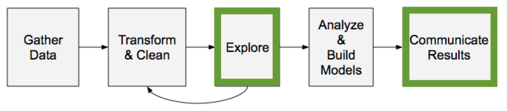

:PROPERTIES:
:ID:       0669cf34-1246-433d-a39b-fa4858531068
:END:
#+title: Data Analysis Workflow

Steps covered in other categories: [[id:2be62d58-9f1c-4c6e-a20e-5722a4e0c4e7][Data Sampling]] and [[id:61297403-6903-4513-90c7-2b5fc0b49e11][Hypothesis Testing]] (Statistics), [[id:eb2a5e50-a93f-4013-b48b-722bef3682cc][Modeling and Predicting]] (Machine Learning).

* [[id:16fff215-ce9c-45ca-a5d3-5e509f647732][Data Importing]]
* [[id:de66c696-5ca1-4fbc-a9b2-097ee7bf4ccd][Data Cleaning]]
* [[id:dba49314-c6f2-4c41-bef5-b4cb842ec625][Data Manipulation]]
* [[id:d31a2f5c-51c6-4742-8248-8d3c8904011a][Exploratory Data Analysis]]
* [[id:41c5482c-9098-4b60-a2ff-e3c13bfb4486][Data Visualization]]
* [[id:6eed31dd-a6eb-41f6-95b5-6125b86b3536][Data Reporting]]
