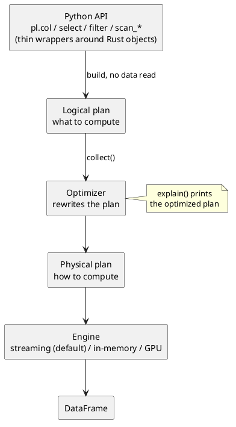

:PROPERTIES:
:ID:       190bfd1c-68ae-4f32-baab-cc98490c71e9
:VERIFIED_WITH: Polars 2.0.0, pandas 3.0.6 (2026-10-22)
:END:
#+title: Polars
#+filetags: :PyLibs:Polars:

* TOC :TOC_2:
- [[#positioning][Positioning]]
- [[#mental-model][Mental Model]]
  - [[#expressions-are-descriptions][Expressions Are Descriptions]]
  - [[#contexts-evaluate-expressions][Contexts Evaluate Expressions]]
  - [[#eager-is-lazy-plus-an-immediate-collect][Eager Is Lazy Plus an Immediate Collect]]
- [[#query-optimization][Query Optimization]]
  - [[#from-code-to-result][From Code to Result]]
  - [[#reading-explain][Reading ~explain()~]]
  - [[#main-optimizations][Main Optimizations]]
  - [[#engines][Engines]]
- [[#under-the-hood][Under the Hood]]
- [[#why-faster-than-pandas][Why Faster Than Pandas]]
- [[#coming-from-pandas][Coming from Pandas]]
- [[#core-api-map][Core API Map]]
- [[#pitfalls][Pitfalls]]
- [[#polars-apis][Polars APIs]]

* Positioning
- A DataFrame library whose engine is written in Rust; the Python package is a thin layer that builds queries for that engine.
- Pick it over pandas for medium to large tabular data, pipelines that read files and keep a small part of them, and multi-core machines.
- Stay with pandas when the libraries around it expect pandas objects.

* Mental Model
** Expressions Are Descriptions
~pl.col("price")~ does not touch any data. It returns a ~pl.Expr~: a small tree that describes a computation on a column that does not exist yet.

#+begin_src python
e = pl.col("price").mean()
e                 # <Expr ['col("price").mean()']>
pl.col("nope")    # fine: no DataFrame involved yet
#+end_src

Methods on an ~Expr~ only grow the tree. Errors such as ~ColumnNotFoundError~ appear when a context evaluates the expression against a real frame.

** Contexts Evaluate Expressions
A context takes expressions, evaluates them against a frame, and decides the shape of the result. The same expression gives different results in different contexts:

#+begin_src python
df = pl.DataFrame({"g": ["a", "a", "b"], "price": [1.0, 2.0, 6.0]})
e = pl.col("price").mean()
#+end_src

| Call                             | Rows | Result                                |
|----------------------------------+------+---------------------------------------|
| ~df.select(e)~                   |    1 | ~price~: 3.0                          |
| ~df.with_columns(m=e)~           |    3 | original columns + ~m~: 3.0, 3.0, 3.0 |
| ~df.with_columns(m=e.over("g"))~ |    3 | original columns + ~m~: 1.5, 1.5, 6.0 |
| ~df.group_by("g").agg(e)~        |    2 | ~a~ → 1.5, ~b~ → 6.0                  |
| ~df.filter(pl.col("price") > e)~ |    1 | the row with price 6.0                |

| Context          | Output                                                            |
|------------------+-------------------------------------------------------------------|
| ~select~         | Only the listed expressions; scalars broadcast to column length   |
| ~with_columns~   | All existing columns, plus new or replaced ones                   |
| ~filter~         | The rows where a boolean expression is true                       |
| ~group_by().agg~ | One row per group; expressions run inside each group              |
| ~over~ (window)  | Group-wise result mapped back to every row; usable in any context |

Rules that follow from this model:
- Expressions passed to one context are independent of each other, so Polars evaluates them in parallel. For the same reason, an expression cannot see a column created by a sibling in the same call (see [[*Pitfalls][Pitfalls]]).
- Contexts never modify the frame. ~with_columns~ returns a new DataFrame. The unchanged columns are not copied: the new frame points to the same memory buffers as the old one.
- An expression's output name defaults to the first column it references; ~alias~ or keyword arguments (~m=...~) rename it.

** Eager Is Lazy Plus an Immediate Collect
Eager DataFrame methods are implemented on top of the lazy engine. In 2.0 the source of ~DataFrame.with_columns~ is essentially:

#+begin_src python
self.lazy().with_columns(*exprs)._collect_eager(optimizations=QueryOptFlags._eager())
#+end_src

The eager flags turn off the plan-level optimizations (pushdowns, common-subexpression elimination) because every step is a separate one-node query and there is nothing to rearrange. Expression evaluation itself is the same fast Rust code in both modes. What eager mode loses is the whole-pipeline view: ~pl.read_csv(...)~ followed by ~select~ reads every column first, while ~pl.scan_csv(...)...collect()~ reads only the needed ones.

* Query Optimization
** From Code to Result
#+begin_src plantuml :file images/polars_query_pipeline.png
@startuml
skinparam defaultTextAlignment center
rectangle "Python API\npl.col / select / filter / scan_*\n(thin wrappers around Rust objects)" as py
rectangle "Logical plan\nwhat to compute" as lp
rectangle "Optimizer\nrewrites the plan" as opt
rectangle "Physical plan\nhow to compute" as pp
rectangle "Engine\nstreaming (default) / in-memory / GPU" as eng
rectangle "DataFrame" as out
py --> lp : build, no data read
lp --> opt : collect()
opt --> pp
pp --> eng
eng --> out
note right of opt : explain() prints\nthe optimized plan
@enduml
#+end_src

#+RESULTS:

A ~LazyFrame~ is a logical plan: a tree of operations (scan, filter, select, join, ...) whose nodes contain expression trees. Because the optimizer sees the whole tree before any data is read, it can reorder and drop work that a line-by-line executor cannot.

** Reading ~explain()~
#+begin_src python
q = (
    pl.scan_csv("data.csv")          # columns: name, price, city, extra
    .with_columns(disc=pl.col("price") * 0.8)
    .filter(pl.col("price") < 500)
    .select("name", "disc")
)
q.explain(optimized=False)
q.explain()
#+end_src

Plans read bottom-up: the scan is at the bottom, the final result at the top.

Unoptimized, the plan follows the code:
#+begin_example
SELECT [col("name"), col("disc")]
  FILTER col("price") < 500
  FROM
     WITH_COLUMNS:
     [(col("price").cast(Float64) * 0.8).alias("disc")]
      Csv SCAN [data.csv]
      PROJECT */4 COLUMNS
#+end_example

Optimized:
#+begin_example
simple π 2/2 ["name", "disc"]
   WITH_COLUMNS:
   [(col("price").cast(Float64) * 0.8).alias("disc")]
    Csv SCAN [data.csv]
    PROJECT 2/4 COLUMNS
    SELECTION: col("price") < 500
#+end_example

The ~FILTER~ node disappeared: it moved into the scan as ~SELECTION~, so rows are dropped while the CSV is parsed. ~PROJECT 2/4~ means only ~name~ and ~price~ are parsed at all.

** Main Optimizations
| Optimization                     | What it does                                                | Sign in ~explain()~                  |
|----------------------------------+-------------------------------------------------------------+--------------------------------------|
| Predicate pushdown               | Moves filters as close to the data source as possible       | ~SELECTION:~ inside the scan         |
| Projection pushdown              | Reads only the columns used later                           | ~PROJECT k/n COLUMNS~                |
| Slice pushdown                   | Pushes ~head~ / ~slice~ into the scan                       | ~SLICE:~ inside the scan             |
| Common-subexpression elimination | Computes a repeated subexpression once and reuses it        | temporary ~__POLARS_CSER_...~ column |
| Expression simplification        | Constant folding and cheaper equivalent expressions         | rewritten expressions                |
| Type coercion                    | Inserts the casts that mixed types need, once, at plan time | ~.cast(Float64)~ in expressions      |

The full list is the fields of ~pl.QueryOptFlags~ (for example ~join_order~, ~cluster_with_columns~); each can be switched off through ~collect(optimizations=...)~ to compare plans.

** Engines
| Engine    | How it runs                                                             |
|-----------+-------------------------------------------------------------------------|
| streaming | Processes data in batches; works for data larger than RAM; often faster |
| in-memory | Materializes each intermediate result fully; used by eager methods      |
| gpu       | NVIDIA GPU via ~cudf-polars~                                            |

~collect()~ uses ~engine="auto"~, which picks the engine set by ~pl.Config.set_engine_affinity~ or ~POLARS_ENGINE_AFFINITY~, otherwise the default.

Version drift (checked against 1.44.2 and 2.0.0):
| Older code (AI often writes) | Polars 2.0                    | Note                                                     |
|------------------------------+-------------------------------+----------------------------------------------------------|
| ~collect(streaming=True)~    | ~collect(engine="streaming")~ | Deprecated in 1.25, raises ~ArgumentRemovedError~ in 2.0 |
| "auto" means in-memory       | "auto" means streaming        | 1.x fell back to in-memory; 2.0 falls back to streaming  |

* Under the Hood
- *Rust core*: ~pl.Expr~ and ~pl.DataFrame~ are Python wrappers around Rust objects. The Python interpreter runs only while the query is being built; execution happens in Rust without holding the GIL.
- *Thread pool*: work is split across a fixed pool of threads (~pl.thread_pool_size()~, set with ~POLARS_MAX_THREADS~ before import). Parallelism comes from two directions: independent expressions in one context, and chunks or groups of the same column.
- *Arrow columnar memory*: each column is stored in the Apache Arrow format, a contiguous buffer of values plus a validity bitmap (1 bit per row) for nulls. Strings use Arrow's string-view layout.
  - Contiguous values of one type are cache-friendly and let the CPU process several values per instruction (SIMD).
  - Other Arrow-based tools can read numeric columns without copying (~Series.to_arrow()~).
- *Chunked columns*: a ~Series~ is a list of Arrow arrays (chunks). ~pl.concat(..., rechunk=False)~ just appends chunks; ~rechunk()~ copies them into one contiguous array, which speeds up later scans and random access.
- *null vs NaN*: null lives in the validity bitmap and works for every type; NaN is an ordinary float value. ~pl.Series([1.0, None, float("nan")])~ has ~null_count()~ 1, and its ~mean()~ is NaN because the NaN takes part while the null is skipped.

* Why Faster Than Pandas
| Aspect          | pandas 3.0                                                      | Polars                                          |
|-----------------+-----------------------------------------------------------------+-------------------------------------------------|
| Execution core  | Python + C/Cython over NumPy; each call returns to Python       | Rust engine; Python only builds the query       |
| Parallelism     | Most operations use one core                                    | Thread pool over expressions, chunks and groups |
| Planning        | Every call runs immediately in the order written                | Lazy queries are optimized as a whole           |
| Reading files   | Reads all columns and rows, then you select                     | Projection and predicate pushdown into the scan |
| Missing values  | NaN sentinel: ~pd.Series([1, None])~ becomes ~float64~          | Validity bitmap: integers stay integers         |
| Strings         | ~str~ dtype backed by pyarrow if installed, else Python objects | Always Arrow string views                       |
| Index           | Row index; operations align on it                               | No index, no alignment cost                     |
| Larger than RAM | Data must fit in memory                                         | Streaming engine works in batches               |

Polars is /not/ faster when:
- the data is tiny, so fixed overhead dominates;
- the work is a per-row Python function (~map_elements~), which runs at Python speed in either library;
- the code keeps converting between Polars and pandas / NumPy.

* Coming from Pandas
See [[id:05ef9aaa-7fa2-45b4-9ed9-d8d01c8abff2][Pandas]].

| pandas habit                      | Polars way                                              | Why                                                                 |
|-----------------------------------+---------------------------------------------------------+---------------------------------------------------------------------|
| ~df["new"] = df["a"] * 2~         | ~df = df.with_columns(new=pl.col("a") * 2)~             | Frames are immutable; expressions can be optimized and parallelized |
| ~df.loc[mask, cols]~, ~set_index~ | ~filter~ + ~select~; key columns stay columns           | No index                                                            |
| ~df.apply(func, axis=1)~          | Native expressions; ~when/then/otherwise~ for branching | A Python function per row blocks parallelism and optimization       |
| ~read_csv~, then trim the frame   | ~scan_csv~ + lazy query + ~collect()~                   | Lets the optimizer read less                                        |
| ~groupby().transform("mean")~     | ~pl.col("x").mean().over("g")~                          | Window expression keeps the original row count                      |

* Core API Map
The most important kinds of operation, ordered by the context they run in. Details live in the notes under Polars APIs.

| Task                     | Context and output                                  | Key APIs                                       | Details                              |
|--------------------------+-----------------------------------------------------+------------------------------------------------+--------------------------------------|
| Choose / compute columns | ~select~ keeps listed; ~with_columns~ keeps all     | ~pl.col~, ~cs.*~, ~alias~, ~cast~              | [[id:a2c3f3b2-0cd5-45c1-b0a3-fb988e8c5b5b][Selection]], [[id:5a248a1d-a8b5-48d1-9b0b-a87a5e7f27c6][Editing Columns]]           |
| Filter rows              | ~filter~ with a boolean expression                  | ~is_in~, ~is_between~, ~is_null~               | [[id:a2c3f3b2-0cd5-45c1-b0a3-fb988e8c5b5b][Selection]]                            |
| Handle missing values    | expressions inside any context                      | ~fill_null~, ~drop_nulls~, ~null_count~        | [[id:ad8d98c6-4ff8-49e0-90f9-249bf3807a58][Missing Values]]                       |
| Aggregate by group       | ~agg~: one row per group; ~over~: original rows     | ~group_by().agg~, ~over~, ~pl.len~             | [[id:19d91602-af13-42d0-b874-fd556e0c0969][Grouping]], [[id:1484cd25-fd9e-4f91-916a-3dd762088fbe][Group-level Statistics]]     |
| Combine frames           | frame-level, outside expressions                    | ~join~, ~join_asof~, ~join_where~, ~pl.concat~ | [[id:7a28d393-82af-4d55-b3b7-eef7c159ee55][Concatenating and Joining]]            |
| Reshape                  | frame-level                                         | ~pivot~, ~unpivot~                             | [[id:401c9a7a-db51-4da4-a79f-17e95e7848b9][Pivoting and Unpivoting]]              |
| Type-specific operations | namespaces inside expressions                       | ~.str~, ~.dt~, ~when/then/otherwise~           | [[id:a1ba25c4-e112-41d6-9bfc-f47c535b18ee][Text]], [[id:c19385b4-9ec0-4b7d-9a82-454dcf034788][Datetime]]                       |
| Time windows             | ~group_by_dynamic~: window grid; ~rolling~: per row | ~group_by_dynamic~, ~rolling~                  | [[id:bc7c6665-834d-401c-b5ac-30883a1ac62d][Aggregating by Time]], [[id:3848f66e-9f41-4201-a213-c44e581b7e16][Rolling Windows]] |

* Pitfalls
- *Python UDF in an expression* → ~map_elements~ calls Python once per element under the GIL, and the optimizer sees only an opaque ~python_udf()~ node. Polars warns with ~PolarsInefficientMapWarning~ when it recognizes a simple lambda → rewrite with native expressions.
- *Referencing a sibling column* → ~df.with_columns(b=pl.col("a") + 1, c=pl.col("b") * 2)~ raises ~ColumnNotFoundError~ because both expressions are evaluated against the input frame → chain a second ~with_columns~, or reuse the expression: ~c=(pl.col("a") + 1) * 2~.
- *Duplicate output names* → ~select(pl.col("a").sum(), pl.col("a").max())~ raises ~DuplicateError~: both outputs are named ~a~ → ~alias~, keyword arguments, or ~.name.suffix()~.
- *Eager pipeline from a file* → ~pl.read_csv(...)~ followed by filters reads everything first → start with ~pl.scan_*~ and ~collect()~ once at the end.
- *Collecting too early* → each ~collect()~ ends optimization at that point, and collecting the same LazyFrame twice runs the query twice → keep the pipeline lazy; for several outputs from one source use ~pl.collect_all([...])~.
- *NaN treated as missing* → ~fill_null~ and ~drop_nulls~ ignore NaN → use ~fill_nan~ / ~is_nan~, or convert with ~fill_nan(None)~.

* [[id:bd3128d8-cecb-4f42-a846-9b8882e6e65e][Polars APIs]]
