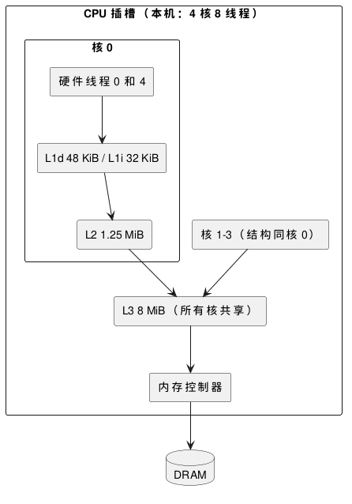

:PROPERTIES:
:ID:       d734bb0e-c8fc-4cd7-a1d9-5432aed0c7d0
:ROAM_ALIASES: "CPU 缓存层级"
:VERIFIED_WITH: Intel i5-1155G7, Linux 6.5, GCC 16.2.1 (2026-10-27)
:END:
#+title: CPU Cache Hierarchy
#+filetags: :Linux:Hardware:

* 层级与访问代价
CPU 访问内存要等上百纳秒，比执行一条指令慢两个数量级；缓存（cache）把最近用过的数据留在离核更近、更小也更快的存储里。

#+begin_src plantuml :file images/cpu_cache_hierarchy.png
@startuml
rectangle "CPU 插槽（本机：4 核 8 线程）" {
  rectangle "核 0" as core0 {
    rectangle "硬件线程 0 和 4" as hw0
    rectangle "L1d 48 KiB / L1i 32 KiB" as l1
    rectangle "L2 1.25 MiB" as l2
  }
  rectangle "核 1–3（结构同核 0）" as cores
  rectangle "L3 8 MiB（所有核共享）" as l3
  rectangle "内存控制器" as mc
}
database "DRAM" as dram
hw0 -down-> l1
l1 -down-> l2
l2 -down-> l3
cores -down-> l3
l3 -down-> mc
mc -down-> dram
@enduml
#+end_src

#+RESULTS:

| 层级 | 归属 | 典型容量 | 典型延迟 | 本机实测（随机访问） |
|---|---|---|---|---|
| L1d / L1i | 每核私有，数据和指令分开 | 32–48 KiB | 4–5 个周期，约 1 ns | 1.6–2.4 ns |
| L2 | 每核私有 | 256 KiB–2 MiB | 约 12–15 个周期 | 5–8 ns |
| L3（末级缓存，LLC） | 所有核共享 | 几 MiB 到几百 MiB | 约 40–70 个周期，10–20 ns | 不稳定，见下文 |
| DRAM | 内存控制器之后 | GiB 级 | 80–120 ns | 130–150 ns |

- 同一个核上的两个超线程（SMT）共享该核的 L1 和 L2。
- 查看本机： ~lscpu -C~ ，或 =/sys/devices/system/cpu/cpu0/cache/index*/= 下的 =size= 、 =shared_cpu_list= ；缓存行大小 ~getconf LEVEL1_DCACHE_LINESIZE~ 。
- 本机实测方法：在不同大小的缓冲区里按随机顺序做指针追逐（pointer chasing，每次读出的值是下一次的地址），绑在一个核上，取平均每次读取的耗时。工作集一旦超出某一级的容量，延迟就跳到下一级。

* 缓存行与局部性
- 缓存以缓存行（cache line）为单位搬运数据，x86 上是 64 字节：读一个 ~int~ 也会把它所在的 64 字节整行搬进来。
- 时间局部性（刚用过的很快再用）和空间局部性（用了一个，接着用相邻的）决定命中率。数组顺序遍历每行只付一次未命中；链表、树、哈希表的指针跳转每一步都可能是一次新的未命中。
- 硬件预取器（prefetcher）识别顺序或固定步长的访问，提前取下一行。本机在 256 MiB 的缓冲区上同样做指针追逐：按顺序排列时 7 ns 一次，随机排列时 150 ns 一次，差 20 倍，指令完全一样。
- 判断：IPC 低、 =cache-misses= 高时，优化方向是数据布局（数组代替指针结构、把热字段放在一起、按访问顺序存放），而不是减少指令。
- 地址翻译也有缓存：页表项缓存在 TLB 中，工作集大时 TLB 未命中叠加在缓存未命中之上，用大页缓解，见 [[id:4dc805d4-c007-4526-bd64-c9ca9af200a4][Linux Virtual Memory and Page Faults]]。

* 缓存一致性与伪共享
- 每个核有私有的 L1 / L2，同一个缓存行可能在多个核里各有一份副本。缓存一致性协议（cache coherence，x86 上是 MESI 的变体）保证它们看到同一个值：多个核可以同时 *读* 一行（共享状态），某个核要 *写* 时必须先独占这一行，其他核的副本失效，下次读时再从写入方取回。
- 所以并发写同一行的代价是这一行在核之间来回传递（cache line bouncing），每次几十纳秒。
- 伪共享（false sharing）：两个线程各写各的变量，变量却落在同一缓存行里，硬件按行而不是按变量做一致性，于是它们像在争用同一个变量。

本机实测：两个线程各做 1 亿次 ~atomic_fetch_add~ （relaxed），计数器相距 8 字节或 64 字节：

| 两个线程所在 | 同一缓存行（相距 8 B） | 不同缓存行（相距 64 B） |
|---|---|---|
| 两个物理核（CPU 1、2） | 4.28 s | 0.97 s |
| 同一物理核的两个超线程（CPU 1、5） | 1.33 s | 1.62 s |

- 跨物理核时伪共享慢 4.4 倍；超线程兄弟共享同一个 L1，没有缓存行传递，伪共享反而无代价（此时慢是因为两个线程抢同一套执行单元）。
- 把原子操作换成普通的 ~volatile~ 读写时，本机两种布局只差约 10%：写先进入存储缓冲区（store buffer），本核后续的读直接从中取值，等待独占缓存行的时间大多被掩盖。原子读改写必须先拿到缓存行的独占权，才把代价完全暴露出来；伪共享严重的典型场景是每线程的计数器、锁和队列的头尾指针。
- 解决：每线程写的数据各自对齐到 64 字节（Intel 的相邻行预取器会成对抓取两行，有的实现取 128 字节）；只读数据不受影响，可以共享。定位多线程程序的伪共享用 ~perf c2c~ 。

* 共享的 L3 与相邻负载干扰
- L3 由所有核共享，一个进程能用多少取决于同时在跑什么。本机测量时系统平均负载约为 6（容器里的其他负载在运行）：工作集 1.5 MiB 时约 16–24 ns，2.5 MiB 时已升到 60 ns，3 MiB 以上就与内存延迟相差无几，远没有用满 8 MiB 的 L3。
- 判断：在共享机器上测出的 L3 收益不可靠；低延迟系统里，邻居进程的大数据扫描会把关键线程的热数据挤出 L3。对策是把噪声负载移到其他插槽或机器，或用 Intel RDT 的缓存分配技术（CAT，经 =/sys/fs/resctrl= 配置）给关键核划出专用的 L3 路（way）。
