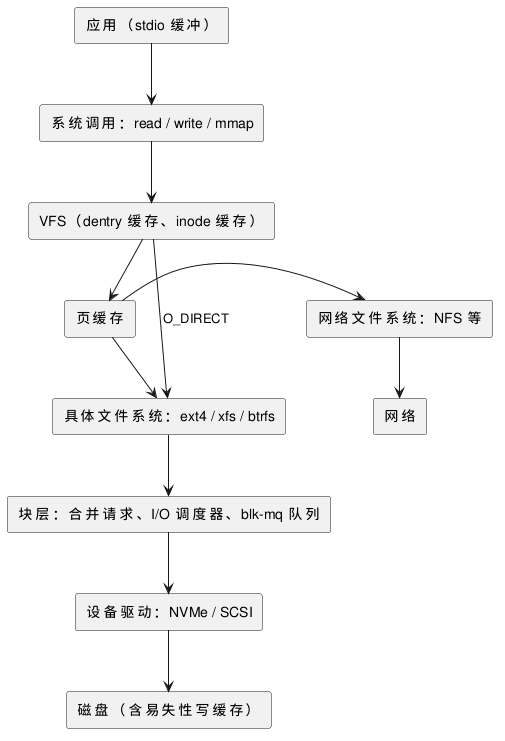

:PROPERTIES:
:ID:       d5d10c24-2f44-46a6-aa2d-1277d2af4fc6
:ROAM_ALIASES: "Linux 块层" "Linux I/O 栈"
:VERIFIED_WITH: Linux 6.5 (2026-10-26)
:END:
#+title: Linux Block Layer and I/O Stack
#+filetags: :Linux:

* I/O 栈
一次文件读写从应用到磁盘经过的层次：

#+begin_src plantuml :file images/linux_io_stack.png
@startuml
skinparam defaultTextAlignment center
rectangle "应用（stdio 缓冲）" as App
rectangle "系统调用：read / write / mmap" as SC
rectangle "VFS（dentry 缓存、inode 缓存）" as VFS
rectangle "页缓存" as PC
rectangle "具体文件系统：ext4 / xfs / btrfs" as FS
rectangle "网络文件系统：NFS 等" as NFS
rectangle "块层：合并请求、I/O 调度器、blk-mq 队列" as BL
rectangle "设备驱动：NVMe / SCSI" as DRV
rectangle "磁盘（含易失性写缓存）" as DISK
rectangle "网络" as NET
App -down-> SC
SC -down-> VFS
VFS -down-> PC
PC -down-> FS
VFS -down-> FS : O_DIRECT
PC -right-> NFS
NFS -down-> NET
FS -down-> BL
BL -down-> DRV
DRV -down-> DISK
@enduml
#+end_src

#+RESULTS:

- 文件系统把「文件的第几页」翻译成「设备的第几个块」，生成块 I/O 请求（ ~bio~ ）交给块层。直接读写块设备（ =/dev/sda= ）时跳过文件系统；网络文件系统跳过块层。
- 页缓存在文件系统之上：缓存命中的读不会到达块层，所以块层的统计（ ~iostat~ ）看不到这些读。

* 块层做什么
- 向上给文件系统一个统一的块设备接口，向下屏蔽 SATA、SAS、NVMe 等设备的差异。
- 合并：把相邻扇区的请求合成一个大请求，减少设备操作次数。
- 调度：决定请求下发的顺序，在吞吐、延迟和进程间公平之间取舍。
- 多队列（blk-mq）：每个 CPU 有自己的软件队列，映射到设备的硬件队列。NVMe 设备有很多硬件队列，各 CPU 并行提交、互不加锁；旧的单队列块层和它的调度器在 5.0 移除。

* I/O 调度器
当前设备的调度器在 =/sys/block/<dev>/queue/scheduler= 中，方括号内是正在用的；可以运行时写入切换，持久化用 udev 规则。

| 调度器 | 做法 | 适合 |
|---|---|---|
| ~none~ | 不排序，只做合并 | NVMe 等高速设备：设备内部自己调度，软件排序只增加开销。多硬件队列设备的默认值 |
| ~mq-deadline~ | 按扇区排序以减少寻道，同时给每个请求设截止时间，读优先 | 机械盘、单队列设备的默认值；数据库等 I/O 压力大的服务器 |
| ~bfq~ | 按进程分配 I/O 预算，保证公平和交互响应 | 桌面、慢速机械盘；CPU 开销较大 |
| ~kyber~ | 按读、写的目标延迟控制队列深度 | 高速设备上要控制延迟时 |

- 旧资料中的 CFQ、deadline、noop 是单队列时代的调度器，5.0 起已不存在；分别对应现在的 bfq、mq-deadline、none。
- 本机：NVMe 盘为 ~none~ ，两块机械盘为 ~bfq~ ，另一块机械盘为 ~mq-deadline~ 。

* 机械盘与 SSD
| | 机械盘（HDD） | SSD / NVMe |
|---|---|---|
| 一次随机读 | 寻道 + 旋转等待，毫秒级（7200 转的盘平均旋转等待约 4 ms） | 几十到上百微秒 |
| 随机 I/O 能力 | 每秒一两百次 | 每秒数万到数十万次 |
| 并行 | 只有一个磁头臂，并发请求只能排队 | 内部多通道，队列越深吞吐越高 |
| 优化重点 | 顺序化：合并、排序、预读 | 提供足够的并发（多线程或异步 I/O） |

所以同样的「随机读小文件」负载，在机械盘上调度器和预读很关键，在 NVMe 上瓶颈往往变成系统调用和 CPU。
