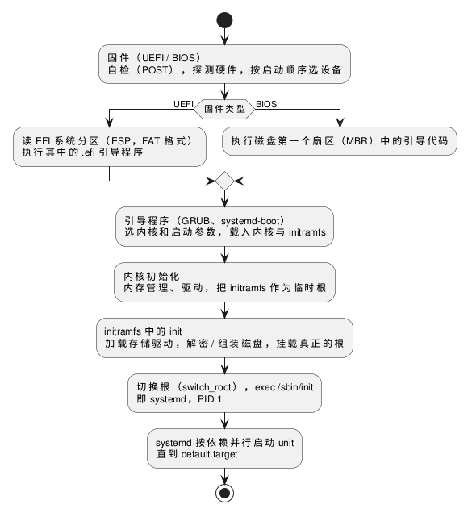

:PROPERTIES:
:ID:       2fd5f48e-1354-47be-be34-c7f700b5028a
:ROAM_ALIASES: "Linux 启动流程"
:VERIFIED_WITH: systemd 262 (2026-10-27)
:END:
#+title: Linux Boot Process
#+filetags: :Linux:

* 流程
每一阶段只做一件事：把下一阶段装进内存，再把控制权交给它。用一个简单的程序启动更复杂的程序，这个过程叫自举（bootstrapping）。

#+begin_src plantuml :file images/linux_boot_process.png
@startuml
start
:固件（UEFI / BIOS）
自检（POST），探测硬件，按启动顺序选设备;
if (固件类型) then (UEFI)
  :读 EFI 系统分区（ESP，FAT 格式）
  执行其中的 .efi 引导程序;
else (BIOS)
  :执行磁盘第一个扇区（MBR）中的引导代码;
endif
:引导程序（GRUB、systemd-boot）
选内核和启动参数，载入内核与 initramfs;
:内核初始化
内存管理、驱动，把 initramfs 作为临时根;
:initramfs 中的 init
加载存储驱动，解密 / 组装磁盘，挂载真正的根;
:切换根（switch_root），exec /sbin/init
即 systemd，PID 1;
:systemd 按依赖并行启动 unit
直到 default.target;
stop
@enduml
#+end_src

#+RESULTS:

* 各阶段的要点
- *固件* ：固件本身存放在主板的 SPI flash 中；UEFI 的 NVRAM 保存启动项等设置（ ~efibootmgr~ 查看和修改）。UEFI 可以不经 GRUB，直接启动带 EFI stub 的内核或统一内核镜像（UKI）。
- *内核启动参数* ：引导程序传给内核，运行时在 =/proc/cmdline= 查看。 ~root=~ 指定根设备；低延迟用的 ~isolcpus=~ 、 ~nohz_full=~ 也在这里设置，见 [[id:d525dfda-0943-4e82-b4a8-cad648ad48b5][Linux CPU Scheduling and Affinity]]。
- *为什么需要 initramfs* ：内核要先挂载根文件系统，但根所在设备的驱动（NVMe、RAID、LVM、LUKS 加密）可能编译成了模块，而模块就放在根文件系统里。initramfs 是装进内存的一个小根文件系统，带着这些模块和工具。换了磁盘控制器或改了加密、LVM 配置后要重建 initramfs（ ~mkinitcpio -P~ 、 ~dracut~ 、 ~update-initramfs -u~ ，依发行版）。
- *systemd* ：PID 1 负责启动所有服务和收养孤儿进程，不能退出。它管理的对象叫 unit：service（服务）、mount、socket、timer 等；target 是一组 unit 的同步点，取代 SysV init 的运行级别，例如 =multi-user.target= （无图形）、 =graphical.target= 。旧的 =/etc/init.d/= 脚本和 =rc.local= 只为兼容保留，自定义开机任务写成 service unit。

* 排查
| 问题 | 看什么 |
|---|---|
| 启动慢 | ~systemd-analyze~ （固件、引导、内核、用户空间各花多久）、 ~systemd-analyze critical-chain~ （关键路径） |
| 某个服务没起来 | ~systemctl --failed~ 、 ~systemctl status <unit>~ 、 ~journalctl -b -u <unit>~ |
| 上次启动失败或死机 | ~journalctl -b -1~ （需要持久化日志，即 =/var/log/journal/= 存在） |
| 停在 initramfs 的应急 shell | 找不到根设备：核对 ~root=~ 中的 UUID（ ~blkid~ ），驱动是否打进了 initramfs |

~systemd-analyze blame~ 列出各 unit 的启动耗时，但 unit 是并行启动的，耗时长的不一定拖慢启动，要以 ~critical-chain~ 为准。
