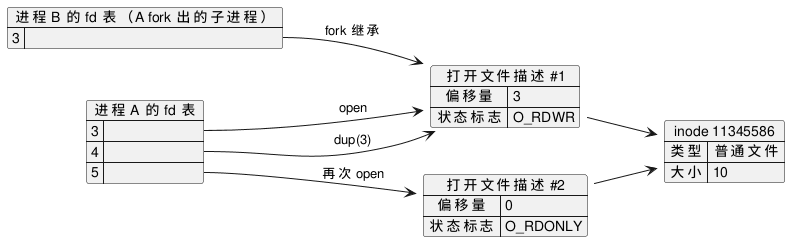

:PROPERTIES:
:ID:       937b44b4-497a-466a-924d-0a01a2228266
:ROAM_ALIASES: "Linux 文件描述符"
:VERIFIED_WITH: Linux 6.5, glibc 2.44, GCC 16.2.1 (2026-10-26)
:END:
#+title: Linux File Descriptors and Open Files
#+filetags: :Linux:

* 三张表
文件描述符（file descriptor，fd）只是一个小整数，背后是三层结构：

#+begin_src plantuml :file images/linux_fd_tables.png
@startuml
left to right direction
map "进程 A 的 fd 表" as A {
  3 =>
  4 =>
  5 =>
}
map "进程 B 的 fd 表（A fork 出的子进程）" as B {
  3 =>
}
map "打开文件描述 #1" as D1 {
  偏移量 => 3
  状态标志 => O_RDWR
}
map "打开文件描述 #2" as D2 {
  偏移量 => 0
  状态标志 => O_RDONLY
}
map "inode 11345586" as I {
  类型 => 普通文件
  大小 => 10
}
A::3 --> D1 : open
A::4 --> D1 : dup(3)
B::3 --> D1 : fork 继承
A::5 --> D2 : 再次 open
D1 --> I
D2 --> I
@enduml
#+end_src

#+RESULTS:

| 层 | 范围 | 内容 |
|---|---|---|
| fd 表 | 每个进程一张（同一进程的线程共用） | fd 号 → 打开文件描述，外加 fd 标志（只有 ~FD_CLOEXEC~ 一个） |
| 打开文件描述（open file description） | 全系统；每次 ~open~ 新建一个 | 当前偏移量、状态标志（ ~O_APPEND~ 、 ~O_NONBLOCK~ 、读写模式） |
| inode | 全系统；每个文件一个 | 文件本身：大小、权限、数据位置、文件锁 |

* 谁和谁共享偏移量
本机实测：文件内容为 10 字节，从 fd 3 读 3 字节后：

| 得到 fd 的方式 | 共享打开文件描述 | 结果 |
|---|---|---|
| ~dup~ / ~dup2~ / ~fcntl(F_DUPFD)~ | 是 | 新 fd 的偏移量也是 3 |
| ~fork~ 继承 | 是 | 子进程再读 2 字节，父进程的偏移量变成 5 |
| 经 Unix socket 传递（ ~SCM_RIGHTS~ ） | 是 | 接收方拿到的是同一个描述 |
| 对同一路径再 ~open~ 一次 | 否，只共享 inode | 新 fd 的偏移量为 0 |

- 父子进程同时写一个继承来的 fd 不会互相覆盖（偏移量是共享的），但各自的输出会交错。
- 多个进程各自 ~open~ 同一个日志文件追加写入，要用 ~O_APPEND~ ：内核把「移到文件末尾并写入」作为一步完成。不加时各进程有各自的偏移量，会互相覆盖。本机实测 ~O_APPEND~ 下先 ~lseek(fd, 0, SEEK_SET)~ 再写，数据仍追加在末尾。

* 两类标志的作用范围
| | fd 标志 | 状态标志 |
|---|---|---|
| 存在哪 | fd 表的条目 | 打开文件描述 |
| 有哪些 | ~FD_CLOEXEC~ | ~O_APPEND~ 、 ~O_NONBLOCK~ 、 ~O_ASYNC~ 等 |
| 读写方式 | ~fcntl(F_GETFD / F_SETFD)~ | ~fcntl(F_GETFL / F_SETFL)~ |
| 影响范围 | 只有这一个 fd | 所有共享该描述的 fd，包括其他进程中的 |

- 坑：程序把继承来的标准输入设为 ~O_NONBLOCK~ ，影响的是和 shell 共享的同一个描述；程序退出后 shell 读终端可能收到 ~EAGAIN~ 。本机实测：对 fd 设 ~O_NONBLOCK~ 后，它 ~dup~ 出来的 fd 也是非阻塞，但 ~FD_CLOEXEC~ 不会跟过去。
- ~FD_CLOEXEC~ ： ~exec~ 时自动关闭这个 fd，防止子程序继承不该拿到的文件或 socket。在 ~open~ 时直接传 ~O_CLOEXEC~ （socket 用 ~SOCK_CLOEXEC~ 、 ~accept4~ ），不要 ~open~ 之后再 ~fcntl~ 设置：多线程程序里，两步之间另一个线程可能正好 ~fork~ + ~exec~ ，fd 就泄漏进了子程序。

* fd 是有限资源
- 新 fd 总是取当前最小的可用号码；所以先 ~close(1)~ 再 ~open~ 能把标准输出重定向到文件（ ~dup2~ 把这两步合成一步原子操作）。
- 每个进程的上限是 ~RLIMIT_NOFILE~ （ ~ulimit -n~ ），超过时 ~open~ 、 ~accept~ 返回 ~EMFILE~ 。很多发行版的软限制默认是 1024（本机为 65535）；高并发服务要调大， ~select~ 能处理的 fd 号也只到 1024。
- fd 泄漏的表现是 fd 数随时间只增不减，最终 ~EMFILE~ 。用 ~ls /proc/<pid>/fd | wc -l~ 观察；其中的符号链接指向 fd 对应的文件、socket 或管道。
- =/dev/fd/<n>= 是 =/proc/self/fd/<n>= 的链接， =/dev/stdin= 等是它的别名。shell 的进程替换 =<(cmd)= 借它把管道当文件名传给命令。
  - 坑：在 Linux 上打开它是重新 ~open~ fd n 指向的文件，得到新的打开文件描述，不是 ~dup~ （一些其他 Unix 上才是 ~dup~ ）。本机实测：原 fd 偏移量为 10，经 =/dev/fd= 打开的 fd 偏移量为 0、读写模式按新的 ~open~ 参数。
