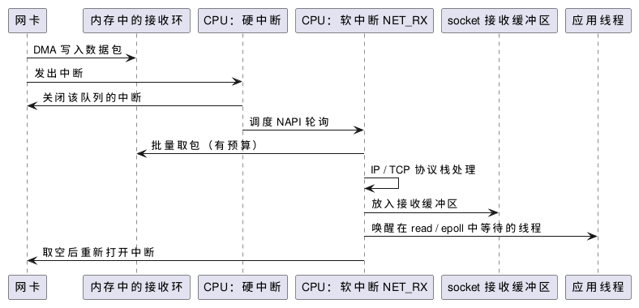

:PROPERTIES:
:ID:       18ebf2c0-c945-4bbc-ad58-9477849c7bbb
:ROAM_ALIASES: "Linux 中断与软中断"
:VERIFIED_WITH: Linux 6.5 (2026-10-26)
:END:
#+title: Linux Interrupts and Softirqs
#+filetags: :Linux:

* 中断是什么
中断（interrupt）是硬件或其他 CPU 发给某个 CPU 的信号，表示有事件需要立即处理。CPU 暂停当前执行，保存状态，在内核态运行中断处理程序，处理完再回到原来的执行流。
- 用户态和内核态的代码都会被中断打断；处理程序本身总在内核态运行。
- 在同一个 CPU 上，中断处理优先于任何任务，包括实时任务。被打断的任务不发生上下文切换，只是多了一段延迟。
- 所以中断既是 CPU 开销，也是延迟抖动的来源：低延迟线程所在的核上来一次中断，就多出几微秒。

* 上半部与下半部
为了让中断处理尽快结束，Linux 把工作分成两半：

| | 硬中断（hardirq，上半部） | 软中断（softirq，下半部） |
|---|---|---|
| 由谁触发 | 设备 | 内核（通常由硬中断处理程序发起） |
| 做什么 | 最少的必要工作：确认中断、记下数据位置、安排后续工作 | 耗时的处理：网络协议栈、定时器、RCU 回调、调度器负载均衡等 |
| 能否被打断 | 执行期间屏蔽本 CPU 的其他中断（至少屏蔽同一中断线） | 可被硬中断打断 |

- 软中断通常在硬中断返回时（ ~irq_exit~ ）就地执行，不是一个单独的线程。积压太多、超出一轮的处理预算时，剩下的交给每个 CPU 一个的内核线程 =ksoftirqd/N= ，按普通任务参与调度。
- 因此 =ksoftirqd= 的 CPU 占用高说明软中断过载，最常见的是网络收包太多。
- 软中断的种类固定，见 =/proc/softirqs= ： =HI= 、 =TIMER= 、 ~NET_TX~ 、 ~NET_RX~ 、 =BLOCK= 、 ~IRQ_POLL~ 、 =TASKLET= 、 =SCHED= 、 =HRTIMER= 、 =RCU= 。

* 例子：收一个网络包
网卡硬中断只做最核心的事，协议栈的大部分工作放在软中断里：

#+begin_src plantuml :file images/linux_packet_receive_interrupts.png
@startuml
participant "网卡" as NIC
participant "内存中的接收环" as Ring
participant "CPU：硬中断" as H
participant "CPU：软中断 NET_RX" as S
participant "socket 接收缓冲区" as Sock
participant "应用线程" as App
NIC -> Ring : DMA 写入数据包
NIC -> H : 发出中断
H -> NIC : 关闭该队列的中断
H -> S : 调度 NAPI 轮询
S -> Ring : 批量取包（有预算）
S -> S : IP / TCP 协议栈处理
S -> Sock : 放入接收缓冲区
S -> App : 唤醒在 read / epoll 中等待的线程
S -> NIC : 取空后重新打开中断
@enduml
#+end_src

#+RESULTS:

- NAPI：流量大时内核关着中断连续轮询接收环，一次中断处理一批包，避免每个包一次中断。
- 内核旁路（kernel bypass）把这一整条路径搬到用户态，应用线程直接忙轮询网卡，既没有中断也没有协议栈的软中断。

* Linux Interrupt Counters in /proc
:PROPERTIES:
:ID:       3158f50d-42bd-46d5-8862-2801f343fe72
:END:
- =/proc/interrupts= ：每个中断源在每个 CPU 上的累计次数。用 ~watch -d cat /proc/interrupts~ 看哪一行在涨。
- =/proc/softirqs= ：每类软中断在每个 CPU 上的累计次数。 ~NET_RX~ 集中在一个 CPU 上，说明网卡中断都落在这个核上（单队列或亲和性设置）。
- ~top~ 的 =hi= 、 =si= 列：硬中断、软中断占用的 CPU 时间百分比。

=/proc/interrupts= 中除了设备中断，常见的几行：

| 行 | 含义 | 来源 |
|---|---|---|
| =LOC= | 本地定时器中断 | 时钟 tick，可用 ~nohz_full~ 减少 |
| =RES= | 重调度中断（rescheduling IPI） | 另一个 CPU 唤醒了要在本 CPU 运行的任务 |
| =CAL= | 函数调用 IPI | 另一个 CPU 请求本 CPU 执行某个函数 |
| =TLB= | TLB shootdown | 同一进程在其他 CPU 上修改了内存映射（ ~munmap~ 、 ~mprotect~ 等），本 CPU 要作废缓存的映射 |

IPI（inter-processor interrupt）是 CPU 之间发的中断。

* 中断亲和性
- =/proc/irq/<N>/smp_affinity_list= 设定中断号 =N= 送往哪些 CPU；启动参数 ~irqaffinity=~ 设定默认值。
- irqbalance 守护进程会周期性重新分配中断，手动设定前停用它，或在其配置中排除隔离核。
- 多队列网卡每个队列有自己的中断，可以分散到不同核上。
- 低延迟系统把设备中断全部移离隔离核。 =LOC= 和各种 IPI 不能这样移走：前者靠 ~nohz_full~ 减少，后者靠减少跨核唤醒、避免在热路径上修改内存映射。
