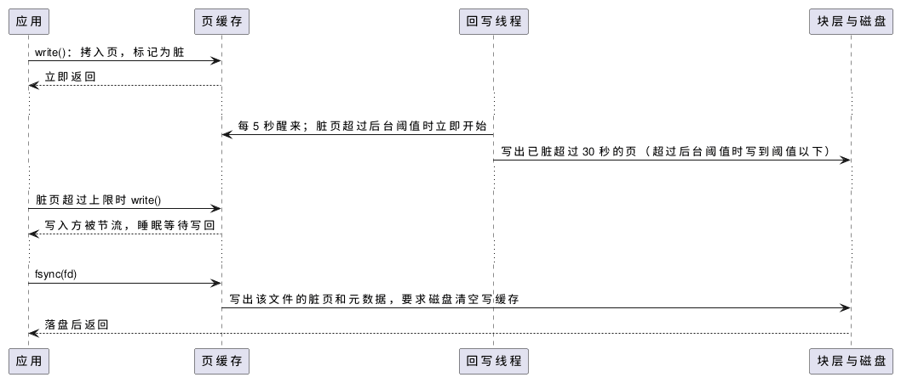

:PROPERTIES:
:ID:       a20150eb-3731-4848-8a33-c55c4a318b7b
:ROAM_ALIASES: "Linux 页缓存"
:VERIFIED_WITH: Linux 6.5, btrfs on HDD (2026-10-26)
:END:
#+title: Linux Page Cache and Writeback
#+filetags: :Linux:

* 核心模型
页缓存（page cache）是内核用空闲内存缓存的文件内容，按（文件, 页偏移）组织。普通的 ~read~ / ~write~ 都经过它：

- 读：页在缓存中就直接拷给用户；不在就发起磁盘读，进程在 D 状态等待。顺序读时内核预读（readahead）后面的页，窗口从小逐步增长到设备的 =/sys/block/<dev>/queue/read_ahead_kb= （常见默认 128 KiB）。
- 写：把数据拷进页缓存、把页标记为脏页（dirty page）就返回，之后由内核在后台写回（writeback）磁盘。
- 同一文件的页在全系统只缓存一份： ~read~ / ~write~ 和 ~mmap~ 访问的是同一批页，多个进程读同一文件也共享这批页。

本机实测（btrfs，机械盘）：

| 操作（256 MiB 文件） | 耗时 |
|---|---|
| ~write~ 进页缓存 | 0.11 s |
| 随后 ~fsync~ 写到磁盘 | 0.54 s |
| 用 ~posix_fadvise(DONTNEED)~ 清掉缓存后读（冷） | 8.4 s |
| 再读一次（热） | 0.04 s |

2.4 之前另有一个按磁盘块缓存的 buffer cache，之后并入页缓存。现在 =/proc/meminfo= 中：

| 字段 | 含义 |
|---|---|
| =Cached= | 文件内容的页缓存，也包括 tmpfs 和共享内存的页（ =Shmem= ），后者不能直接丢弃 |
| =Buffers= | 块设备本身的页缓存：直接读写块设备、部分文件系统元数据。通常很小 |
| =Dirty= / =Writeback= | 等待写回 / 正在写回的数据量 |

* 写回
#+begin_src plantuml :file images/linux_page_cache_writeback.png
@startuml
participant "应用" as App
participant "页缓存" as PC
participant "回写线程" as F
participant "块层与磁盘" as D
App -> PC : write()：拷入页，标记为脏
PC --> App : 立即返回
...
F -> PC : 每 5 秒醒来；脏页超过后台阈值时立即开始
F -> D : 写出已脏超过 30 秒的页（超过后台阈值时写到阈值以下）
...
App -> PC : 脏页超过上限时 write()
PC --> App : 写入方被节流，睡眠等待写回
...
App -> PC : fsync(fd)
PC -> D : 写出该文件的脏页和元数据，要求磁盘清空写缓存
D --> App : 落盘后返回
@enduml
#+end_src

#+RESULTS:

| 参数（ =/proc/sys/vm/= ） | 作用 | 上游默认 |
|---|---|---|
| ~dirty_writeback_centisecs~ | 回写线程周期 | 500（5 秒） |
| ~dirty_expire_centisecs~ | 脏页存在多久后必须写回 | 3000（30 秒） |
| ~dirty_background_ratio~ | 脏页超过可用内存的这个比例，回写线程开始在后台写 | 10 |
| ~dirty_ratio~ | 脏页超过这个比例，执行写入的进程自己被节流 | 20 |

- 比例的基数是可用内存（空闲 + 可回收），不是总内存。 ~*_ratio~ 与对应的 ~*_bytes~ 互斥，设置一个另一个读出来就是 0。本机设了 ~dirty_background_bytes~ = 200 MB、 ~dirty_bytes~ = 400 MB。
- 回写线程是按设备的 kworker（名字中带 =flush-<主设备号>:<次设备号>= ）；旧资料中的 ~pdflush~ 在 2.6.32 已被取代。
- 坑一（延迟）：大内存机器上 20% 可能是几 GiB 脏数据。突发写入撞上 ~dirty_ratio~ 时， ~write~ 会卡住秒级；之后的 ~fsync~ 也要等前面积压的数据。延迟敏感的机器用 ~dirty_background_bytes~ 让写回早开始、每次少写，并且不在热路径线程里写文件。
- 坑二（丢数据）： ~write~ 返回不代表落盘。断电或内核崩溃会丢失还没写回的数据，最多约 30 秒加一个周期；进程自己崩溃则不丢，数据已在内核里。需要持久时调用 ~fsync~ 。
- 写回经文件系统和块层下发，见 [[id:d5d10c24-2f44-46a6-aa2d-1277d2af4fc6][Linux Block Layer and I/O Stack]]。

* 回收与清缓存
- 页缓存可以随时让出：干净的页直接丢弃，脏页先写回再丢弃。所以 ~free~ 的 =free= 很小是正常的，看 =available= 。回收的时机和与匿名页的权衡见 [[id:065d6f74-0113-4308-b158-b2333a6f7339][Linux Memory Reclaim]]。
- ~echo 1 > /proc/sys/vm/drop_caches~ 丢弃干净的页缓存（ =2= 丢 dentry / inode 等 slab， =3= 两者都丢），脏页不受影响，要先 ~sync~ 。只用于测冷缓存的性能，不是「释放内存」的手段：丢掉的缓存之后还要从磁盘读回来。
- 只针对一个文件： ~posix_fadvise(fd, 0, 0, POSIX_FADV_DONTNEED)~ 丢弃它的干净页（本机实测 256 MiB 降到 0）。查看文件有多少在缓存中用 ~fincore~ （util-linux）或 ~vmtouch~ 。
