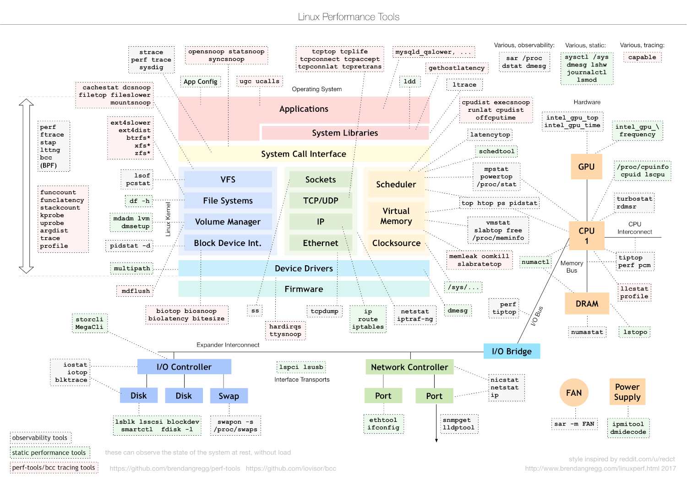

:PROPERTIES:
:ID:       8c7cfc98-33d2-45d2-8bac-01e5c13dc4f9
:ROAM_ALIASES: "Linux 性能工具"
:END:
#+title: Linux Performance Tools
#+filetags: :Linux:

什么现象看哪个指标，在 CPU、内存、I/O 三篇分析笔记里；本篇按 *数据从哪来* 给工具分类，回答「这个工具能看到什么、代价是什么」。

* 三种观测方式
| 方式 | 原理 | 代表 | 开销 | 回答什么 |
|---|---|---|---|---|
| 计数器 | 内核一直在累加的统计（ =/proc= 、 =/sys= ），工具采样两次作差 | ~ps~ 、 ~top~ 、 ~vmstat~ 、sysstat、 ~free~ | 几乎为零，随时可开 | 有多少、多快：使用率、速率、队列长度 |
| 跟踪（tracing） | 在事件点（系统调用、内核函数、tracepoint）上记录每一次发生 | ~strace~ 、ftrace、 ~perf trace~ 、bcc / bpftrace | 与事件频率成正比 | 是谁、哪一次、参数是什么、耗时分布 |
| 采样（profiling） | 定时或每 N 个硬件事件中断一次，记录当时的调用栈 | ~perf record~ 、bcc 的 ~profile~ | 与采样频率成正比，99 Hz 时很小 | 时间花在哪些函数（只看得到 on-CPU） |

- 顺序：先用计数器（便宜、全局）判断哪种资源有问题，再用跟踪或采样（贵、局部）定位到进程、函数和调用，对应 [[id:fa3e0959-819d-4d3e-abcd-e4bdc1cea072][Linux Performance Troubleshooting Method]] 中「从整体到代码」的流程。
- 计数器类工具只是在格式化 =/proc= ，各文件见 [[id:8e974bc1-a02f-4567-8e13-5e8b37b5babb][Linux /proc and sysctl Interfaces]]。
- 跟踪的代价主要在把每个事件交给用户态：高频事件（每秒几十万次系统调用）逐条输出时，工具本身就成了负载。eBPF 在内核里先聚合成计数或直方图，只把结果交给用户态，所以能用在生产环境。

* 全景图
#+caption: Linux 各子系统的观测工具（Brendan Gregg，2017）

按子系统找工具时查这张图；网络部分的工具在 Network 大类中另有笔记。

* 计数器类
| 工具 / 包 | 包含 | 何时想到它 |
|---|---|---|
| procps-ng | ~ps~ 、 ~top~ 、 ~free~ 、 ~vmstat~ 、 ~pmap~ 、 ~slabtop~ 、 ~watch~ 、 ~pgrep~ | 几乎每台机器都有；容器和精简系统里没有时直接读 =/proc= |
| psmisc | ~pstree~ 、 ~killall~ 、 ~fuser~ | ~pstree -aps <pid>~ 显示一个进程的祖先链和命令行：找是谁在反复拉起短时进程 |
| sysstat | ~iostat~ 、 ~mpstat~ 、 ~pidstat~ 、 ~sar~ （及后台采集器 ~sadc~ ） | ~iostat~ 看各磁盘、 ~mpstat~ 看各核、 ~pidstat~ 看每个进程或线程（ ~-u~ CPU、 ~-w~ 切换、 ~-d~ I/O、 ~-r~ 缺页、 ~-t~ 线程）、 ~sar~ 看历史 |
| top 的替代品 | ~htop~ （交互、树状）、 ~btop~ （图形化）、 ~atop~ （按资源分组，记录历史，能看到采样间隔内已退出的进程） | 交互式浏览；事后回看用 ~atop~ 或 ~sar~ |
| ~dstat~ | 把 ~vmstat~ 、 ~iostat~ 、 ~ifstat~ 的内容合成一行 | 原项目已停止维护，用社区分支 ~dool~ 或 pcp 的 ~pcp-dstat~ |
| ~watch -d <cmd>~ | 周期执行命令并高亮变化的部分 | 盯 =/proc/interrupts= 、 =/proc/softirqs= 这类计数文件里哪一行在涨 |

- *历史只能事前开* ： ~sar~ 能回看的数据来自 ~sadc~ 的定时采集（默认每 10 分钟一次），要先按发行版的方式启用；出事后再装只有实时数据。10 分钟的平均值也会抹平尖峰。
- *第一行是开机以来的平均* ： ~vmstat 1~ 和 ~iostat 1~ 输出的第一组数是开机以来的平均值，不是当前值，从第二组开始看（ ~iostat -y~ 跳过第一组）。
- *进程还是线程* ： ~top~ 默认按进程汇总，多线程程序的一个线程打满一个核时显示为 100%，看不出是哪个线程；用 ~top -H~ 、 ~pidstat -t~ 、 ~ps -eLf~ 看线程。

* 跟踪类
| 工具 | 机制 | 开销 | 何时用 |
|---|---|---|---|
| ~strace~ | ptrace：被跟踪的线程每次进出系统调用都停下来，切到 strace 进程 | 系统调用密集时慢几倍到几十倍 | 开发和测试环境中看程序做了哪些系统调用、在哪一步失败；系统调用本身见 [[id:b740640d-e1b6-4d3e-a151-44653e269df7][Linux System Calls]] |
| ~ltrace~ | 拦截动态库函数调用 | 比 strace 更高 | 看程序调了哪些库函数 |
| ~perf trace~ | 基于内核 tracepoint，不停下进程 | 小得多 | 生产环境中代替 strace |
| ftrace | 内核内置的跟踪框架，接口在 tracefs（ =/sys/kernel/tracing= ）：函数跟踪、tracepoint、kprobe | 视事件而定 | 没有 eBPF 的旧内核。perf-tools（Brendan Gregg 的一组 shell 脚本： ~execsnoop~ 、 ~opensnoop~ 、 ~iosnoop~ 、 ~funccount~ 、 ~kprobe~ 等）是它的前端 |
| eBPF：bcc、bpftrace | 在内核事件点运行经过校验的小程序，在内核里聚合 | 低，适合生产 | 首选。bcc 是现成工具集（Python 前端，运行时编译，需要内核头文件）；libbpf-tools 是同一批工具的 CO-RE 版本（依赖内核 BTF，单个二进制）；bpftrace 用来写一行脚本 |

strace 常用：跟踪已有进程用 ~-p <pid>~ ，加 ~-f~ 跟所有线程和子进程； ~-c~ 汇总各调用的次数和耗时， ~-T~ 显示每次调用的耗时， ~-e trace=file~ / ~desc~ / ~network~ 按类别过滤， ~-o~ 写到文件。

bcc 中按问题找工具：

| 想知道 | 工具 |
|---|---|
| 短时进程是谁、谁启动的 | ~execsnoop~ |
| 打开了哪些文件、哪次打开失败 | ~opensnoop~ |
| 哪个文件读写最多 | ~filetop~ |
| 块 I/O 的延迟分布、每个请求、按进程排序 | ~biolatency~ 、 ~biosnoop~ 、 ~biotop~ |
| 页缓存命中率（全局 / 每进程） | ~cachestat~ 、 ~cachetop~ |
| 长期未释放的内存分配 | ~memleak -p <pid>~ |
| 线程不在 CPU 上时在等什么 | ~offcputime~ |
| 在运行队列里排队多久 | ~runqlat~ |
| TCP 重传、主动和被动建连 | ~tcpretrans~ 、 ~tcpconnect~ 、 ~tcpaccept~ |

包名：Arch 的 =bcc-tools= 装在 =/usr/share/bcc/tools/= ，不在 =PATH= 里；Debian / Ubuntu 的包是 =bpfcc-tools= ，命令带 =-bpfcc= 后缀，如 ~execsnoop-bpfcc~ 。

* 坑
- *strace 只跟一个线程* ： ~strace -p <pid>~ 只跟踪这个 ID 对应的线程，多线程程序的主线程往往只是睡在 ~futex~ 或 ~epoll_wait~ 里；加 ~-f~ 才能看到工作线程。
- *权限* ：perf 和 eBPF 工具需要 root 或相应 capability（ ~CAP_PERFMON~ 、 ~CAP_BPF~ ，5.8 起）；容器里运行还需要容器有这些权限，内核用的是宿主机的。
- *选工具时先想开销* ：在延迟敏感的生产进程上，先用计数器和 eBPF 工具，最后才考虑 strace、ltrace 或 ~gdb~ 这类会停下进程的工具。

* [[id:894e26d6-8bae-49ab-ac0c-e9812dd08d9b][perf Profiler]]
* [[id:3eb94d17-33dd-4314-afb4-ee194cb82acd][Benchmarking and Load Generation]]
