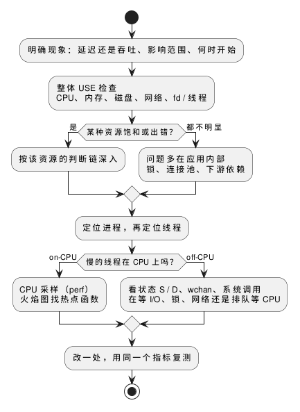

:PROPERTIES:
:ID:       fa3e0959-819d-4d3e-abcd-e4bdc1cea072
:ROAM_ALIASES: "Linux 性能排障方法"
:END:
#+title: Linux Performance Troubleshooting Method
#+filetags: :Linux:

* 先把现象说清楚
- 「系统慢」要先变成一个可测量的量：延迟（哪个分位数）还是吞吐？全部请求还是一部分？只有一台机器还是全部？
- 从什么时候开始、那时改了什么（发布、配置、流量、数据量）。很多问题在这一步就有了方向。
- 能稳定复现再动手：偶发问题先写一个能触发它的负载（压测脚本、循环请求），否则改了也无法确认是否生效。每次只改一处，用同一个指标复测。

* USE 方法
对每种资源依次检查利用率（Utilization）、饱和度（Saturation）、错误（Errors）三项，先排除再深入，避免只盯着最先看到的那个数字：

| 资源 | 利用率 | 饱和度（排队） | 错误 |
|---|---|---|---|
| CPU | 各核使用率 | 运行队列等待、 =/proc/pressure/cpu= | 少见（ ~dmesg~ 中的机器检查错误） |
| 内存 | 已用占比（看 =available= ） | 回收、换页、主缺页、 =/proc/pressure/memory= | 分配失败、OOM（ ~dmesg~ ） |
| 磁盘 | =%util= （只对机械盘可靠） | 队列长度 =aqu-sz= 、await 上升、 =/proc/pressure/io= | ~dmesg~ 中的 I/O error、SMART |
| 网卡 | 带宽占比 | 丢包、重传、socket 队列溢出 | 网卡错误计数 |
| 软件资源 | 已用 fd / 线程数占上限 | 等锁、等连接池 | ~EMFILE~ 、 ~EAGAIN~ 等，见 [[id:505fb55e-6b4a-4a66-9f8a-7925d2983d27][Linux Resource Limits]] |

- 饱和度比利用率更能说明问题：利用率是一段时间的平均，70% 的平均里可能有一半时间在排队；饱和度直接回答「有没有人在等」。
- 各资源的指标读法和判断链：[[id:00e92d55-5469-4d5d-9566-e889d0b86ab3][Linux CPU Performance Analysis]]、[[id:0696af2e-fb7a-49a4-a88a-8d32ba0e7c43][Linux Memory Performance Analysis]]、[[id:f44727ab-e7c3-42cf-8d66-d0c595a352d6][Linux I/O Performance Analysis]]。

* 从整体到代码
#+begin_src plantuml :file images/linux_troubleshooting_flow.png
@startuml
start
:明确现象：延迟还是吞吐、影响范围、何时开始;
:整体 USE 检查\nCPU、内存、磁盘、网络、fd / 线程;
if (某种资源饱和或出错？) then (是)
  :按该资源的判断链深入;
else (都不明显)
  :问题多在应用内部\n锁、连接池、下游依赖;
endif
:定位进程，再定位线程;
if (慢的线程在 CPU 上吗？) then (on-CPU)
  :CPU 采样（perf）\n火焰图找热点函数;
else (off-CPU)
  :看状态 S / D、wchan、系统调用\n在等 I/O、锁、网络还是排队等 CPU;
endif
:改一处，用同一个指标复测;
stop
@enduml
#+end_src

#+RESULTS:

整体检查的常用组合（各工具只需知道看哪一列，选项随时查）：

| 命令 | 看什么 |
|---|---|
| ~uptime~ | 平均负载的趋势 |
| ~dmesg -T~ 的最后几十行 | OOM、I/O 错误、网卡和驱动报错 |
| ~vmstat 1~ | =r= （可运行任务）、 =b= （D 状态）、 =si= / =so= 、CPU 各项 |
| ~mpstat -P ALL 1~ | 各核使用率，找单核打满 |
| ~pidstat 1~ 、 ~top~ | 哪个进程占 CPU；加 ~-t~ / ~-H~ 看线程 |
| ~iostat -xz 1~ | 各磁盘的 IOPS、吞吐、await、 =aqu-sz= |
| ~free -m~ | =available= 、 =buff/cache= |
| ~sar -n DEV 1~ 、 ~sar -n TCP,ETCP 1~ | 网卡流量、TCP 新建连接和重传 |

* on-CPU 与 off-CPU
一个请求的时间要么花在 CPU 上（计算、自旋、等缓存未命中），要么花在等待上（I/O、锁、网络、缺页读盘、排队等 CPU）：

- CPU 采样工具（ ~perf record~ 、火焰图）只能看到前者。进程 CPU 使用率不高而延迟高时，CPU 火焰图帮不上忙，要找它在等什么：进程状态（ =S= 等事件、 =D= 等 I/O，见 [[id:925ecbf4-455e-437d-a1bb-432542685263][Linux Process States]]）、 =/proc/<pid>/wchan= 、 ~strace -c -p~ 的系统调用耗时，或 off-CPU 分析工具（bcc 的 ~offcputime~ ）。
- 排队等 CPU 是特殊的 off-CPU：任务状态是 =R= ，但没在运行，只能从调度器统计中看到，见 CPU 笔记的饱和度一节。

* 坑
- *平均值掩盖问题* ：8 核机器 12.5% 的总使用率可能是一个核 100%（单线程热点、中断集中在一个核）；1 秒的平均掩盖毫秒级的尖峰。看各核、各线程和延迟分布（直方图、分位数），不只看平均值。
- *观测本身有代价* ： ~strace~ 基于 ptrace，被跟踪进程每次系统调用都要停下来，系统调用密集的程序会慢很多倍；生产环境优先用 ~perf trace~ 或基于 eBPF 的工具。
- *容器里的数字* ： =/proc/meminfo= 、 =/proc/stat= 不按容器隔离，容器中的 ~free~ 、 ~top~ 显示的是宿主机的数字（除非装了 lxcfs）。容器的用量和限制看它的 cgroup 文件（ =memory.current= 、 =memory.stat= 、 =cpu.stat= 、 =*.pressure= ）。
