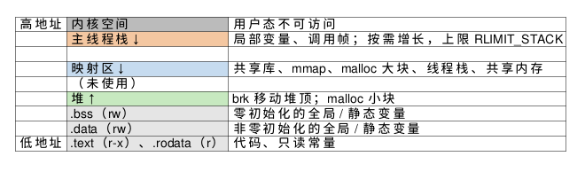

:PROPERTIES:
:ID:       c864c39e-2dd7-4c4d-ad24-9b541abc2f30
:ROAM_ALIASES: "Linux 进程地址空间"
:VERIFIED_WITH: Linux 6.5, glibc 2.44, GCC 16.2.1 (2026-10-26)
:END:
#+title: Linux Process Address Space
#+filetags: :Linux:

* 布局
每个进程看到一段自己的虚拟地址空间。x86-64 上用户空间占低地址的 128 TiB，内核空间在高半部分，用户态访问内核地址会收到 ~SIGSEGV~ 。这些区域都只是地址范围，用到时才分配物理页，见 [[id:4dc805d4-c007-4526-bd64-c9ca9af200a4][Linux Virtual Memory and Page Faults]]。

#+begin_src plantuml :file images/linux_process_address_space.png
@startuml
skinparam rectangleBorderColor #FFFFFF
skinparam rectangleBackgroundColor #FFFFFF
rectangle L [
| 高地址 |<#BBBBBB> 内核空间 | 用户态不可访问 |
| |<#F4C7A1> 主线程栈 ↓ | 局部变量、调用帧；按需增长，上限 RLIMIT_STACK |
| |<#FFFFFF> | |
| |<#C6DBEF> 映射区 ↓ | 共享库、mmap、malloc 大块、线程栈、共享内存 |
| |<#FFFFFF> （未使用） | |
| |<#C7E9C0> 堆 ↑ | brk 移动堆顶；malloc 小块 |
| |<#E5E5E5> .bss（rw） | 零初始化的全局 / 静态变量 |
| |<#E5E5E5> .data（rw） | 非零初始化的全局 / 静态变量 |
| 低地址 |<#E5E5E5> .text（r-x）、.rodata（r） | 代码、只读常量 |
]
@enduml
#+end_src

#+RESULTS:

- =.data= 的初值存在可执行文件里； =.bss= 在文件中只记大小，加载时映射成全零的匿名页，所以大的零初始化数组不会让二进制变大。
- ASLR（地址空间布局随机化）让栈、映射区、堆和 PIE 可执行文件的基址每次运行都不同（ =/proc/sys/kernel/randomize_va_space= 为 2 时全开，本机为 2）。调试时看到的地址每次不一样是正常的。
- 查看一个进程的实际布局： =/proc/<pid>/maps= ，每行一个映射区域，带权限和对应的文件；只读代码段和共享库在多个进程间共享同一份物理页。

* 栈
- *每个线程一个栈* 。主线程的栈按需向下增长，上限是 ~RLIMIT_STACK~ （ ~ulimit -s~ ，默认 8 MiB）；其他线程的栈由 pthread 在创建时 ~mmap~ 一块固定大小的区域，glibc 默认取 ~RLIMIT_STACK~ 的值（本机 8 MiB），可用 ~pthread_attr_setstacksize~ 改。
- 栈底下方有保护页（guard page），越界访问即 ~SIGSEGV~ 。深递归、大的局部数组是栈溢出的常见原因；栈溢出不会抛异常，进程直接被杀。
- 8 MiB 只是虚拟地址的预留，只有用到的页才占物理内存：1,000 个线程预留 8 GiB 虚拟地址，RSS 却可能只有几十 MiB。

* 栈与堆的取舍
| | 栈 | 堆 |
|---|---|---|
| 分配 | 移动栈指针，几乎无代价，不加锁 | 调用 ~malloc~ ：查空闲块、可能加锁、可能进内核 |
| 释放 | 离开作用域时自动 | 显式 ~free~ / ~delete~ ，或 RAII |
| 大小 | 小（MiB 级），大小通常在编译期确定 | 受可用内存限制，运行时决定 |
| 线程 | 每线程私有 | 进程内共享，分配器要处理并发 |
| 碎片 | 无 | 长期运行会产生碎片 |

默认用栈；对象大、大小运行时才知道、或要活过当前作用域时才用堆。
