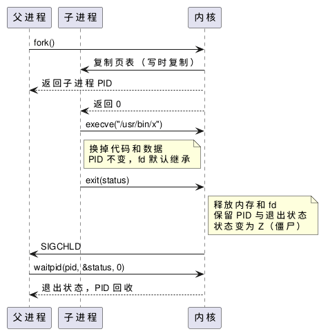

:PROPERTIES:
:ID:       6f1e5033-7e68-4eb1-a7d7-d5fd9db8b863
:ROAM_ALIASES: "Linux 进程生命周期"
:VERIFIED_WITH: Linux 6.5, glibc 2.44, GCC 16.2.1 (2026-10-26)
:END:
#+title: Linux Process Lifecycle
#+filetags: :Linux:

* 总览
一个进程从 ~fork~ 出生，通常紧接着 ~exec~ 换成新程序，结束时先变成僵尸（zombie），等父进程用 ~wait~ 取走退出状态后才真正消失。

#+begin_src plantuml :file images/linux_process_lifecycle.png
@startuml
participant "父进程" as P
participant "子进程" as C
participant "内核" as K
P -> K : fork()
K -> C : 复制页表（写时复制）
K --> P : 返回子进程 PID
K --> C : 返回 0
C -> K : execve("/usr/bin/x")
note right of C : 换掉代码和数据\nPID 不变，fd 默认继承
C -> K : exit(status)
note right of K : 释放内存和 fd\n保留 PID 与退出状态\n状态变为 Z（僵尸）
K -> P : SIGCHLD
P -> K : waitpid(pid, &status, 0)
K --> P : 退出状态，PID 回收
@enduml
#+end_src

#+RESULTS:

* 创建：fork 与 exec
- ~fork~ 调用一次、返回两次：父进程得到子进程 PID，子进程得到 0，失败时父进程得到 -1。
- *写时复制（copy-on-write, COW）* ： ~fork~ 不复制物理内存，只复制页表并把页标为只读，哪一方先写某页才复制那一页。所以 ~fork~ 便宜但不免费，页表复制的代价随父进程已映射的内存增长。本机实测 ~fork~ + ~_exit~ + ~waitpid~ 一轮：小进程约 96 µs，父进程触碰过 1 GiB 堆后约 21 ms。
- 大进程只为启动外部程序时用 ~posix_spawn~ ：glibc 用 ~clone(CLONE_VM | CLONE_VFORK)~ 实现，子进程借用父进程地址空间直到 ~exec~ ，不复制页表。
- ~exec~ 替换程序映像：PID、打开的文件描述符（未设 ~O_CLOEXEC~ / ~FD_CLOEXEC~ 的）保留；设置了处理函数的信号重置为默认动作（原来的处理函数代码已不存在），被忽略的信号仍然忽略。

** 多线程进程中的 fork
子进程里只有调用 ~fork~ 的那一个线程。其他线程当时持有的锁（包括 ~malloc~ 内部的锁）被原样复制成「已加锁」，却再也没有线程会释放它们。因此多线程程序 ~fork~ 后、 ~exec~ 前只能调用 async-signal-safe 函数，不要 ~malloc~ 、不要用 ~printf~ 等 stdio 函数、不要碰 C++ 对象；只想起一个子程序时直接用 ~posix_spawn~ 。

* 终止
| 方式 | ~atexit~ 函数 | 刷新 stdio 缓冲 | C++ 静态对象析构 | 当前栈上对象析构 |
|---|---|---|---|---|
| 从 ~main~ 返回 | 是 | 是 | 是 | 是 |
| ~exit()~ | 是 | 是 | 是 | 否 |
| ~quick_exit()~ | 只调 ~at_quick_exit~ 注册的函数 | 否 | 否 | 否 |
| ~_exit()~ / ~_Exit()~ | 否 | 否 | 否 | 否 |
| ~abort()~ 、被信号杀死 | 否 | 否 | 否 | 否 |

- 从 ~main~ 返回等于以返回值调用 ~exit~ ，进程里其他线程随之终止。主线程调用 ~pthread_exit~ 则只结束自己，最后一个线程结束时进程按 ~exit(0)~ 退出。
- ~fork~ 出的子进程不 ~exec~ 就结束时用 ~_exit~ ：子进程复制了父进程尚未刷出的 stdio 缓冲，用 ~exit~ 会再刷一遍。

#+begin_src c
printf("hello ");          /* 没有换行，留在缓冲区里 */
pid_t pid = fork();
if (pid == 0) exit(0);     /* 改成 _exit(0) 只输出一次 hello */
waitpid(pid, NULL, 0);
printf("parent\n");
#+end_src

输出重定向到文件或管道时（全缓冲）：

#+begin_example
exit:   hello hello parent
_exit:  hello parent
#+end_example

* 回收：wait、僵尸与孤儿
- 子进程退出后，内核释放它的内存和文件描述符，但保留 PID 和退出状态，进程变成 *僵尸（zombie）* ，并向父进程发 ~SIGCHLD~ 。父进程 ~wait~ / ~waitpid~ 取走状态后，PID 才被回收。
- 父进程的三种回收方式：
  - 阻塞地 ~waitpid(pid, ...)~ 。
  - 在 ~SIGCHLD~ 处理函数里循环 ~waitpid(-1, &status, WNOHANG)~ 直到返回 0：多个子进程几乎同时退出时信号会合并，一次信号可能对应多个僵尸。
  - 不关心退出状态时把 ~SIGCHLD~ 设为 ~SIG_IGN~ ，内核直接回收，不产生僵尸。
- 僵尸 ~kill -9~ 无效，它已经死了。只能让父进程回收，或结束父进程，由新的父进程回收。少量僵尸无害，大量僵尸会耗尽 PID（ ~/proc/sys/kernel/pid_max~ ）。
- *孤儿进程（orphan）* ：父进程先退出时，子进程被 PID 1 或最近的 subreaper（ ~prctl(PR_SET_CHILD_SUBREAPER)~ ，如 ~systemd --user~ ）收养，由它负责回收。
- 容器坑：容器里的 PID 1 是应用本身时，它通常不回收收养来的孤儿，僵尸会越积越多。用 ~docker run --init~ 或 tini 之类的小 init 做 PID 1。
