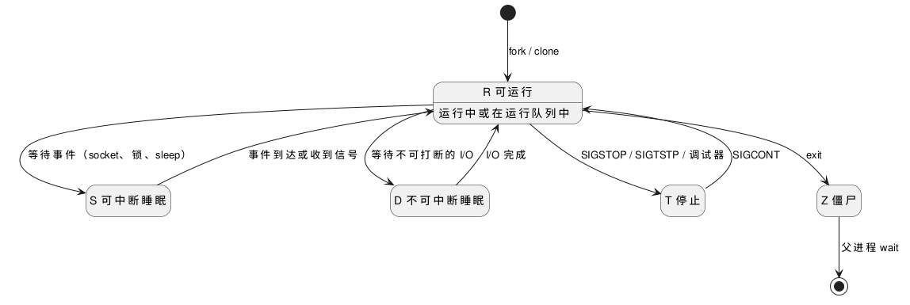

:PROPERTIES:
:ID:       925ecbf4-455e-437d-a1bb-432542685263
:ROAM_ALIASES: "Linux 进程状态"
:VERIFIED_WITH: Linux 6.5, procps-ng ps (2026-10-26)
:END:
#+title: Linux Process States
#+filetags: :Linux:

* 状态模型
教科书模型有就绪（Ready）、运行（Running）、阻塞（Blocked）三个核心状态，Linux 的对应关系：
- 就绪和运行都记作 =R= ：任务在 CPU 的运行队列里，正在跑或等着跑。
- 阻塞分成可被信号唤醒的 =S= 和不可被唤醒的 =D= 。
- 教科书中把整个进程换出到磁盘的挂起状态（Ready / Blocked Suspended）在 Linux 中不存在：Linux 按页换出（swap），进程状态不变。

状态属于每个任务，同一进程的各线程可以处在不同状态。

#+begin_src plantuml :file images/linux_process_states.png
@startuml
hide empty description
state "R 可运行" as R : 运行中或在运行队列中
state "S 可中断睡眠" as S
state "D 不可中断睡眠" as D
state "T 停止" as T
state "Z 僵尸" as Z
[*] --> R : fork / clone
R --> S : 等待事件（socket、锁、sleep）
S --> R : 事件到达或收到信号
R --> D : 等待不可打断的 I/O
D --> R : I/O 完成
R --> T : SIGSTOP / SIGTSTP / 调试器
T --> R : SIGCONT
R --> Z : exit
Z --> [*] : 父进程 wait
@enduml
#+end_src

#+RESULTS:

* 状态码
~ps~ 的 =STAT= 列、 ~top~ 的 =S= 列的首字母：

| 码 | 含义 | 排障时意味着什么 |
|---|---|---|
| =R= | 运行或可运行 | 持续多于 CPU 核数 → CPU 饱和 |
| =S= | 可中断睡眠，等待事件 | 大多数进程的常态 |
| =D= | 不可中断睡眠，通常在等磁盘、NFS 等 I/O；信号（含 ~SIGKILL~ ）不能唤醒 | 长时间或大量出现 → I/O 慢或设备出问题 |
| =I= | 空闲的内核线程 | 忽略 |
| =T= / =t= | 被作业控制信号停止 / 被调试器跟踪时停止 | 被 ~Ctrl-Z~ 或 gdb 停住了 |
| =Z= | 僵尸：已退出，父进程未回收 | 父进程有 bug，见 [[id:6f1e5033-7e68-4eb1-a7d7-d5fd9db8b863][Linux Process Lifecycle]] |
| =X= | 已死亡 | 看不到 |

首字母后的修饰符可随时查 ~man ps~ ，常见的有 =N= （低优先级）、 =<= （高优先级）、 =s= （会话首进程）、 =l= （多线程）、 =+= （前台进程组）。

* D 状态与平均负载
- Linux 的平均负载（load average）是 =R= 和 =D= 任务数的指数移动平均，不只是 CPU 上的任务。负载高而 CPU 使用率不高时，先找 =D= 状态的进程和 iowait。 =I= 状态特意从 =D= 中区分出来，就是为了不让空闲内核线程抬高负载。
- =D= 进程 ~kill -9~ 也杀不掉，信号要等它醒来才处理；卡死的 NFS 挂载和故障磁盘常导致这种情况。内核的可被杀睡眠（ ~TASK_KILLABLE~ ）也显示为 =D= ，但会响应 ~SIGKILL~ 。
