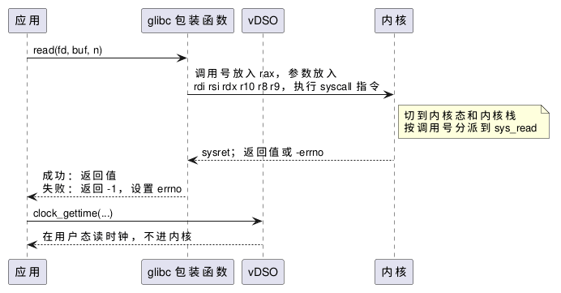

:PROPERTIES:
:ID:       b740640d-e1b6-4d3e-a151-44653e269df7
:ROAM_ALIASES: "Linux 系统调用"
:VERIFIED_WITH: Linux 6.5, glibc 2.44, GCC 16.2.1 (2026-10-26)
:END:
#+title: Linux System Calls
#+filetags: :Linux:SystemCall:

* 一次系统调用的路径
系统调用（system call）是用户程序请求内核服务的唯一入口：文件、网络、进程、内存都要经过它。x86-64 上：

#+begin_src plantuml :file images/linux_system_call_path.png
@startuml
participant "应用" as App
participant "glibc 包装函数" as Libc
participant "vDSO" as V
participant "内核" as K
App -> Libc : read(fd, buf, n)
Libc -> K : 调用号放入 rax，参数放入\nrdi rsi rdx r10 r8 r9，执行 syscall 指令
note right of K : 切到内核态和内核栈\n按调用号分派到 sys_read
K --> Libc : sysret；返回值或 -errno
Libc --> App : 成功：返回值\n失败：返回 -1，设置 errno
App -> V : clock_gettime(...)
V --> App : 在用户态读时钟，不进内核
@enduml
#+end_src

#+RESULTS:

- 整个过程是同一个任务从用户态进入内核态再返回，属于特权模式切换，不是上下文切换。调用阻塞（等 I/O、等锁）时任务才会睡眠，发生真正的切换。
- 不是所有系统调用都有 glibc 包装函数（例如 ~gettid~ 到 glibc 2.30 才有）。没有时用 ~syscall(SYS_xxx, ...)~ 直接调用。

* 返回值与 errno
- 内核返回负的错误码；glibc 包装函数把它转换为返回 -1 并设置 ~errno~ 。 ~errno~ 是线程局部的，只在调用失败后读取才有意义，成功的调用不保证清零它。
- ~EINTR~ ：阻塞中的调用被信号处理函数打断，返回 -1。用 ~SA_RESTART~ 安装处理函数时，部分调用会自动重启，其余仍要自己重试。
- 部分完成： ~read~ / ~write~ 可能只处理了请求字节数的一部分（socket、管道、被信号打断），调用方要循环直到处理完。

** 误解：系统调用都是原子的
旧笔记写过「All system calls are executed atomically」，不对：阻塞的调用会睡眠、可以被信号打断， ~read~ / ~write~ 可以只完成一部分。内核只对特定操作保证原子性，例如 ~open~ 带 ~O_CREAT | O_EXCL~ 时的「检查并创建」、 ~O_APPEND~ 写入时的「定位到末尾并写入」、不超过 ~PIPE_BUF~ 字节的管道写入。

* 开销
本机（i5-1155G7，Linux 6.5，CPU 不受 Meltdown 影响、未启用 KPTI）每次调用实测：

| 调用 | 耗时 |
|---|---|
| ~syscall(SYS_getppid)~ ，几乎不做事的系统调用 | 约 94 ns |
| ~clock_gettime(CLOCK_MONOTONIC)~ ，经 vDSO | 约 19 ns |
| 同上，用 ~syscall(SYS_clock_gettime, ...)~ 强制进内核 | 约 137 ns |

- 一次进出内核的直接代价约百纳秒，需要 KPTI 等漏洞缓解措施的 CPU 上更高；进内核还会挤掉一部分缓存和 TLB，这部分间接代价算在之后的用户态代码上。
- *vDSO* ：内核映射进每个进程的一小段代码， ~clock_gettime~ 、 ~gettimeofday~ 、 ~time~ 、 ~getcpu~ 在用户态直接完成。前提是时钟源支持在用户态读取，一般是 =tsc= ；有些虚拟机的时钟源不是 =tsc= ，这些调用会退回真正的系统调用，打时间戳的代价变成几倍。查看 =/sys/devices/system/clocksource/clocksource0/current_clocksource= （本机为 =tsc= ）。

** 减少系统调用
| 手段 | 做法 |
|---|---|
| 批量 | ~readv~ / ~writev~ 、 ~sendmmsg~ / ~recvmmsg~ 一次处理多个缓冲区或报文 |
| 事件通知 | ~epoll~ 一次等待多个 fd，而不是逐个轮询，见 [[id:6a9a7f5c-361c-42f1-a284-d8f16d992040][Linux I/O Models and Multiplexing]] |
| 共享环 | io_uring 用与内核共享的提交 / 完成队列，多个请求一次进内核，甚至不进内核 |
| 内核旁路 | 用户态直接操作网卡，热路径上没有系统调用 |

观察进程做了哪些系统调用： ~strace -f -c <cmd>~ 统计次数和耗时。strace 基于 ptrace，会让被跟踪进程慢很多倍，不要长时间挂在延迟敏感的生产进程上。

* glibc
glibc（GNU C Library）是大多数 Linux 发行版的标准 C 库（Standard C Library），包括：
- C 标准库和 POSIX 函数，以及系统调用的包装函数；
- 动态链接器 =ld-linux-x86-64.so.2= ；
- ~malloc~ （ptmalloc）：在 ~brk~ / ~mmap~ 申请来的内存上做用户态分配，多数 ~malloc~ 调用不进内核；
- pthreads：glibc 2.34 起并入 =libc.so.6= ，不再需要单独链接 =libpthread= 。

版本： ~ldd --version~ ，或直接运行 =libc.so.6= （路径因发行版而异：Debian 系为 =/lib/x86_64-linux-gnu/libc.so.6= ，Arch 为 =/usr/lib/libc.so.6= ）。

兼容方向：在旧 glibc 上编译的程序可以在新 glibc 上运行，反之不行，因为程序会引用编译时 glibc 的符号版本（如 ~GLIBC_2.34~ ）。发布二进制文件时，在要支持的最老系统（或其 glibc 版本的容器）中构建。
