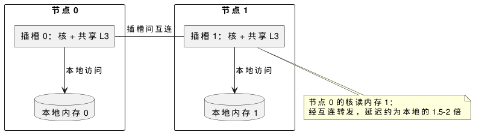

:PROPERTIES:
:ID:       29001a4b-0d21-4602-b9b5-535c0f8ee122
:ROAM_ALIASES: "NUMA 内存架构"
:VERIFIED_WITH: Linux 6.5, numactl 2.0.19 (2026-10-27)
:END:
#+title: NUMA Memory Architecture
#+filetags: :Linux:Hardware:

* 节点与远程访问
非一致内存访问（Non-Uniform Memory Access，NUMA）：每个 CPU 插槽有自己的内存控制器和内存条，一个插槽的核和它直连的内存组成一个节点（node）。访问其他节点的内存要经过插槽间互连（Intel UPI、AMD Infinity Fabric），延迟大约是本地的 1.5–2 倍，带宽也更低。

#+begin_src plantuml :file images/numa_two_sockets.png
@startuml
rectangle "节点 0" {
  rectangle "插槽 0：核 + 共享 L3" as s0
  database "本地内存 0" as m0
}
rectangle "节点 1" {
  rectangle "插槽 1：核 + 共享 L3" as s1
  database "本地内存 1" as m1
}
s0 -down-> m0 : 本地访问
s1 -down-> m1 : 本地访问
s0 -right- s1 : 插槽间互连
note bottom of s1
  节点 0 的核读内存 1：
  经互连转发，延迟约为本地的 1.5–2 倍
end note
@enduml
#+end_src

#+RESULTS:

- 单插槽也可能分成多个节点（AMD EPYC 的 NPS 设置、Intel 的 Sub-NUMA Clustering）；普通台式机、笔记本只有一个节点，本机即如此。
- 查看： ~numactl --hardware~ 列出每个节点的 CPU、内存和节点距离（node distances，以 10 表示本地的相对值，远程常见 20 或 21）； ~lscpu~ 的 =NUMA node(s)= 。
- 每个节点的物理内存再分为若干 zone，各有自己的回收水位线，见 [[id:b879e051-9bf6-48d5-a135-0da0ee8ee2d4][Linux Memory Zones and Watermarks]]。

* 内存落在哪个节点
- 默认策略是 *首次触碰（first-touch）* ：物理页在第一次写入、触发缺页时，分配在当时运行的 CPU 所在的节点上，而不是调用 ~malloc~ 的地方，也不是后来最常访问它的地方。
- 坑：主线程把一个大数组整个初始化（ ~memset~ 、填初值），再分给各节点上的工作线程处理。所有页都落在主线程所在的节点，另一个节点上的线程全是远程访问，带宽还挤在一个内存控制器上。对策是让每个工作线程初始化自己要处理的那一段。
- 线程迁移到另一个节点后，它之前分配的内存不会跟着走：这是绑核时要把线程留在内存所在节点的原因。

| 策略 | 设置 | 适用 |
|---|---|---|
| 本地优先（默认） | | 线程固定在一个节点上运行 |
| 绑定 | ~numactl --membind=N~ ， ~mbind~ / ~set_mempolicy~ 的 ~MPOL_BIND~ | 低延迟进程；节点内存不足时宁可回收或 OOM，也不分配到远程 |
| 优先 | ~numactl --preferred=N~ | 想要本地，但允许溢出到其他节点 |
| 交错 | ~numactl --interleave=all~ | 被所有节点的线程共同访问的大块数据（数据库缓冲池、共享哈希表），用平均延迟换总带宽 |

- 运行在指定节点上： ~numactl --cpunodebind=N --membind=N ./app~ 。检查结果： ~numastat -p <pid>~ 给出进程在各节点上的内存；系统级 ~numastat~ 的 =numa_miss= 、 =other_node= 计数增长说明在发生远程分配或访问（本机单节点，两者为 0）。

* 自动 NUMA 平衡
- 内核的自动 NUMA 平衡（ ~kernel.numa_balancing~ ）周期性地解除进程部分页的映射，靠由此产生的提示缺页（NUMA hinting fault）统计哪个节点在访问这些页，再把页迁移到访问者所在的节点，或把任务迁到内存所在的节点。多节点机器上多数发行版默认开启；单节点机器上内核自动关闭（本机为 0）。
- 判断：对不绑核的普通服务，它能自动改善局部性；对低延迟进程，提示缺页和页迁移都是不可预测的停顿。已经显式绑定 CPU 和内存时，关闭它（ ~sysctl kernel.numa_balancing=0~ ）。
- 节点内存不足时先回收本地还是去别的节点分配，由 ~vm.zone_reclaim_mode~ 决定，见上面的 zone 链接。

* 低延迟系统中的布局
关键线程、它的内存、它用的网卡要在同一个节点上：
- 网卡挂在某个插槽的 PCIe 上，查 =/sys/class/net/<ifname>/device/numa_node= 。网卡 DMA 写入的接收缓冲区、处理这个队列的中断和轮询线程都应在这个节点上，否则每个包都要跨插槽。
- 绑核、核隔离和中断亲和性的做法见 [[id:d525dfda-0943-4e82-b4a8-cad648ad48b5][Linux CPU Scheduling and Affinity]]。
