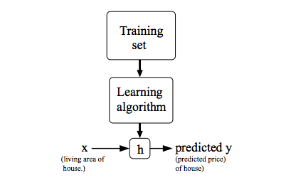

:PROPERTIES:
:ID:       79bd8eb3-154b-470d-bbcb-ff6ae9c507db
:END:
#+title: Supervised Learning
#+filetags: ML

* TOC :TOC_2:
- [[#overview][Overview]]
- [[#data-requirements][Data Requirements]]
- [[#regression][Regression]]
  - [[#algorithms][Algorithms]]
  - [[#performance-evaluation][Performance Evaluation]]
- [[#classification][Classification]]
  - [[#binary-classification][Binary Classification]]
  - [[#multi-class-classification][Multi-class Classification]]
  - [[#multi-label-classification][Multi-label Classification]]
  - [[#algorithms][Algorithms]]
  - [[#performance-evaluation][Performance Evaluation]]
- [[#examples][Examples]]
- [[#choosing-a-model][Choosing a Model]]

* Overview
In supervised learning, we are given a data set and already *know what our correct output should look like*,
having the idea that there is a *relationship* between the input and the output.

* Data Requirements
- No missing values
- Data in numeric format
- Perform [[id:d31a2f5c-51c6-4742-8248-8d3c8904011a][Exploratory Data Analysis]] first

* Regression
:PROPERTIES:
:ID:       e4e7e012-6d8d-472d-ba81-147b35bf1740
:END:
Predict a *continuous* output.
** Algorithms
- [[id:b6f03e6b-8850-4f2d-8d2d-f337029fe1e7][Linear Regression]]
- [[id:10b0fc16-06fe-4725-ac6a-738f6842ce84][Polynomial Regression]]
- [[id:4e603b85-7e9e-47ca-b3f4-b7747cd6019a][K-Neighbors Regression]]
** Performance Evaluation
- [[id:04e7b7cf-d5d3-4e31-b06b-ba66204c56d8][R-squared]]
- Score with [[id:5461b659-bc1a-4594-b7fb-8388345187d3][Cross-validation]] so the result does not depend on one train/test split.

* Classification
:PROPERTIES:
:ID:       009a561d-de32-408a-a5ec-a75839547797
:END:
Predict a *discrete* output.
** [[id:264851aa-8984-4615-8d8f-e243a43b74a0][Binary Classification]]
** [[id:91264f10-9a71-4d15-9b63-09c2a6566d75][Multi-class Classification]]
** [[id:a3f7682e-3cde-4879-b314-f6220f8cc3c7][Multi-label Classification]]
** Algorithms
- [[id:9db494ed-d782-4bfe-b9d2-52c768251490][Logistic Regression]]
- [[id:a3762245-595d-4b5e-b317-4eafd2a45c7f][Softmax Regression]]
- [[id:4dec577e-c1d9-4b01-9a95-63e3413b42a9][K-Nearest Neighbors]]
- [[id:31b71a06-0592-444b-b410-916ee717b488][Neural Network]]

** Performance Evaluation
- [[id:91a5b0fd-48cd-47aa-8fff-cb9cb0fd520c][Classification Metrics]]

* Examples
- Regression Problem: Given data about the size of houses on the real estate market, try to predict their price.
- Classification Problem: Given a patient with a tumor, we have to predict whether the tumor is malignant or benign.

* Choosing a Model
- Trade-offs between candidate models: [[id:5456bf47-a5cd-4413-86ac-09408f009fe0][Evaluating Multiple Models]]
