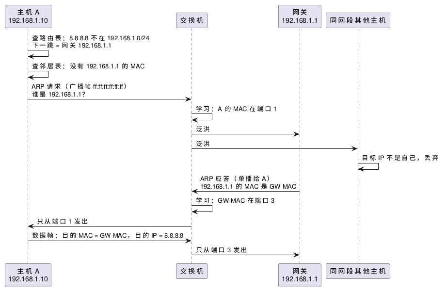

:PROPERTIES:
:ID:       5dd548b6-be23-4868-b45b-0737c1d87509
:ROAM_ALIASES: "交换机、ARP 与 VLAN"
:VERIFIED_WITH: iproute2 7.2.0 (2026-10-27)
:END:
#+title: Ethernet Switching, ARP and VLAN
#+filetags: :Network:

* TOC :TOC_1:
- [[#intuition][Intuition]]
- [[#访问其他网段arp-查的是网关][访问其他网段：ARP 查的是网关]]
- [[#邻居表][邻居表]]
- [[#pitfalls][Pitfalls]]
- [[#vlan][VLAN]]
- [[#二层交换机三层交换机与路由器][二层交换机、三层交换机与路由器]]
- [[#misconceptions][Misconceptions]]

* Intuition
同一网段（同一个广播域）内，帧按 MAC 地址投递。发包前要回答两个问题：

1. *下一跳是谁* ：由 IP 层查路由表决定。目的地址在本网段时，下一跳就是目的主机；否则是网关（default gateway）。
2. *下一跳的 MAC 是多少* ：由 ARP（Address Resolution Protocol）回答，结果缓存在邻居表里。

交换机只看帧头的 MAC，不看 IP。它从每个进来的帧学习「源 MAC ↔ 端口」，目的 MAC 已学到就只从那个端口发出，没学到或是广播地址就从其他所有端口发出（泛洪，flooding）。

各层的数据单位与封装见 [[id:72d3cced-60c4-4109-bc8c-a4ccbec10039][Network Layers and Data Units]]。

* 访问其他网段：ARP 查的是网关
主机 A（192.168.1.10/24）访问 8.8.8.8，网关是 192.168.1.1：

#+begin_src plantuml :file images/arp_via_gateway.png
@startuml
participant "主机 A\n192.168.1.10" as A
participant "交换机" as SW
participant "网关\n192.168.1.1" as GW
participant "同网段其他主机" as C
A -> A : 查路由表：8.8.8.8 不在 192.168.1.0/24\n下一跳 = 网关 192.168.1.1
A -> A : 查邻居表：没有 192.168.1.1 的 MAC
A -> SW : ARP 请求（广播帧 ff:ff:ff:ff:ff:ff）\n谁是 192.168.1.1？
SW -> SW : 学习：A 的 MAC 在端口 1
SW -> GW : 泛洪
SW -> C : 泛洪
C -> C : 目标 IP 不是自己，丢弃
GW -> SW : ARP 应答（单播给 A）\n192.168.1.1 的 MAC 是 GW-MAC
SW -> SW : 学习：GW-MAC 在端口 3
SW -> A : 只从端口 1 发出
A -> SW : 数据帧：目的 MAC = GW-MAC，目的 IP = 8.8.8.8
SW -> GW : 只从端口 3 发出
@enduml
#+end_src

#+RESULTS:

- 每经过一个路由器，帧头的 MAC 换成这一跳的，IP 头的源、目的地址不变（经过 NAT 时例外，见 [[id:42efb840-bcf5-418a-a608-ccaea803b08c][NAT and DHCP in Home Networks]]）。
- 收到 ARP 请求的主机也会顺便记下请求方的 IP 与 MAC，所以应答之后双方都有对方的缓存。
- ARP 只在一个广播域内有效，不跨路由器。IPv6 用 NDP（Neighbor Discovery，基于 ICMPv6）做同样的事。

* 邻居表
Linux 把 ARP / NDP 缓存叫邻居表（neighbor table），用 ~ip neigh~ 查看。表项状态：

| 状态 | 含义 |
|---|---|
| =REACHABLE= | 最近确认过可达，直接使用 |
| =STALE= | 超过可达时间未确认；仍照常使用，下次发包时触发确认 |
| =DELAY= / =PROBE= | 已向 =STALE= 的邻居发包，正在等上层确认或发单播 ARP 探测 |
| =FAILED= | 探测无应答，发往它的包会被丢弃 |
| =PERMANENT= | 手动添加的静态表项（ ~ip neigh add ... nud permanent~ ），不过期 |

Linux 相关选项（ =net.ipv4.neigh.<接口|default>.*= ）：

| 选项 | 上游默认 | 作用 |
|---|---|---|
| ~base_reachable_time_ms~ | 30000 | =REACHABLE= 的基准时长，实际取其 0.5–1.5 倍的随机值 |
| ~gc_stale_time~ | 60 秒 | =STALE= 表项多久后可被回收 |
| ~gc_thresh1~ / ~gc_thresh2~ / ~gc_thresh3~ | 128 / 512 / 1024 | 表项少于 thresh1 不回收；超过 thresh2 积极回收；thresh3 是硬上限 |

* Pitfalls
- *大二层网络的邻居表溢出* ：一台主机与上千个同网段地址通信（大型扁平网络、容器或 Kubernetes 节点）时超过 ~gc_thresh3~ ，内核日志出现 =neighbour table overflow= ，新邻居解析失败、连接随机超时。调大三个阈值。
- *ARP 没有认证* ：任何主机都可以应答或主动广播「某 IP 的 MAC 是我」（免费 ARP，gratuitous ARP），这就是 ARP 欺骗和中间人攻击的基础。免费 ARP 也有正当用途：主备切换时新主机广播虚拟 IP 的新 MAC，让邻居立即更新缓存。
- *iptables 管不到 ARP* ：ARP 直接封装在以太网帧里，不是 IP 包，iptables 的规则对它不起作用；要过滤 ARP 用 nftables 的 =arp= 族或 arptables。

* VLAN
VLAN（virtual LAN）在同一套交换机和网线上划出多个互相隔离的二层网络：
- 每个 VLAN 是独立的广播域，广播（包括 ARP、mDNS 和各种发现协议）只在本 VLAN 内泛洪。
- VLAN 之间的流量必须经过三层设备（路由器或三层交换机），所以能在那里做访问控制，ARP 欺骗、广播嗅探这类二层攻击也被限制在各自的 VLAN 内。
- 帧中插入 4 字节的 802.1Q 标签，其中 VLAN ID 12 位，可用 1–4094。
- 端口两种模式：access 口属于一个 VLAN，收发不带标签的帧，接普通终端；trunk 口承载多个 VLAN，帧带标签，连接交换机、路由器或 AP。

家庭网络里的常见用法：把 IoT 设备、访客网络划进单独的 VLAN，只放行到互联网，不能访问主网段。在 OpenWRT 中是 bridge VLAN filtering（DSA 驱动的设备）里为各端口设置 tagged / untagged，再为每个 VLAN 建接口和防火墙区域。

* 二层交换机、三层交换机与路由器
| | 二层交换机 | 三层交换机 | 路由器 |
|---|---|---|---|
| 转发依据 | MAC | MAC 和 IP | IP |
| VLAN 间通信 | 不能 | 能，在硬件中转发 | 能 |
| 典型位置 | 接入终端 | 园区网内部，VLAN 多、流量大 | 网络边界，连接 WAN |
| NAT、拨号、复杂策略 | 无 | 一般没有或很有限 | 有 |

三层交换机解决的是「VLAN 很多时，路由器做 VLAN 间转发端口少、速度慢」：它在交换芯片中完成 VLAN 间的路由，接口和吞吐与交换机相当；连接外网、NAT 和防火墙仍交给路由器。

* Misconceptions
** 三层交换机带有 NAT、QoS 等路由器功能，只是没有 WAN 口？
原来以为：三层交换机 = 二层交换机 + 部分路由器功能（NAT、QoS 等），区别只在没有 WAN 口。

实际：三层交换机多出来的主要是 VLAN 间路由（以及 ACL、QoS 这类在交换芯片中能做的功能）。NAT 需要维护每条连接的转换状态，通常由路由器或防火墙承担，一般的三层交换机不做。没有 WAN 口是这个定位的结果，不是区别本身。
