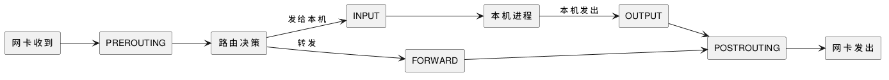

:PROPERTIES:
:ID:       cee785fb-8f4b-4230-ad02-312714729965
:ROAM_ALIASES: "Linux 防火墙：iptables 与 nftables"
:VERIFIED_WITH: iptables 1.8.13 (nf_tables), nftables 1.1.7 (2026-10-27)
:END:
#+title: Linux Netfilter, iptables and nftables
#+filetags: :Network:Linux:

* TOC :TOC_1:
- [[#netfilter-与五个-hook][Netfilter 与五个 hook]]
- [[#表链与规则顺序][表、链与规则顺序]]
- [[#drop-与-reject][DROP 与 REJECT]]
- [[#nftables][nftables]]
- [[#ufw][ufw]]
- [[#pitfalls][Pitfalls]]
- [[#capability-map][Capability Map]]

* Netfilter 与五个 hook
Netfilter 是内核协议栈上的一组 hook。iptables、nftables、ufw、firewalld、Docker 的端口映射都只是往这些 hook 上挂规则的不同前端。包按方向经过的 hook：

#+begin_src plantuml :file images/linux_netfilter_hooks.png
@startuml
left to right direction
agent "网卡收到" as IN
agent "PREROUTING" as PRE
agent "路由决策" as R
agent "INPUT" as INP
agent "本机进程" as P
agent "OUTPUT" as OUT
agent "FORWARD" as FWD
agent "POSTROUTING" as POST
agent "网卡发出" as SEND
IN --> PRE
PRE --> R
R --> INP : 发给本机
INP --> P
P --> OUT : 本机发出
OUT --> POST
R --> FWD : 转发
FWD --> POST
POST --> SEND
@enduml
#+end_src

#+RESULTS:

- 发给本机的包：PREROUTING → INPUT；本机发出的包：OUTPUT → POSTROUTING；路过本机（路由器、容器网桥）的包：PREROUTING → FORWARD → POSTROUTING，不经过 INPUT。
- 这些 hook 在收发路径上的位置见 [[id:f226240d-ec04-44ce-a1bd-1394443d27be][Linux Network Stack Receive and Transmit Paths]]。

* 表、链与规则顺序
iptables 按用途把规则分成几张表，每张表在部分 hook 上有同名的内置链：

| 表 | 用途 | 内置链 |
|---|---|---|
| =filter= （默认） | 放行或丢弃 | INPUT、FORWARD、OUTPUT |
| =nat= | 改地址：DNAT（端口映射）、SNAT / MASQUERADE（共享出口） | PREROUTING、INPUT、OUTPUT、POSTROUTING |
| =mangle= | 改包头字段、给包打标记（策略路由用） | 全部五个 |
| =raw= | 在连接跟踪之前处理，例如让某些包不进连接跟踪 | PREROUTING、OUTPUT |

- 链中的规则 *自上而下* 匹配，命中 =ACCEPT= 、 =DROP= 、 =REJECT= 这类终止目标就停止；全部不命中时执行链的默认策略（ ~-P~ ）。 =LOG= 不终止，记完日志继续往下匹配。
- 连接跟踪（conntrack）给每个包标上所属连接的状态： =NEW= 、 =ESTABLISHED= 、 =RELATED= 、 =INVALID= 。默认策略为 DROP 的主机，第一条规则通常是 ~-m conntrack --ctstate ESTABLISHED,RELATED -j ACCEPT~ ，之后只为 =NEW= 连接开端口。没有这一条，本机主动发起的连接收不到回包：回包的源端口才是服务端口，目的端口是随机的。
- =nat= 表只对连接的第一个包查规则，结果记在 conntrack 中，同一连接的后续包按记录改写。所以改了 NAT 规则后，已有连接不受影响。

* DROP 与 REJECT
| | =DROP= | =REJECT= |
|---|---|---|
| 对端收到 | 什么也没有 | 默认 ICMP port unreachable；TCP 可用 ~--reject-with tcp-reset~ 回 RST |
| 客户端表现 | SYN 反复重传，直到连接超时（curl 退出码 28） | 立即失败，Connection refused（curl 退出码 7，两种回法相同） |
| 适合 | 面向公网，不暴露端口的存在 | 内网和本机，让客户端快速失败、便于排查 |

SYN 重传和 RST 的含义见 [[id:1ece815b-5c13-4d67-b816-b2ff98f34696][TCP Connection Management]]。

* nftables
nftables 是 iptables 的继任者，挂在同一组 Netfilter hook 上，但模型不同：

| | iptables | nftables |
|---|---|---|
| 表和链 | 内置 =filter= 、 =nat= 等表和同名链 | 没有预置，自己建表，再建挂到 hook 上的 base chain |
| 地址族 | iptables / ip6tables 分开两套 | 一张 =inet= 族的表同时管 IPv4 和 IPv6 |
| 链的类型和顺序 | 由表决定 | 建 base chain 时写明 ~type filter hook input priority 0~ ，同一 hook 上的多条链按 priority 从小到大执行 |
| 多个地址或端口 | 一条规则一个，或借助 ipset | 规则内直接写集合 ~tcp dport { 22, 80, 443 }~ ，也有命名集合和映射 |
| 加载 | 逐条命令修改 | ~nft -f 文件~ 整体原子替换规则集 |

最小的单机配置：

#+begin_src sh
nft add table inet filter
nft add chain inet filter input '{ type filter hook input priority 0; policy drop; }'
nft add rule inet filter input ct state established,related accept
nft add rule inet filter input iif lo accept
nft add rule inet filter input tcp dport 22 accept
#+end_src

在 shell 中写链定义要加引号，否则 ~{~ 、 ~;~ 会被 shell 解释。 ~nft -a list ruleset~ 显示每条规则的 handle，删除、插入都按 handle 定位。

** 多个 base chain 时 accept 不是最终结果
同一 hook 上有多条 base chain（自己的表、Docker、firewalld、ufw 各建一套）时，包要依次经过每一条：某条链里的 =accept= 只结束这一条链，后面 priority 更大的链仍会处理它；任何一条链 =drop= 都是最终结果。所以「我这张表里已经放行了」不代表包能到达。本机核对：两张 =inet= 表的 input 链（priority 0 放行 ping，priority 10 丢弃 ping），ping 127.0.0.1 失败，第二条链的计数器为 1。

* ufw
ufw（Uncomplicated Firewall）是 Ubuntu、Debian 上的前端，把 ~ufw allow 22/tcp~ 这类命令翻译成 iptables 规则（底层仍可能是 nft）。常用的只有几条：

#+begin_src sh
ufw default deny incoming
ufw default allow outgoing
ufw allow 22/tcp
ufw enable
ufw status numbered
#+end_src

- 远程启用前先放行 SSH，否则 ~ufw enable~ 之后连接立即断开。
- 与 Docker 一起用时，发布的容器端口不受 ufw 限制，原因见下文 Pitfalls。

* Pitfalls
- *规则加在兜底规则之后* ：链末已有 ~-j DROP~ 时，再 ~-A~ 追加的放行规则永远不会被匹配。用 ~-I INPUT <位置>~ 插入，先 ~iptables -L INPUT -n --line-numbers~ 看位置。
- ~-F~ *不重置默认策略* ：它只清空（默认 filter 表）各链中的规则，不删表、链，也不改 ~-P~ 。策略是 DROP 时远程执行 ~iptables -F~ ，SSH 立刻断开。清空前先 ~iptables -P INPUT ACCEPT~ 。
- *规则不持久* ：规则只在内核内存里，重启即丢。用 ~iptables-save > 文件~ / ~iptables-restore < 文件~ ；开机加载由发行版的服务负责（Arch 的 =iptables.service= 读 =/etc/iptables/iptables.rules= ，Debian 用 netfilter-persistent）。
- *Docker 绕过 INPUT* ：发布的端口（ ~-p 8080:80~ ）在 =nat= 的 PREROUTING 做 DNAT 转给容器，包走 FORWARD，不经过 INPUT，所以 INPUT 上的规则和 ufw 都挡不住。要限制访问，把规则写进 Docker 留给用户的 =DOCKER-USER= 链。
- *两套后端* ：现在的发行版中 ~iptables~ 多是 iptables-nft，把规则翻译成 nftables 写进内核； ~iptables -V~ 的括号中显示 ~nf_tables~ 或 =legacy= 。legacy 和 nft 两套规则可以同时生效，但各自的命令只列出自己那一套，排查时用 ~nft list ruleset~ 看 nft 这边的全貌。
- ~iptables -L~ 不加 ~-n~ 会对每个地址做反向 DNS 解析，规则多或 DNS 不通时很慢。

* Capability Map
| 需要 | 用什么 |
|---|---|
| 看当前规则 | ~iptables -S~ （命令形式）、 ~iptables -L -n -v --line-numbers~ （带命中计数）、 ~iptables -t nat -S~ |
| 删一条规则 | ~iptables -D INPUT <行号>~ |
| 把 iptables 命令改写成 nft 语法 | ~iptables-translate~ ，如 ~-A INPUT -p tcp --dport 22 -j ACCEPT~ → ~add rule ip filter INPUT tcp dport 22 counter accept~ |
| 新写防火墙 | nftables，见 [[*nftables][nftables]] |
| 简单的单机防火墙 | ufw（Ubuntu、Debian）、firewalld（Fedora、RHEL，按「区域」组织），都是生成底层规则的前端 |
| 过滤 ARP 或网桥上的二层流量 | nftables 的 =arp= 、 =bridge= 族 |
