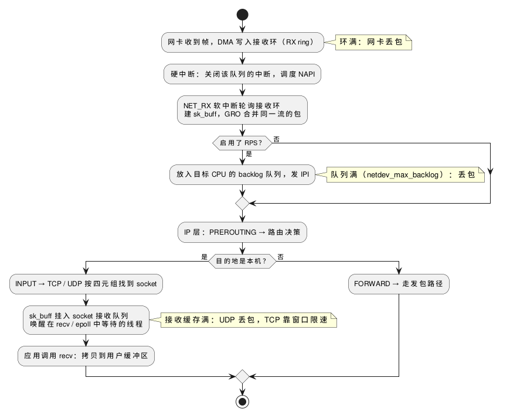
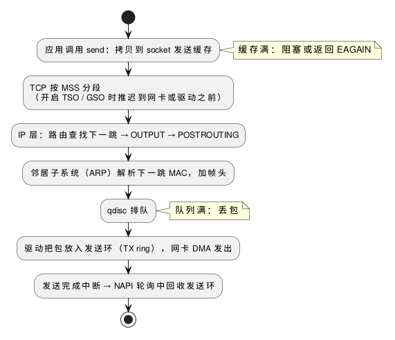

:PROPERTIES:
:ID:       f226240d-ec04-44ce-a1bd-1394443d27be
:ROAM_ALIASES: "Linux 网络协议栈收发路径"
:VERIFIED_WITH: Linux kernel docs and net/core/hotdata.c (master, 2026-10-27)
:END:
#+title: Linux Network Stack Receive and Transmit Paths
#+filetags: :Network:Linux:

* TOC :TOC_1:
- [[#收包路径][收包路径]]
- [[#发包路径][发包路径]]
- [[#包在哪里排队在哪里丢][包在哪里排队、在哪里丢]]
- [[#多核扩展rssrpsrfsxps][多核扩展：RSS、RPS、RFS、XPS]]
- [[#延迟相关的可调项][延迟相关的可调项]]
- [[#内核路径与内核旁路][内核路径与内核旁路]]
- [[#misconceptions][Misconceptions]]

* 收包路径
#+begin_src plantuml :file images/linux_network_receive_path.png
@startuml
start
:网卡收到帧，DMA 写入接收环（RX ring）;
note right: 环满：网卡丢包
:硬中断：关闭该队列的中断，调度 NAPI;
:NET_RX 软中断轮询接收环
建 sk_buff，GRO 合并同一流的包;
if (启用了 RPS？) then (是)
  :放入目标 CPU 的 backlog 队列，发 IPI;
  note right: 队列满（netdev_max_backlog）：丢包
else (否)
endif
:IP 层：PREROUTING → 路由决策;
if (目的地是本机？) then (是)
  :INPUT → TCP / UDP 按四元组找到 socket;
  :sk_buff 挂入 socket 接收队列
  唤醒在 recv / epoll 中等待的线程;
  note right: 接收缓存满：UDP 丢包，TCP 靠窗口限速
  :应用调用 recv：拷贝到用户缓冲区;
else (否)
  :FORWARD → 走发包路径;
endif
stop
@enduml
#+end_src

#+RESULTS:

- 硬中断只做最少的事，建 ~sk_buff~ 、GRO 和整个协议栈都在 ~NET_RX~ 软中断里做；软中断在哪个 CPU、什么时候交给 =ksoftirqd= ，见 [[id:18ebf2c0-c945-4bbc-ad58-9477849c7bbb][Linux Interrupts and Softirqs]]。
- PREROUTING、INPUT、FORWARD 是 netfilter 的 hook，防火墙和 NAT 规则在这些位置执行。
- 协议栈到 socket 为止都不拷贝数据，只传递 ~sk_buff~ 指针；唯一一次 CPU 拷贝发生在 ~recv~ ，网卡写内存是 DMA。

* 发包路径
#+begin_src plantuml :file images/linux_network_transmit_path.png
@startuml
start
:应用调用 send：拷贝到 socket 发送缓存;
note right: 缓存满：阻塞或返回 EAGAIN
:TCP 按 MSS 分段
（开启 TSO / GSO 时推迟到网卡或驱动之前）;
:IP 层：路由查找下一跳 → OUTPUT → POSTROUTING;
:邻居子系统（ARP）解析下一跳 MAC，加帧头;
:qdisc 排队;
note right: 队列满：丢包
:驱动把包放入发送环（TX ring），网卡 DMA 发出;
:发送完成中断 → NAPI 轮询中回收发送环;
stop
@enduml
#+end_src

#+RESULTS:

- 发包通常在调用 ~send~ 的线程上下文中一路执行到驱动；TCP 也可能在收到 ACK、窗口打开时由软中断继续发。qdisc 暂时发不出时才交给 ~NET_TX~ 软中断。
- ~send~ 返回只表示数据进了本机的发送缓存。TCP 数据留在发送缓存里直到被 ACK，以便重传；对方收没收到要靠应用层确认。
- 分段由 TCP 按 MSS 完成，IP 层通常不分片，见 [[id:72d3cced-60c4-4109-bc8c-a4ccbec10039][Network Layers and Data Units]]。

* 包在哪里排队、在哪里丢
丢包和延迟都发生在队列上。排查时沿路径逐个看计数器：

| 队列 | 满了会怎样 | 看哪里 | 调整 |
|---|---|---|---|
| 网卡接收环 | 网卡丢包 | ~ip -s link~ 的 =missed= ； ~ethtool -S <dev>~ 中名字含 =missed= 、 ~no_buffer~ 的计数（随驱动） | ~ethtool -G~ 加大环 |
| 软中断预算 | 本轮处理不完，剩余交给 =ksoftirqd= ，延迟增加 | ~/proc/net/softnet_stat~ 第 3 列（ ~time_squeeze~ ，每 CPU 一行，十六进制） | ~net.core.netdev_budget~ 、 ~netdev_budget_usecs~ |
| backlog 队列（RPS 和非 NAPI 驱动） | 丢包 | ~softnet_stat~ 第 2 列 | ~net.core.netdev_max_backlog~ |
| socket 接收缓存 | UDP 直接丢；TCP 用接收窗口让对端减速，超出仍丢 | ~nstat -az~ 的 =UdpRcvbufErrors= 、 =TcpExtTCPRcvQDrop= ； ~ss -m~ | ~SO_RCVBUF~ 、 ~net.core.rmem_max~ 、 ~tcp_rmem~ |
| socket 发送缓存 | ~send~ 阻塞或返回 ~EAGAIN~ ，不丢包 | ~ss -tm~ 、 =Send-Q= | ~SO_SNDBUF~ 、 ~tcp_wmem~ |
| qdisc | 丢包 | ~tc -s qdisc~ 的 =dropped= | ~ip link set <dev> txqueuelen N~ 、换 qdisc |

TCP 缓存的自动调优、为什么手动设缓存反而变慢，见 [[id:d43414ac-35ca-4f1d-a603-8026943a9801][TCP Reliable Delivery and Flow Control]]。

* 多核扩展：RSS、RPS、RFS、XPS
单个接收队列意味着所有收包软中断压在一个核上（ =/proc/softirqs= 的 ~NET_RX~ 集中在一列）。分散的办法：

| 机制 | 做什么 | 由谁实现 | 默认 |
|---|---|---|---|
| RSS（receive side scaling） | 网卡按流的哈希把包分到多个接收队列，每个队列一个中断，中断再分到不同核 | 网卡 | 多队列网卡的驱动初始化时配置；队列数用 ~ethtool -l~ / ~-L~ |
| RPS（receive packet steering） | 软件版 RSS：在软中断里把协议栈处理转给别的 CPU（入 backlog、发 IPI） | 内核 | 关（ ~rps_cpus~ 为 0） |
| RFS（receive flow steering） | 在 RPS 上再进一步：把流送到正在 ~recv~ 它的线程所在的 CPU，提高缓存命中 | 内核；aRFS 由网卡实现 | 关 |
| XPS（transmit packet steering） | 按 CPU 选择发送队列，减少队列锁争用 | 内核 | 取决于驱动 |

- 硬件队列数不少于 CPU 数、各队列中断已分到不同核时，RPS 多余；队列比 CPU 少时才考虑 RPS。
- 同一条流始终落在同一个队列和核上（哈希按四元组），所以单条大流量连接无法靠多队列分摊。
- 低延迟系统反过来要 *控制* 收包落在哪个核：把网卡队列的中断移离运行关键线程的隔离核，放到同一 NUMA 节点的另一个核上；或者用忙轮询、内核旁路让关键线程自己收包。隔离核的配置见 [[id:d525dfda-0943-4e82-b4a8-cad648ad48b5][Linux CPU Scheduling and Affinity]]。

* 延迟相关的可调项
| 可调项 | 作用 | 上游默认 | 低延迟取向 |
|---|---|---|---|
| 中断合并 ~ethtool -C <dev> rx-usecs N~ 、 ~adaptive-rx~ | 网卡攒多少微秒或多少个包再发一次中断 | 由驱动决定，很多驱动开着自适应 | 调小或关掉：每个包更快通知，CPU 开销上升 |
| ~SO_BUSY_POLL~ （socket 选项）、 ~net.core.busy_read~ （其默认值） | 阻塞读时先在设备接收队列上忙轮询这么多微秒，再睡眠 | 0（关） | 内核文档建议全局开时设 50 |
| ~net.core.busy_poll~ | ~poll~ / ~select~ / ~epoll~ 的忙轮询微秒数 | 0（关） | 几个 socket 设 50，几百个设 100 |
| ~net.core.netdev_budget~ | 一轮 ~NET_RX~ 软中断最多处理的包数 | 300 | 吞吐取向； ~time_squeeze~ 持续上涨时调大 |
| ~net.core.netdev_budget_usecs~ | 一轮软中断的时间上限 | 2 个 jiffy（HZ = 1000 时 2000 µs，HZ = 250 时 8000 µs） | 同上 |
| ~net.core.dev_weight~ | 一次 NAPI poll 从单个设备最多取的包数 | 64 | 一般不动 |
| ~net.core.netdev_max_backlog~ | 每 CPU backlog 队列长度 | 1000 | 突发时 ~softnet_stat~ 第 2 列上涨则调大 |

- 忙轮询需要内核开启 ~CONFIG_NET_RX_BUSY_POLL~ 、驱动支持 NAPI；它省掉的是「中断 → 唤醒线程」的延迟，代价是一个核空转、功耗上升。
- 默认值取自内核文档和 =net/core/hotdata.c= 。本机在非初始网络命名空间中，读不到这些全局 sysctl，未记录本机值。

* 内核路径与内核旁路
| 方式 | 中断 | 内核协议栈 | 每个包的系统调用 | 代价 |
|---|---|---|---|---|
| 普通内核路径 | 有（可合并） | 经过 | ~recv~ / ~send~ （或 ~epoll_wait~ 后再读） | 基线 |
| 内核忙轮询（ ~SO_BUSY_POLL~ ） | 轮询期间没有 | 经过 | 仍有 | 一个核空转 |
| ~AF_XDP~ | 可以没有 | 绕过：驱动层的 XDP 程序把包直接放进用户态的环 | 很少，可批量 | 应用自己处理协议；需要驱动支持 |
| DPDK | 没有 | 绕过：用户态驱动独占网卡 | 没有 | 网卡脱离内核， ~ip~ 、 ~ss~ 、 ~tcpdump~ 都看不到；需要用户态协议栈 |
| Onload / ~ef_vi~ （AMD Solarflare） | 没有 | 换成用户态 TCP / UDP 栈，保留 socket API | 没有 | 需要专用网卡 |

内核旁路省掉的是三样东西：中断和唤醒、协议栈的通用处理、用户态与内核态之间的拷贝和系统调用。普通路径上系统调用本身的开销见 [[id:b740640d-e1b6-4d3e-a151-44653e269df7][Linux System Calls]]。

* Misconceptions
** 硬中断处理程序把帧转成 ~sk_buff~ 交给协议栈？
原来以为：硬中断处理程序把网络帧转成 ~sk_buff~ ，再用软中断通知内核收到了包。

实际：NAPI 驱动的硬中断只关掉该队列的中断、调度轮询。建 ~sk_buff~ 、GRO、逐层处理全在 ~NET_RX~ 软中断的轮询里完成；轮询取空后才重新打开中断。

** 包到达 socket 时就拷贝进了接收缓存？
原来以为：传输层找到 socket 后，把数据拷贝到 socket 的接收缓存。

实际：协议栈只把 ~sk_buff~ 挂到 socket 的接收队列，接收缓存大小只是这个队列的记账上限。拷贝到用户空间发生在应用调用 ~recv~ 时；应用不读，包就一直占着内核内存。
