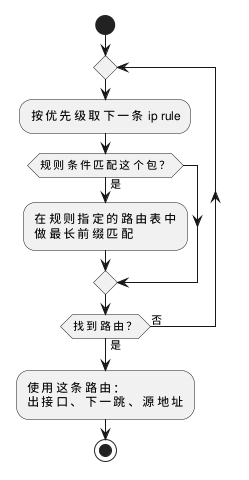

:PROPERTIES:
:ID:       e29921b0-a25c-4158-b33c-fecdb5406b51
:ROAM_ALIASES: "Linux 路由与策略路由"
:VERIFIED_WITH: iproute2 7.2.0 (2026-10-27)
:END:
#+title: Linux Routing and Policy Routing
#+filetags: :Network:Linux:

* Intuition
Linux 为每个要发出（或转发）的包回答「从哪个接口发、下一跳是谁、用哪个源地址」。查找分两级：

1. *策略规则（ ~ip rule~ ）决定查哪张路由表* ：规则按优先级从小到大逐条匹配，条件可以是源地址、入接口、fwmark 等。
2. *路由表（ ~ip route~ ）决定路径* ：在选中的表里做最长前缀匹配。表里没有匹配的路由时，回到第 1 步继续试下一条规则。

#+begin_src plantuml :file images/linux_route_lookup.png
@startuml
start
repeat
  :按优先级取下一条 ip rule;
  if (规则条件匹配这个包？) then (是)
    :在规则指定的路由表中\n做最长前缀匹配;
  endif
repeat while (找到路由？) is (否) not (是)
:使用这条路由：\n出接口、下一跳、源地址;
stop
@enduml
#+end_src

#+RESULTS:

默认只有三条规则，所以不做策略路由时只会用到 =main= 表：

#+begin_example
0:	from all lookup local
32766:	from all lookup main
32767:	from all lookup default
#+end_example

| 表 | ID | 内容 |
|---|---|---|
| =local= | 255 | 内核自动维护：本机地址和广播地址，判断「这个包是不是发给本机的」 |
| =main= | 254 | ~ip route~ 默认操作的表，DHCP、网络管理器写的路由都在这里 |
| =default= | 253 | 通常为空 |

表名与 ID 的对应在 =/etc/iproute2/rt_tables= 。

* 读路由表
用户自己路由器上的 =main= 表：

#+begin_example
default via 113.158.85.1 dev if-wan proto static
192.168.0.0/16 dev if-lan proto kernel scope link src 192.168.0.1
#+end_example

| 字段 | 含义 |
|---|---|
| =default= | 0.0.0.0/0，其他路由都不匹配时用它 |
| =via= | 下一跳网关；没有 =via= 表示目的地就在这个接口所连的网段，直接 ARP 目的地址 |
| =dev= | 出接口 |
| =proto= | 路由的来源： =kernel= （配置地址时自动生成）、 =static= （手工或配置文件）、 =dhcp= 等 |
| =scope= | 目的地有多「近」： =host= 本机、 =link= 同一链路、 =global= 需要经过网关 |
| =src= | 本机发起连接时默认使用的源地址 |

第一条：去往其他所有地址的包从 =if-wan= 发给 113.158.85.1。第二条：去往 192.168.0.0/16 的包直接从 =if-lan= 发出，源地址用 192.168.0.1。

*排查时直接问内核会怎么走* ：

#+begin_src sh
ip route get 8.8.8.8                  # 经过规则和路由表后的最终结果
ip route get 8.8.8.8 from 10.1.0.1    # 指定源地址，验证策略路由
#+end_src

本机核对（在网络命名空间中）：默认路由走 =d0= 时 ~ip route get 8.8.8.8~ 返回 =via 10.0.0.254 dev d0= ；加一条更具体的 =8.8.0.0/16 via 10.0.0.2= 后结果变为 =via 10.0.0.2= ，最长前缀优先。

* 策略路由
典型场景：两条上行线路，从第二个地址发出的流量必须走第二条线路回去（例如 VPS 有两张网卡，或路由器按设备分流）。

#+begin_src sh
ip route add default via 10.1.0.254 dev d1 table 100
ip rule add from 10.1.0.1 table 100 priority 1000
#+end_src

本机核对：之后 ~ip route get 8.8.8.8~ 仍走 =d0= ， ~ip route get 8.8.8.8 from 10.1.0.1~ 走 =d1 table 100= 。规则指向的表里没有匹配的路由时，查找回落到下一条规则：只在 table 200 中放 =8.8.8.0/24= ，访问 1.1.1.1 仍走 =main= 的默认路由。

本机 Tailscale 写入的规则是按 fwmark 分流的实例：

#+begin_example
5210:	from all fwmark 0x80000/0xff0000 lookup main
5230:	from all fwmark 0x80000/0xff0000 lookup default
5250:	from all fwmark 0x80000/0xff0000 unreachable
5270:	from all lookup 52
#+end_example

Tailscale 给自己发出的（已加密的）UDP 包打上标记 0x80000，让它们走正常路由出去；其他流量查 table 52，去往 tailnet 地址的进 =tailscale0= 隧道。没有前三条，隧道自己的包也会被路由进隧道，形成环路。

* Pitfalls
- *不持久* ： ~ip route~ 、 ~ip rule~ 只改内核当前状态，重启或网络管理器重新配置接口后丢失。持久配置写进 systemd-networkd、NetworkManager 或 OpenWRT 的 =/etc/config/network= 。
- *非对称路由被反向路径过滤丢弃* ： ~rp_filter~ 检查「如果要回复这个包的源地址，会不会从它进来的接口发出」。严格模式（1）下，包从 A 口进来、回程路由却指向 B 口，包被直接丢弃，现象是某个接口上的服务收不到连接。策略路由、多上行时常遇到。生效值取 =conf.all= 与 =conf.<接口>= 中较大者；内核上游默认 0（不检查），systemd 的 =50-default.conf= 把各接口设为 2（宽松：源地址经任意接口可达即可），本机即是如此。
- *加了规则却没有效果* ：规则指向的表里没有匹配的路由时会回落到后面的规则，看起来像规则没生效。先 ~ip route show table <表>~ 确认表里有路由，再用 ~ip route get ... from ...~ 验证。

* Capability Map
| 需要 | 用什么 |
|---|---|
| 看接口和地址 | ~ip -br -c addr~ 、 ~ip -br -c link~ （ ~-br~ 每个接口一行， ~-c~ 彩色） |
| 接口开关、改 MTU、改 MAC | ~ip link set dev <接口> up/down~ 、 ~ip link set dev <接口> mtu <n>~ 、先 down 再 ~ip link set dev <接口> address <MAC>~ |
| 看 ARP / NDP 缓存 | ~ip neigh~ ，表项状态见 [[id:5dd548b6-be23-4868-b45b-0737c1d87509][Ethernet Switching, ARP and VLAN]] |
| 看所有表的路由 | ~ip route show table all~ |
| 旧命令对照 | net-tools 的 ~ifconfig~ 、 ~route~ 、 ~arp~ 、 ~netstat~ 已不再维护，分别对应 ~ip addr~ / ~ip link~ 、 ~ip route~ 、 ~ip neigh~ 、 ~ss~ |
