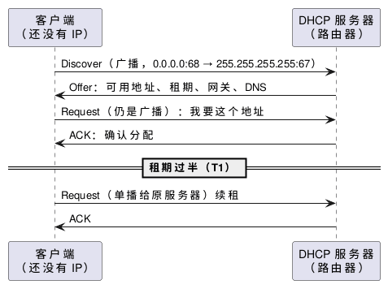

:PROPERTIES:
:ID:       42efb840-bcf5-418a-a608-ccaea803b08c
:ROAM_ALIASES: "NAT 与 DHCP"
:END:
#+title: NAT and DHCP in Home Networks
#+filetags: :Network:

* Intuition
家用路由器同时做两件事：用 DHCP 给内网设备发地址和网关、DNS 等配置；用 NAT 让整个内网共用 ISP 分配的一个公网 IPv4 地址出去。

* NAT
** 转换过程
内网 192.168.3.6 访问 65.44.21.24:21，路由器的公网地址是 200.100.10.1：

| 方向 | 源地址 | 目的地址 |
|---|---|---|
| 出去，转换前 | 192.168.3.6:5733 | 65.44.21.24:21 |
| 出去，转换后 | 200.100.10.1:5733 | 65.44.21.24:21 |
| 回来，转换前 | 65.44.21.24:21 | 200.100.10.1:5733 |
| 回来，转换后 | 65.44.21.24:21 | 192.168.3.6:5733 |

- 家用路由器做的是 NAPT（也叫 PAT、masquerade）：改写源 IP，必要时也改源端口，这样多台内网主机能共用一个公网 IP。端口不冲突时通常保留原端口，冲突时才换一个。
- 回包靠转换表找回内网主机。Linux 上这张表就是连接跟踪（conntrack）表：连接的第一个包查 =nat= 表的规则（MASQUERADE 在 POSTROUTING），转换结果记在 conntrack 中，后续包和回包按记录改写。规则所在的 hook 见 [[id:cee785fb-8f4b-4230-ad02-312714729965][Linux Netfilter, iptables and nftables]]。

** NAT 带来的限制
- *外部不能主动连进来* ：转换表里只有内网主动发起的连接，外面发来的新连接找不到对应的内网主机，直接丢弃。要对外提供服务，在路由器上设端口转发（DNAT），或用 UPnP / NAT-PMP 让程序自己申请。
- *运营商级 NAT（CGNAT）下端口转发无效* ：路由器 WAN 口拿到的是 =100.64.0.0/10= 或其他私有地址时，外面还有一层运营商的 NAT，家里的端口转发只穿过了自己这一层。判断方法：对比路由器 WAN 口地址和外部看到的公网 IP（例如 ~curl ifconfig.me~ ），不一致就在 CGNAT 后面。
- *空闲连接被回收* ：转换表项有超时。UDP 尤其短，长连接（SSH、数据库、WebSocket）长时间没有数据时，中间某一层 NAT 删掉表项，之后的包被丢弃，连接「假死」。应用层心跳或 TCP keepalive 的间隔要短于路径上最短的 NAT 超时。
- *P2P 打洞* ：两端都在 NAT 后面时，像 Tailscale 这类工具先通过第三方服务器交换各自的公网映射，再同时向对方发包「打洞」。多数家用 NAT 对同一个内网端口使用固定的公网映射，打洞能成功；对每个目的地址分配不同映射的 NAT（symmetric NAT）通常打不通，只能经中继转发。

** Linux 相关选项
| 选项 | 上游默认 | 作用 |
|---|---|---|
| ~net.ipv4.ip_forward~ | 0 | 不开启就不转发，Linux 做路由器或宿主机给容器做 NAT 都要开（Docker 会自动打开） |
| ~net.netfilter.nf_conntrack_max~ | 按内存计算 | conntrack 表上限；满了之后新连接被丢弃，内核日志出现 =nf_conntrack: table full, dropping packet= |
| ~net.netfilter.nf_conntrack_tcp_timeout_established~ | 432000 秒（5 天） | 已建立的 TCP 连接空闲多久后删除表项 |
| ~net.netfilter.nf_conntrack_udp_timeout~ / ~nf_conntrack_udp_timeout_stream~ | 30 / 120 秒 | UDP 单向 / 双向都有流量后的表项超时 |

* DHCP
** DORA
#+begin_src plantuml :file images/dhcp_dora.png
@startuml
participant "客户端\n（还没有 IP）" as C
participant "DHCP 服务器\n（路由器）" as S
C -> S : Discover（广播，0.0.0.0:68 → 255.255.255.255:67）
S -> C : Offer：可用地址、租期、网关、DNS
C -> S : Request（仍是广播）：我要这个地址
S -> C : ACK：确认分配
== 租期过半（T1） ==
C -> S : Request（单播给原服务器）续租
S -> C : ACK
@enduml
#+end_src

#+RESULTS:

- 客户端还没有地址，也不知道服务器在哪，所以 Discover 和第一次 Request 都是广播；DHCP 跑在 UDP 上（服务器 67 端口，客户端 68 端口），属于应用层协议。
- Request 也广播，是为了告诉其他发过 Offer 的服务器「没选你」，让它们收回预留的地址。
- 续租：租期过半（T1）时单播找原服务器续；到 87.5%（T2）仍未续上，就广播找任意服务器；租期到期则放弃地址。
- 广播不跨路由器。DHCP 服务器不在本网段时，要由路由器上的 DHCP 中继（relay）转发。
- 除了地址，Offer / ACK 中的选项还带子网掩码、默认网关、DNS 服务器和租期；设备拿到的网关和 DNS 不对，先查这里。

** OpenWRT 中的 DHCP
- DHCPv4 由 dnsmasq 提供（同时兼做 DNS 转发），IPv6 的 DHCPv6 和路由通告（RA）由 odhcpd 负责；配置在 =/etc/config/dhcp= 。
- lan 接口默认地址池从 .100 开始共 150 个、租期 12 小时。
- 静态分配（static lease）：按 MAC 地址固定分给某台设备一个 IP，常用于需要端口转发或被别的设备访问的主机。

* Pitfalls
- *同一网段有两台 DHCP 服务器* ：把第二台路由器的 LAN 口接进现有网络、又没关它的 DHCP，设备会随机拿到其中一台给的地址和网关，表现为部分设备时好时坏、上不了网。第二台设备当 AP 或交换机用时，关掉它的 DHCP。
- *手动设置的地址落在地址池里* ：DHCP 服务器不知道这个地址已被占用，可能再分给别的设备，造成 IP 冲突。手动地址放在地址池之外，或改用静态分配。
- IPv6 通常不用 NAT：每台设备有自己的公网地址，访问控制靠路由器防火墙的默认拒绝入站，而不是靠 NAT。
