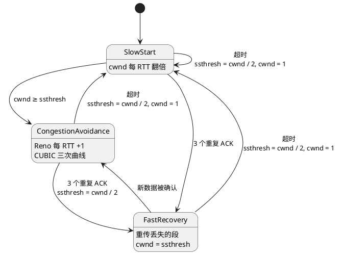
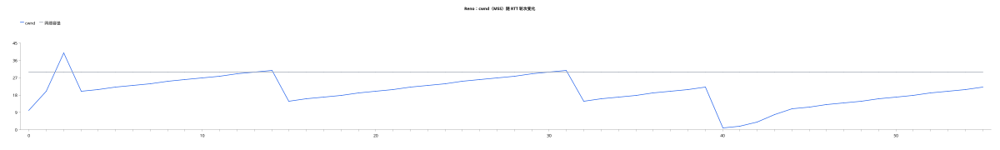
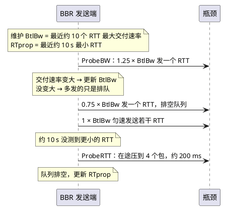
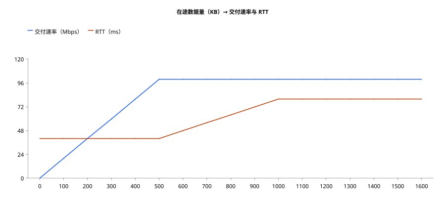

:PROPERTIES:
:ID:       41d8d73a-dcd2-40f5-b168-d7582aa77737
:ROAM_ALIASES: "TCP 拥塞控制"
:VERIFIED_WITH: Linux 7.2.9 (CachyOS, 2026-10-17)
:END:
#+title: TCP Congestion Control
#+filetags: :Network:TCP:

* TOC :TOC_2:
- [[#intuition][Intuition]]
- [[#管道模型带宽时延积][管道模型：带宽时延积]]
- [[#经典拥塞控制][经典拥塞控制]]
  - [[#慢启动][慢启动]]
  - [[#拥塞避免与-aimd][拥塞避免与 AIMD]]
  - [[#两种丢包反应][两种丢包反应]]
  - [[#cubic][CUBIC]]
- [[#bbr][BBR]]
  - [[#基于丢包的算法的问题][基于丢包的算法的问题]]
  - [[#bbr-怎么找到工作点][BBR 怎么找到工作点]]
  - [[#两种工作点][两种工作点]]
  - [[#代价与版本][代价与版本]]
- [[#linux-相关选项][Linux 相关选项]]
- [[#connections][Connections]]

* Intuition

- 接收窗口 rwnd 管接收端吃不吃得下（流量控制），拥塞窗口 cwnd 管网络扛不扛得住（拥塞控制）；在途数据 ≤ ~min(cwnd, rwnd)~ 。三种窗口的关系见 [[id:d43414ac-35ca-4f1d-a603-8026943a9801][TCP Reliable Delivery and Flow Control]]。
- TCP 看不到路径上的路由器，只能从端上的现象反推拥塞，信号分三类：
  - *丢包* （超时、重复 ACK）：经典算法 Reno、CUBIC 基本只看它，没丢就加速、丢了就减速。
  - *延迟* （RTT 变大）：基于延迟的算法（如 BBR）用它。
  - *显式拥塞通知* （ECN, explicit congestion notification）：路由器队列快满时不丢包，而是给包打标记，发送端看到标记就减速。
- 目标工作点：把管道填满，但不把中间设备的缓存填满。基于丢包的算法停在「缓存满、开始丢包」处，BBR 瞄准「管道刚好填满」处。

* 管道模型：带宽时延积

带宽时延积（BDP, bandwidth-delay product）= 带宽 × RTT，是填满管道所需的在途数据量。用 RTT 而不是单程时延：数据发出后要等一个 RTT，ACK 回来才腾出窗口。

例：100 Mbps × 40 ms = 4 Mbit ≈ 500 KB。不开窗口缩放时窗口最大 64 KB，吞吐上限 ≈ 64 KB / 40 ms ≈ 13 Mbps，带宽再大也跑不满。所以长肥网络（LFN, long fat network）必须开窗口缩放。

- 在途数据 < BDP：管道没填满，带宽浪费；多发一点，速率就上去，RTT 不变。
- 在途数据 > BDP：速率不再增加，多出来的数据在瓶颈处排队，RTT 上升；缓存满了才丢包。
- 缓存过大导致排队延迟很高的现象叫 *bufferbloat* 。OpenWRT 的 SQM（smart queue management，配 ~cake~ / ~fq_codel~ 队列）就是治家用宽带 bufferbloat 的。

* 经典拥塞控制

cwnd 以 MSS 为单位。

** 慢启动

- 初始窗口（initial window）是 10 个 MSS（RFC 6928，Linux 2.6.39 起），不是 1。短连接大多一两个 RTT 就传完。
- 慢启动（slow start）：每收到一个 ACK，cwnd 加 1 个 MSS；一个 RTT 内收到约 cwnd 个 ACK，所以 *每个 RTT 翻倍* 。「慢」是相对一上来就满速发而言。
- cwnd 达到慢启动阈值（ssthresh, slow start threshold）后进入拥塞避免。ssthresh 初始为无穷大，所以连接的第一次慢启动一直翻倍到第一次丢包；ssthresh 是丢包后才设成具体值的。Linux 的 CUBIC 带 HyStart，会在 RTT 开始上升时提前退出慢启动。

** 拥塞避免与 AIMD

- 拥塞避免（congestion avoidance），Reno：每个 RTT 加 1 个 MSS。
- 加法增、乘法减合称 AIMD（additive increase, multiplicative decrease）。多条流共享瓶颈时，AIMD 会收敛到公平分配。

** 两种丢包反应

| 信号         | 说明网络                                     | ssthresh                   | cwnd                 | 之后                                    |
|--------------+----------------------------------------------+----------------------------+----------------------+-----------------------------------------|
| 超时         | 什么都没回来，很可能堵死                     | 在途数据 / 2               | 1 个 MSS（RFC 5681） | 重新慢启动，到 ssthresh 后转拥塞避免    |
| 3 个重复 ACK | 后面的段还在陆续到达，网络仍通，只丢了个别段 | cwnd / 2（CUBIC 为 × 0.7） | = ssthresh           | 快速恢复（fast recovery），然后拥塞避免 |

#+begin_src plantuml :file images/tcp_congestion_states.png
@startuml
[*] --> SlowStart
SlowStart : cwnd 每 RTT 翻倍
CongestionAvoidance : Reno 每 RTT +1\nCUBIC 三次曲线
FastRecovery : 重传丢失的段\ncwnd = ssthresh

SlowStart --> CongestionAvoidance : cwnd ≥ ssthresh
SlowStart --> FastRecovery : 3 个重复 ACK
CongestionAvoidance --> FastRecovery : 3 个重复 ACK\nssthresh = cwnd / 2
FastRecovery --> CongestionAvoidance : 新数据被确认
SlowStart --> SlowStart : 超时\nssthresh = cwnd / 2, cwnd = 1
CongestionAvoidance --> SlowStart : 超时\nssthresh = cwnd / 2, cwnd = 1
FastRecovery --> SlowStart : 超时\nssthresh = cwnd / 2, cwnd = 1
@enduml
#+end_src

#+RESULTS:

Reno 的 cwnd 随时间变化（初始窗口 10，网络容量 30 MSS，第 40 个 RTT 人为安排一次超时）：

#+begin_src plantuml :file images/tcp_reno_cwnd_chart.png
@startchart
scale 1200 width
title Reno：cwnd（MSS）随 RTT 轮次变化
h-axis [0, " ", " ", " ", " ", " ", " ", " ", " ", " ", 10, " ", " ", " ", " ", " ", " ", " ", " ", " ", 20, " ", " ", " ", " ", " ", " ", " ", " ", " ", 30, " ", " ", " ", " ", " ", " ", " ", " ", " ", 40, " ", " ", " ", " ", " ", " ", " ", " ", " ", 50, " ", " ", " ", " ", " "]
v-axis 0 --> 45
line "cwnd" [10, 20, 40, 20, 21, 22, 23, 24, 25, 26, 27, 28, 29, 30, 31, 15, 16, 17, 18, 19, 20, 21, 22, 23, 24, 25, 26, 27, 28, 29, 30, 31, 15, 16, 17, 18, 19, 20, 21, 22, 1, 2, 4, 8, 11, 12, 13, 14, 15, 16, 17, 18, 19, 20, 21, 22] #2563eb
line "网络容量" [30, 30, 30, 30, 30, 30, 30, 30, 30, 30, 30, 30, 30, 30, 30, 30, 30, 30, 30, 30, 30, 30, 30, 30, 30, 30, 30, 30, 30, 30, 30, 30, 30, 30, 30, 30, 30, 30, 30, 30, 30, 30, 30, 30, 30, 30, 30, 30, 30, 30, 30, 30, 30, 30, 30, 30] #9ca3af
legend top
@endchart
#+end_src

#+RESULTS:

- 0–2：慢启动 10 → 20 → 40，冲过容量（ssthresh 初始无穷大）。
- 3、15、32：3 个重复 ACK，减半后线性爬升，形成 AIMD 锯齿。
- 40：超时，cwnd 降到 1，ssthresh = 22 / 2 = 11；慢启动 1 → 2 → 4 → 8 → 11 封顶后转线性。

逐步演示与 Reno / CUBIC 恢复对比（HTML）：[[file:demos/tcp_cwnd_sawtooth.html][TCP cwnd 锯齿]]

** CUBIC

Linux 从 2.6.19 起默认用 CUBIC：

- 丢包后 cwnd 乘 0.7（Reno 是 0.5）。
- 增长不按 RTT 轮次线性加，而是按「距上次丢包过了多久」走三次曲线：离上次丢包时的窗口 ~W_max~ 远时涨得快，接近时放缓（在这附近最可能再丢包），越过后加速试探更大的容量。
- 增长只取决于时间，所以高 BDP 链路上恢复快得多，也不依赖 RTT。例：RTT 100 ms、 ~W_max~ = 1000 MSS，Reno 减半后每 RTT 加 1，要约 50 秒回到 1000；CUBIC 约 9 秒。
- 窗口小、RTT 短时切到 TCP 友好模式（TCP-friendly region），按接近 Reno 的速度增长。

* BBR

BBR（Bottleneck Bandwidth and RTT）不把丢包当拥塞信号，而是主动测量管道并停在理想工作点。

** 基于丢包的算法的问题

- 丢包不一定是拥塞：无线、长距离跨洋链路上有不少随机丢包。CUBIC 每丢一次就降窗，1% 左右的随机丢包就能让吞吐掉到带宽的一小部分。
- 等到丢包时缓存已经塞满：基于丢包的算法本质上是靠把队列填满来探测容量，延迟被拉高（bufferbloat）。

** BBR 怎么找到工作点

- 估计两个量：
  - 瓶颈带宽（BtlBw, bottleneck bandwidth）：最近约 10 个 RTT 内测到的 *最大* 交付速率。
  - 往返传播时延（RTprop, round-trip propagation time）：最近约 10 秒内的 *最小* RTT，即没有排队时的 RTT。
- BtlBw × RTprop = BDP。BBR 按 BtlBw 匀速发送（pacing），在途数据维持在 BDP 附近；cwnd 只作上限（约 2 × BDP）。
- 两个量 *不能同时测* ：测最大带宽要把管道填满（难免排点队，RTT 不准），测最小 RTT 要队列排空。所以轮流探测：
  - ProbeBW：周期性按 1.25 倍速率发一个 RTT 试探带宽是否变大，再按 0.75 倍发一个 RTT 把排起的队排掉，其余时间 1 倍。
  - ProbeRTT：约每 10 秒把在途数据压到 4 个包、持续约 200 ms，重新测最小 RTT。

#+begin_src plantuml :file images/tcp_bbr_probing.png
@startuml
participant "BBR 发送端" as S
participant "瓶颈" as B
note over S : 维护 BtlBw = 最近约 10 个 RTT 最大交付速率\nRTprop = 最近约 10 s 最小 RTT
S -> B : ProbeBW：1.25 × BtlBw 发一个 RTT
note over S : 交付速率变大 → 更新 BtlBw\n没变大 → 多发的只是排队
S -> B : 0.75 × BtlBw 发一个 RTT，排空队列
S -> B : 1 × BtlBw 匀速发送若干 RTT
note over S : 约 10 s 没测到更小的 RTT
S -> B : ProbeRTT：在途压到 4 个包，约 200 ms
note over S : 队列排空，更新 RTprop
@enduml
#+end_src

#+RESULTS:

** 两种工作点

单条流、瓶颈带宽 100 Mbps、RTprop 40 ms（BDP 500 KB）、瓶颈缓存 500 KB：

#+begin_src plantuml :file images/tcp_bbr_operating_points.png
@startchart
scale 900 width
title 在途数据量（KB）→ 交付速率与 RTT
h-axis [0, 100, 200, 300, 400, 500, 600, 700, 800, 900, 1000, 1100, 1200, 1300, 1400, 1500, 1600]
v-axis 0 --> 120
line "交付速率（Mbps）" [0, 20, 40, 60, 80, 100, 100, 100, 100, 100, 100, 100, 100, 100, 100, 100, 100] #2563eb
line "RTT（ms）" [40, 40, 40, 40, 40, 40, 48, 56, 64, 72, 80, 80, 80, 80, 80, 80, 80] #c2410c
legend top
@endchart
#+end_src

#+RESULTS:

| 在途数据                | 交付速率         | RTT                 | 谁停在这里                    |
|-------------------------+------------------+---------------------+-------------------------------|
| < BDP（500 KB）         | 随在途数据上升   | = RTprop（40 ms）   |                               |
| = BDP                   | 到顶（100 Mbps） | = RTprop            | BBR                           |
| BDP ～ BDP + 缓存       | 不变             | 上升                |                               |
| > BDP + 缓存（1000 KB） | 不变             | 最高（80 ms），丢包 | 基于丢包的算法（Reno、CUBIC） |

两者速率一样，基于丢包的算法却多了整个缓存的排队时间；缓存越大，差距越大。

可拖动在途数据量和缓存大小的演示（HTML）：[[file:demos/tcp_bbr_operating_point.html][BBR 工作点]]

** 代价与版本

- BBR v1 基本不理会丢包：浅缓存链路上持续造成大量丢包；与 CUBIC 共享瓶颈时带宽分配不公平，偏向谁取决于缓存深浅。
- BBR v2 / v3 加入了对丢包和 ECN 的反应。
- 本机 CachyOS 内核同时带 ~tcp_bbr~ 和 ~tcp_bbr3~ 两个模块，后者来自发行版补丁，由此推断主线的 ~tcp_bbr~ 仍是 v1。TODO verify：主线内核是否已合入 BBR v3。
- 只改 *发送端* ，接收端不用配合，适合服务器单方面开启；Google 在自家服务和 QUIC 上使用。

* Linux 相关选项

| 选项                                        | 作用                                                                                                                                                                 | 默认                                                                       |
|---------------------------------------------+----------------------------------------------------------------------------------------------------------------------------------------------------------------------+----------------------------------------------------------------------------|
| ~net.ipv4.tcp_congestion_control~           | 默认拥塞控制算法；也可用 ~TCP_CONGESTION~ socket 选项按连接设置。启用 BBR：先 ~modprobe tcp_bbr~ ，再设为 ~bbr~                                                      | ~cubic~                                                                    |
| ~net.ipv4.tcp_available_congestion_control~ | 已加载可用的算法（只读）                                                                                                                                             | 本机 ~reno cubic~                                                          |
| ~net.core.default_qdisc~                    | 网卡默认排队规则（qdisc）。 ~fq_codel~ 主动控制队列长度、缓解 bufferbloat； ~fq~ 常与 BBR 一起推荐（4.13 前 BBR 依赖 fq 做 pacing，之后 TCP 自己能做，但 fq 更高效） | 内核 ~pfifo_fast~ ；本机 ~fq_codel~ ，由 systemd 的 ~50-default.conf~ 设置 |
| ~net.ipv4.tcp_ecn~                          | ECN：0 关闭；1 主动请求并接受；2 只在对方请求时启用                                                                                                                  | 2                                                                          |
| ~net.ipv4.tcp_slow_start_after_idle~        | 空闲超过一个 RTO 后把 cwnd 打回初始值；长连接间歇发数据时每次都要重新慢启动，服务端常设 0                                                                            | 1                                                                          |

- 初始窗口不是 sysctl，按路由设： ~ip route change ... initcwnd 10~ （本端通告的初始接收窗口用 ~initrwnd~ ）。
- 观察： ~ss -ti~ 显示算法名、 ~cwnd:~ 、 ~ssthresh:~ ；BBR 连接还会显示 ~bbr:(bw:…,mrtt:…,pacing_gain:…,cwnd_gain:…)~ ，即当前的 BtlBw、最小 RTT 和增益。

* Connections

- 序号、重传、三种窗口、流量控制：[[id:d43414ac-35ca-4f1d-a603-8026943a9801][TCP Reliable Delivery and Flow Control]]
- 连接管理：[[id:1ece815b-5c13-4d67-b816-b2ff98f34696][TCP Connection Management]]
- 查看 socket 状态、计时器和 ~-i~ 详情的工具：[[id:75c05e0a-5afe-41a8-ad39-10223bb86902][ss (Linux Socket Statistics)]]
