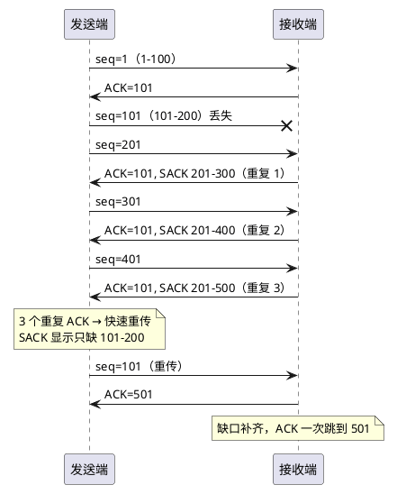
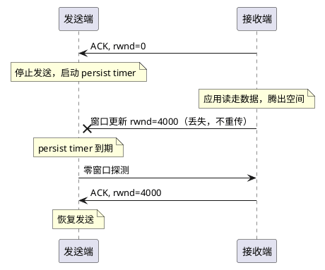

:PROPERTIES:
:ID:       d43414ac-35ca-4f1d-a603-8026943a9801
:ROAM_ALIASES: "TCP 可靠传输与流量控制"
:VERIFIED_WITH: Linux 7.2.9 (CachyOS, 2026-10-17)
:END:
#+title: TCP Reliable Delivery and Flow Control
#+filetags: :Network:TCP:

* TOC :TOC_2:
- [[#intuition][Intuition]]
- [[#序号与累计确认][序号与累计确认]]
  - [[#按字节编号][按字节编号]]
  - [[#累计确认][累计确认]]
- [[#发送窗口与滑动窗口][发送窗口与滑动窗口]]
  - [[#三种窗口][三种窗口]]
  - [[#发送端的四个区域][发送端的四个区域]]
- [[#丢包与重传][丢包与重传]]
  - [[#乱序与-ack-丢失][乱序与 ACK 丢失]]
  - [[#超时重传][超时重传]]
  - [[#快速重传与-sack][快速重传与 SACK]]
- [[#流量控制][流量控制]]
  - [[#接收窗口][接收窗口]]
  - [[#零窗口探测][零窗口探测]]
  - [[#silly-window-syndrome][Silly Window Syndrome]]
- [[#pitfalls][Pitfalls]]
  - [[#字节流没有消息边界粘包][字节流没有消息边界（「粘包」）]]
  - [[#nagle-遇上延迟确认][Nagle 遇上延迟确认]]
  - [[#手动设缓存反而变慢][手动设缓存反而变慢]]
- [[#linux-相关选项][Linux 相关选项]]
- [[#misconceptions][Misconceptions]]
  - [[#序号是报文段里的第几个字节][序号是报文段里的第几个字节？]]
- [[#connections][Connections]]

* Intuition

TCP 在不可靠的网络上提供有序、可靠的字节流。各机制分工：

| 机制                             | 解决的问题                           |
|----------------------------------+--------------------------------------|
| 序号 + 累计确认                  | 顺序：乱序重排、判断哪些数据已经收到 |
| 重传（超时重传、快速重传、SACK） | 丢包                                 |
| 接收窗口 rwnd                    | 流量控制：别把接收端的缓存塞满       |
| 拥塞窗口 cwnd                    | 拥塞控制：别把网络塞满               |
| 发送窗口 = min(rwnd, cwnd)       | 限制在途（已发未确认）的数据量       |

连接的建立与关闭见 [[id:1ece815b-5c13-4d67-b816-b2ff98f34696][TCP Connection Management]]，cwnd 与拥塞控制见 [[id:41d8d73a-dcd2-40f5-b168-d7582aa77737][TCP Congestion Control]]。本笔记讲序号、重传和流量控制。

* 序号与累计确认

** 按字节编号

TCP 给 *每个字节* 编号（序号，sequence number），不给包编号：

- 报文段（segment）的序号 = 它第一个字节的序号。
- ACK 号 = 下一个期望收到的字节序号。
- 编号是字节在整条连接、这个方向的字节流里的位置，与它被装进哪个报文段无关。起点是两端各自选的初始序号（ISN），用 SYN 告诉对方，不是协商出来的。

按字节而不按包编号，是因为重传时可以重新切段：两个待重传的段可以合成一个大段发出，按包编号就对不上了，按字节编号每个字节的身份不变。

** 累计确认

累计确认（cumulative ACK）： ~ACK = N~ 表示 N 之前的字节全部收到、下一个要第 N 个字节。不必每个报文段单独确认，后一个 ACK 自动覆盖前面的。

* 发送窗口与滑动窗口

** 三种窗口

| 窗口                                | 谁维护                                                                                | 作用                                      |
|-------------------------------------+---------------------------------------------------------------------------------------+-------------------------------------------|
| 接收窗口（receive window, rwnd）    | 接收方按剩余缓存计算，放在每个报文段 TCP 头的 Window 字段通告；发送方保存最近一次的值 | 流量控制                                  |
| 拥塞窗口（congestion window, cwnd） | 发送方本地估算，不出现在报文里                                                        | 拥塞控制                                  |
| 发送窗口（send window）             | 发送方                                                                                | 大小 = ~min(rwnd, cwnd)~ ，限制在途数据量 |

- 滑动窗口（sliding window）是机制：窗口左边界随 ACK 右移，右边界随之推进。有边界、会「滑」的是发送方的发送窗口，以及接收方的接收窗口（接收方用它判断哪些序号可以收下）；cwnd 只是一个数值上限，没有边界。
- TCP 全双工，两个方向独立，每一端同时有一个发送窗口和一个接收窗口。
- 平时说「TCP 滑动窗口」「窗口大小」，通常指流量控制这一套：发送窗口按对方通告的 rwnd 滑动。抓包里的 ~win=~ 、TCP 头的窗口字段都是 rwnd。
- 窗口字段只有 16 位（最大 65535 字节）。更大的窗口靠窗口缩放选项（window scale）：两端在 SYN 里各自声明一个 2 的幂作为倍数。高带宽、高时延的链路必须开，原因见 [[id:41d8d73a-dcd2-40f5-b168-d7582aa77737][TCP Congestion Control]] 的带宽时延积。

** 发送端的四个区域

发送端的字节流分四段，由三个位置分开：

| 区域                | 范围                                           |
|---------------------+------------------------------------------------|
| ① 已发送、已确认   | ≤ ~LastByteAcked~                              |
| ② 已发送、未确认   | ~LastByteAcked~ ～ ~LastByteSent~ ，即在途数据 |
| ③ 未发送、允许发送 | ~LastByteSent~ ～ 右边界                       |
| ④ 未发送、不能发送 | > 右边界                                       |

右边界 = ~LastByteAcked + min(rwnd, cwnd)~ 。这组名字出自 Peterson & Davie 教材；RFC 793 和 Linux 源码用 ~SND.UNA~ / ~snd_una~ （最早未确认的字节，= ~LastByteAcked + 1~ ）和 ~SND.NXT~ / ~snd_nxt~ （下一个要发的字节，= ~LastByteSent + 1~ ）。

例：每段 100 字节，只看 rwnd（假设 cwnd 足够大）：

| 事件                       | LastByteAcked | LastByteSent | rwnd | 右边界 | 还能发 |
|----------------------------+---------------+--------------+------+--------+--------|
| 连接建立                   |             0 |            0 |  400 |    400 |    400 |
| 发出 1–400                 |             0 |          400 |  400 |    400 |      0 |
| 收到 ~ACK=201~             |           200 |          400 |  400 |    600 |    200 |
| 发出 401–600               |           200 |          600 |  400 |    600 |      0 |
| 收到 ~ACK=401~ ，rwnd 变小 |           400 |          600 |  200 |    600 |      0 |
| 收到 ~ACK=601~ ，rwnd = 0  |           600 |          600 |    0 |    600 |      0 |

- ACK 推动左边界；右边界 = 左边界 + 窗口，移不移看 ACK 带回的 rwnd。
- 后两行是流量控制：应用读得慢，rwnd 变小，左边界前进而右边界不动，直到零窗口。

逐步演示（HTML，含流量控制调整）：[[file:demos/tcp_send_window.html][TCP 发送滑动窗口]]

* 丢包与重传

** 乱序与 ACK 丢失

- 乱序：6、7 没到，8、9 先到。接收端把 8、9 放进乱序队列（out-of-order queue）缓存，不丢弃；但累计 ACK 只能停在 6。6、7 补齐后，ACK 一次跳到 10。
- ACK 丢失通常无害：后面的累计 ACK 覆盖了它。只有后续 ACK 全丢才会超时重传，接收端按序号识别重复数据并丢弃。

** 超时重传

- 重传定时器（retransmission timer）每条连接一个，盯最早未确认的报文段，不是每段一个（RFC 6298，Linux 同）。
- 重传超时（RTO, retransmission timeout）必须比 RTT 长，否则误重传；也不能太长，否则丢包后恢复太慢。
- 自适应重传（adaptive retransmission）：持续采样 RTT，RTO ≈ 平滑 RTT + 几倍 RTT 波动作余量（公式见 RFC 6298）。
- Karn 算法（Karn's algorithm）：重传过的报文段不拿来采样 RTT，因为回来的 ACK 分不清确认的是原始那次还是重传那次。开启时间戳选项后，每个 ACK 带回发送时间，重传段也能准确采样。
- 指数退避（exponential backoff）：每次超时，RTO 翻倍。

** 快速重传与 SACK

- 快速重传（fast retransmit）：接收端每收到一个乱序段就 *立即* 回 ACK（不走延迟确认），ACK 号停在缺口处，即重复 ACK（duplicate ACK）。发送端收到 3 个重复 ACK，不等超时立即重传缺口处的段。
- 为什么是 3 个：1 个重复 ACK 可能只是乱序，3 个才足够说明丢了。现代 Linux 默认还用 RACK，按发送时间判断丢失；「3 个重复 ACK」是经典模型。
- 选择确认（SACK, selective acknowledgment）：累计 ACK 只报告「连续收到哪里」，SACK 额外报告缺口之后已收到的不连续块，发送端只重传真正缺的部分。它是 TCP 选项，握手时双方都声明支持才启用。

每段 100 字节，第 2 段丢失：

#+begin_src plantuml :file images/tcp_fast_retransmit_sack.png
@startuml
participant 发送端 as S
participant 接收端 as R
S -> R : seq=1（1–100）
R -> S : ACK=101
S ->x R : seq=101（101–200）丢失
S -> R : seq=201
R -> S : ACK=101, SACK 201–300（重复 1）
S -> R : seq=301
R -> S : ACK=101, SACK 201–400（重复 2）
S -> R : seq=401
R -> S : ACK=101, SACK 201–500（重复 3）
note over S : 3 个重复 ACK → 快速重传\nSACK 显示只缺 101–200
S -> R : seq=101（重传）
R -> S : ACK=501
note over R : 缺口补齐，ACK 一次跳到 501
@enduml
#+end_src

#+RESULTS:

丢包之后发送速率怎么调整（快速恢复、超时后重新慢启动）属于拥塞控制，见 [[id:41d8d73a-dcd2-40f5-b168-d7582aa77737][TCP Congestion Control]]。

* 流量控制

** 接收窗口

rwnd = 接收缓存大小 − 已收到但应用还没读走的字节数。应用读得慢，rwnd 就变小，最终变成 0（零窗口，zero window），发送端停止发送。

** 零窗口探测

- 接收端腾出空间后会发窗口更新（window update），但它只是不带数据的 ACK，丢了没人重传。
- 发送端若干等就是死锁：发送端等窗口打开，接收端以为已经通知过了。
- 所以零窗口时发送端启动坚持定时器（persist timer），定期发零窗口探测（zero window probe），逼接收端回报当前窗口；探测间隔按指数退避。

#+begin_src plantuml :file images/tcp_zero_window_probe.png
@startuml
participant 发送端 as S
participant 接收端 as R
R -> S : ACK, rwnd=0
note over S : 停止发送，启动 persist timer
note over R : 应用读走数据，腾出空间
R ->x S : 窗口更新 rwnd=4000（丢失，不重传）
note over S : persist timer 到期
S -> R : 零窗口探测
R -> S : ACK, rwnd=4000
note over S : 恢复发送
@enduml
#+end_src

#+RESULTS:

** Silly Window Syndrome

窗口每次只开一点点，就会出现大量只带几个字节的小段，头部开销远大于数据（silly window syndrome）。两端各有对策：

- 接收端：空出的空间不到一个 MSS（或缓存的一半）时，先不通告更大的窗口（Clark 方案）。
- 发送端：Nagle 算法（Nagle's algorithm）：还有未确认数据时，小数据先攒着，等 ACK 回来或攒够一个 MSS 再发。

* Pitfalls

** 字节流没有消息边界（「粘包」）

TCP 只保证字节流有序，不保留应用消息的边界：发送方两次 ~write()~ 的数据可能被接收方一次 ~read()~ 读到（「粘」，例如 Nagle 合并了小段，或接收缓冲区攒了多段），一次 ~write()~ 也可能分几次才读完（「拆」）。这不是 TCP 的 bug，应用层协议要自己划定边界：

- 定长消息；
- 分隔符，如 HTTP 头部以 ~\r\n\r\n~ 结束；
- 长度前缀，如 HTTP 的 ~Content-Length~ 、gRPC 消息前的长度字段。

UDP 保留数据报边界，没有这个问题。

** Nagle 遇上延迟确认

- 客户端分两次 ~write()~ 发一个请求（先写头、再写体），第二次的小数据被 Nagle 扣住，要等第一段的 ACK。
- 服务端没收齐请求、没有响应可发，于是延迟确认（delayed ACK），ACK 迟迟不回。
- 结果：请求莫名多出约 40 ms 延迟（Linux 延迟确认的最小值； ~ss -ti~ 里的 ~ato:40~ 就是当前延迟确认超时）。
- 解法：一次 ~write()~ 写完（或 ~writev()~ ），或设 ~TCP_NODELAY~ 关掉 Nagle。高频交易等低延迟系统通常直接设 ~TCP_NODELAY~ 。

** 手动设缓存反而变慢

应用用 ~SO_RCVBUF~ / ~SO_SNDBUF~ 指定缓存大小后，该 socket 的自动调优就关闭了。设得比自动调优能达到的值小，高 BDP 链路上 rwnd 受限，吞吐上不去。没有明确理由时不要手动设。

* Linux 相关选项

sysctl（「上游默认」只写确认过的；本机为 Linux 7.2.9 CachyOS）：

| 选项                             | 作用                                                                                             |                                                                    默认 |
|----------------------------------+--------------------------------------------------------------------------------------------------+-------------------------------------------------------------------------|
| ~net.ipv4.tcp_rmem~ / ~tcp_wmem~ | 每个 socket 接收 / 发送缓存的最小、初始、最大值；自动调优在此范围内调整，rwnd 上限由接收缓存决定 |                                    随内核版本和内存而变，用 ~sysctl~ 查 |
| ~net.ipv4.tcp_moderate_rcvbuf~   | 接收缓存自动调优（auto-tuning）                                                                  |                                                                       1 |
| ~net.core.rmem_max~ / ~wmem_max~ | ~SO_RCVBUF~ / ~SO_SNDBUF~ 手动设置的上限，不限制自动调优                                         | 本机 7340032，来自 syncthing 包的 ~/usr/lib/sysctl.d/30-syncthing.conf~ |
| ~net.ipv4.tcp_window_scaling~    | 窗口缩放开关，关掉后窗口最大 64 KB                                                               |                                                                       1 |
| ~net.ipv4.tcp_sack~              | SACK 开关                                                                                        |                                                                       1 |
| ~net.ipv4.tcp_timestamps~        | 时间戳选项：重传段也能准确采样 RTT；高速链路上防序号回绕（PAWS）                                 |                                                                       1 |
| ~net.ipv4.tcp_recovery~          | 丢包检测方式，1 = 启用 RACK                                                                      |                                                                       1 |
| ~net.ipv4.tcp_reordering~        | 初始乱序容忍度，即「几个重复 ACK 算丢包」                                                        |                                                                       3 |
| ~net.ipv4.tcp_retries2~          | 已建立连接的数据最多重传几次后放弃（指数退避累计约 15 分钟）                                     |                                                                      15 |

socket 选项：

| 选项                      | 作用                                                                                                                    |
|---------------------------+-------------------------------------------------------------------------------------------------------------------------|
| ~SO_RCVBUF~ / ~SO_SNDBUF~ | 手动指定缓存大小；设了就关闭该 socket 的自动调优                                                                        |
| ~TCP_NODELAY~             | 关闭 Nagle，小数据立即发                                                                                                |
| ~TCP_QUICKACK~            | 暂时关闭延迟确认，立即回 ACK；不是永久的，内核可能恢复延迟确认，需要时反复设置                                          |
| ~TCP_CORK~                | 比 Nagle 更彻底的手动攒包：塞住期间不发不满一段的数据（最长约 200 ms），取消后一次发出；适合「响应头 + 文件」这类分块写 |

其他：

- RTO 下限按路由设： ~ip route change ... rto_min 50ms~ （数据中心内网常调小）。
- 观察： ~ss -ti~ 每条连接一行详情，例如 ~rtt:230.5/64.9~ （平滑 RTT / 波动，ms）、 ~rto:575~ 、 ~retrans:~ 、 ~wscale:10,10~ （两个方向的窗口缩放位移）、 ~ato:40~ 。

* Misconceptions

** 序号是报文段里的第几个字节？

原来以为：字节编号是包（报文段）里的第几个字节。

实际：是这个字节在整条连接、这个方向的字节流里的位置，和它被装进哪个报文段无关。

例：应用写 300 字节，TCP 切成 3 段，每段 100 字节（相对序号从 1 开始，和 Wireshark 显示的一样）：

| 报文段 | 字节    | seq |
|--------+---------+-----|
| A      | 1–100   |   1 |
| B      | 101–200 | 101 |
| C      | 201–300 | 201 |

- A、B 都到，接收端回 ~ACK=201~ ：200 之前全收到，下一个要第 201 个字节。
- B 丢了、只收到 A 和 C，只能回 ~ACK=101~ 。
- B、C 都要重发时，可以合成一个 200 字节的段， ~seq=101~ 。

* Connections

- 前置：[[id:72d3cced-60c4-4109-bc8c-a4ccbec10039][Network Layers and Data Units]]（报文段、MSS 与封装）
- 连接建立与关闭、ISN：[[id:1ece815b-5c13-4d67-b816-b2ff98f34696][TCP Connection Management]]
- 拥塞控制与 BBR：[[id:41d8d73a-dcd2-40f5-b168-d7582aa77737][TCP Congestion Control]]
- 查看 socket 状态、计时器和 ~-i~ 详情的工具：[[id:75c05e0a-5afe-41a8-ad39-10223bb86902][ss (Linux Socket Statistics)]]
