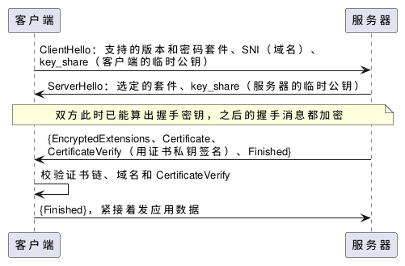

:PROPERTIES:
:ID:       176c3083-6489-4b3e-a17e-41eaebc62bee
:ROAM_ALIASES: "TLS 握手与证书"
:VERIFIED_WITH: OpenSSL 3.6.5 (2026-10-27)
:END:
#+title: TLS Handshake and Certificates
#+filetags: :Network:

* Intuition
TLS 在 TCP 之上提供三样东西：加密（别人看不到内容）、完整性（内容被改会被发现）、身份认证（连上的确实是这个域名的服务器）。

握手要解决两个问题：
1. *双方得到同一把会话密钥，而且窃听者算不出来* ：靠 ECDHE 密钥交换。双方各生成一对临时密钥，交换公钥部分后各自算出相同的共享密钥。
2. *确认对方是真的服务器* ：靠证书。证书把域名和服务器的长期公钥绑在一起，由 CA（certificate authority）签名；服务器在握手中用对应私钥签名，证明自己持有这把私钥。

* TLS 1.3 握手
#+begin_src plantuml :file images/tls13_handshake.png
@startuml
participant 客户端 as C
participant 服务器 as S
C -> S : ClientHello：支持的版本和密码套件、SNI（域名）、\nkey_share（客户端的临时公钥）
S -> C : ServerHello：选定的套件、key_share（服务器的临时公钥）
note over C, S : 双方此时已能算出握手密钥，之后的握手消息都加密
S -> C : {EncryptedExtensions、Certificate、\nCertificateVerify（用证书私钥签名）、Finished}
C -> C : 校验证书链、域名和 CertificateVerify
C -> S : {Finished}，紧接着发应用数据
@enduml
#+end_src

#+RESULTS:

- TLS 1.3 握手只需 1 个 RTT：客户端在第一个消息里就猜好密钥交换参数并附上自己的公钥。加上 TCP 握手，HTTPS 请求在发出第一个字节前要 2 个 RTT；TLS 1.2 要 3 个。
- 会话恢复（session resumption）用上次连接留下的票据跳过证书校验；0-RTT 甚至能在第一个包里带数据，但这部分数据可被重放，只适合幂等请求。
- 前向保密（forward secrecy）：会话密钥来自临时密钥，用完即弃。日后服务器的证书私钥泄露，也解不开以前录下的流量。
- 本机 OpenSSL 3.6 与自己握手时协商出的密钥交换组是 =X25519MLKEM768= （X25519 与后量子算法 ML-KEM 的混合）；限定 TLS 1.2 时是 =ECDHE-ECDSA-AES256-GCM-SHA384= 。

* 证书
** 证书链
- 服务器证书（叶子证书）由中间 CA 签发，中间 CA 由根 CA 签发。客户端只预装根证书（信任库），中间证书要由服务器在握手中一起发过来。
- 校验内容：每一级签名有效、都在有效期内、域名与叶子证书的 subjectAltName（SAN）匹配。现代客户端只看 SAN，不看 CN（Common Name）。

** 申请流程
1. 生成私钥和证书签名请求（CSR），CSR 中有域名和公钥，私钥不离开服务器： ~openssl req -new -newkey rsa:2048 -nodes -keyout example.com.key -out example.com.csr~
2. 把 CSR 交给 CA，CA 验证你控制这个域名（如在网站上放指定文件，或添加 DNS 记录），然后签发 =example.com.crt= 。
3. 在服务上配置私钥和证书（含中间证书的完整链）。

实际中用 ACME 协议自动完成以上步骤和续期：Let's Encrypt 配合 certbot、acme.sh，或 Caddy 这类内置 ACME 的服务器。公开 CA 签发的证书有效期越来越短，手动续期不可持续。

* Pitfalls
- *服务器没发中间证书* ：浏览器通常仍能打开（它会缓存或自己下载中间证书），但 curl、Python、Java 等客户端报 =unable to get local issuer certificate= 。用 ~openssl s_client -connect host:443 -servername host~ 看服务器发了几级证书。本机核对：只配叶子证书时校验返回 21（ =unable to verify the first certificate= ），加上 ~-cert_chain~ 中间证书后返回 0。
- *不带 SNI* ：一个 IP 上托管多个 HTTPS 站点时，服务器靠 ClientHello 中的 SNI 选证书。直接用 IP 访问不带 SNI，拿到的是默认证书，域名不匹配；curl 的做法见 [[id:6148d379-331e-4565-ab00-9413e87c1d22][curl for HTTP and TLS Debugging]]。
- *校验时没检查主机名* ：只验证链不验证域名时，任何有效证书都能冒充。用 OpenSSL 自己写客户端时要显式开启（ ~s_client~ 用 ~-verify_hostname~ ，本机用错误的域名校验返回 62 =hostname mismatch= ）。
- SNI 在 ClientHello 中是明文，路径上的设备能看到访问的域名（ECH 加密 ClientHello 尚未普及）。

* Misconceptions
** 客户端用服务器公钥加密 premaster secret，双方据此生成会话密钥？
原来以为：服务器发来证书和公钥，客户端校验后，用服务器公钥加密一个 premaster secret 发过去，双方用 client hello、server hello 中的随机数和 premaster secret 生成会话密钥。

实际：这是 TLS 1.2 及以前的 RSA 密钥交换。它没有前向保密：录下流量的人日后拿到服务器私钥，就能解出 premaster secret 和所有会话内容。TLS 1.3 删除了 RSA 密钥交换，只保留 (EC)DHE；证书的公钥只用来验证 CertificateVerify 中的签名，不再用来加密任何东西。TLS 1.2 下的主流配置也早已是 ECDHE。
