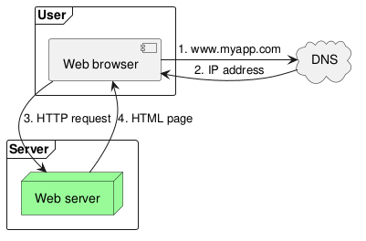
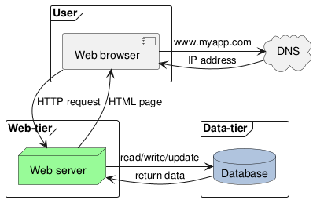
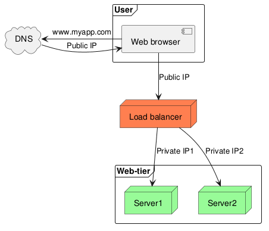
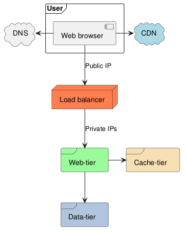
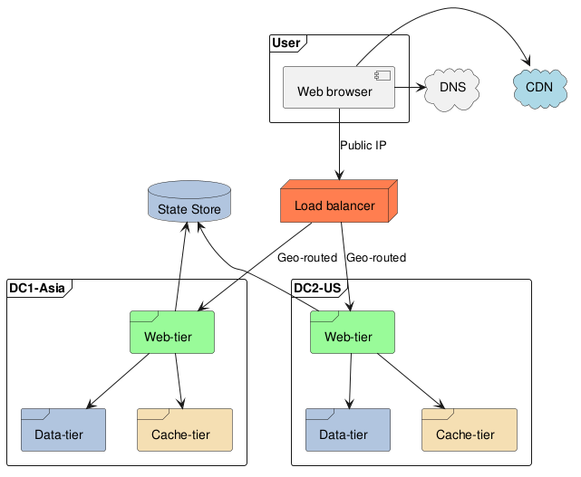
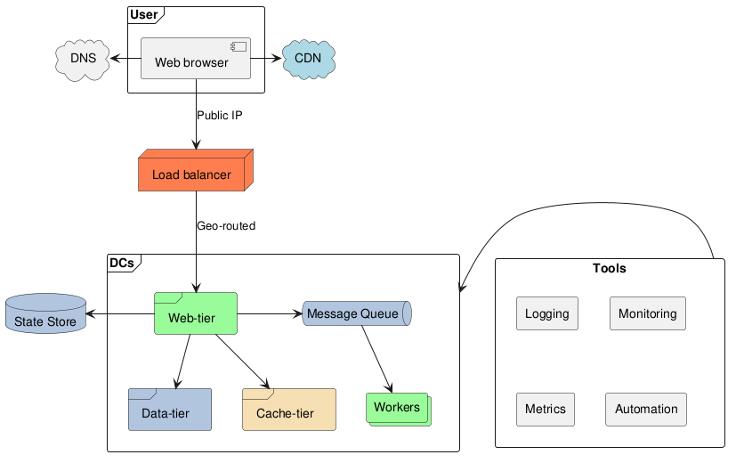

:PROPERTIES:
:ID:       66b1a5a2-36a4-4421-8edc-a470ec0e2292
:ROAM_ALIASES: "Web 应用扩展设计"
:END:
#+title: Scaling a Web Application
#+filetags: :SystemDesign:

* TOC :TOC_1:
- [[#intuition][Intuition]]
- [[#single-server][Single Server]]
- [[#separate-data-tier][Separate Data Tier]]
- [[#load-balancer][Load Balancer]]
- [[#database-replication][Database Replication]]
- [[#cache-and-cdn][Cache and CDN]]
- [[#stateless-web-tier][Stateless Web Tier]]
- [[#multiple-data-centers][Multiple Data Centers]]
- [[#message-queue][Message Queue]]
- [[#logging-metrics-and-automation][Logging, Metrics and Automation]]
- [[#sharding][Sharding]]
- [[#summary][Summary]]

* Intuition
The classic interview question "design a system for millions of users" is answered by growing a single server step by step, each step removing the bottleneck or single point of failure of the previous one. The steps below follow that order; the building blocks are explained in their own notes.

* Single Server
The browser resolves the domain through DNS, then gets HTML or JSON from one server that runs everything.

#+begin_src plantuml :file images/web_single_server.png
@startuml
frame Server {
    Node "Web server" as webserver #palegreen
}
frame User {
    component "Web browser" as browser
}
cloud DNS
browser -d-> webserver : 3. HTTP request
webserver -u-> browser : 4. HTML page

browser -r-> DNS : 1. www.myapp.com
browser <-r- DNS : 2. IP address
@enduml
#+end_src

#+RESULTS:

* Separate Data Tier
Move the database to its own server, so the web tier and the data tier can be scaled independently.

#+begin_src plantuml :file images/web_single_srv_db.png
@startuml
frame "Web-tier" {
    Node "Web server" as webserver #palegreen
}

frame User {
    component "Web browser" as browser
}
cloud DNS
browser -> DNS : www.myapp.com
browser <- DNS : IP address

browser -d-> webserver : HTTP request
webserver -u-> browser  : HTML page

frame "Data-tier" {
    database "Database" as db #LightSteelBlue
}
webserver -> db : read/write/update
webserver <- db : return data
@enduml
#+end_src

#+RESULTS:

Choosing the database: a relational database by default; non-relational stores for super-low latency, unstructured data, or massive volume, as compared in [[id:6de26b38-0e0a-4142-a2ad-5437b2263305][Data Models: Relational, Document and Graph]].

* Load Balancer
Several web servers behind a load balancer: clients reach the balancer's public IP, which forwards to servers on private IPs. This removes the web tier's single point of failure and lets servers be added for capacity, see [[id:1d92f19c-ff18-4006-904d-146a3ce03878][Load Balancing]].

#+begin_src plantuml :file images/web_loadbalancer.png
@startuml
Node "Load balancer" as balancer #Coral
frame "Web-tier" {
    Node Server1 #palegreen
    Node Server2 #palegreen
}
frame User {
    component "Web browser" as browser
}
cloud DNS
browser -d-> balancer : Public IP
balancer -d-> Server1 : Private IP1
balancer -d-> Server2 : Private IP2

browser -l-> DNS : www.myapp.com
browser <-l- DNS : Public IP
@enduml
#+end_src

#+RESULTS:

* Database Replication
The database is now the single point of failure. Leader-follower replication: the leader takes writes, followers serve reads (most applications read far more than they write), and a follower is promoted when the leader fails. The data a new leader may miss and the anomalies of reading from followers are in [[id:54f046db-4dda-4c76-a56a-299945f8da25][Database Replication]].

* Cache and CDN
A cache tier in front of the database takes the frequent reads; a CDN serves static content from servers close to users. Strategies and pitfalls are in [[id:e6126815-01d8-4c71-b870-ba30432b3a69][Caching Strategies in System Design]].

#+begin_src plantuml :file images/web_with_cache.png
@startuml
Node "Load balancer" as balancer #Coral
frame "Web-tier" as web #palegreen
frame User {
    component "Web browser" as browser
}
cloud DNS
browser -d-> balancer : Public IP
balancer -d-> web : Private IPs

browser -l-> DNS

cloud CDN #lightblue
browser -r-> CDN

frame "Data-tier" as data #LightSteelBlue
frame "Cache-tier" as cache #Wheat

web -> cache
web --> data
@enduml
#+end_src

#+RESULTS:

* Stateless Web Tier
Move session data out of the web servers into a shared store (often NoSQL, which is easy to scale). Any server can then handle any request, and auto-scaling only has to add or remove servers.

The stateful alternative needs the load balancer to send each user to the same server (sticky sessions). Adding or removing servers and handling server failures then become hard.

* Multiple Data Centers
#+begin_src plantuml :file images/web_multi_dc.png
@startuml
frame User {
    component "Web browser" as browser
}
Node "Load balancer" as balancer #Coral

cloud DNS
browser -d-> balancer : Public IP
browser -l-> DNS

cloud CDN #lightblue
browser -r-> CDN

frame "DC1-Asia" as asia {
    frame "Web-tier" as w1 #palegreen
    frame "Data-tier" as d1 #LightSteelBlue
    frame "Cache-tier" as c1 #Wheat
    w1 -d-> d1
    w1 -d-> c1
}
frame "DC2-US" as us {
    frame "Web-tier" as w2 #palegreen
    frame "Data-tier" as d2 #LightSteelBlue
    frame "Cache-tier" as c2  #Wheat
    w2 -d-> d2
    w2 -d-> c2
}
database "State Store" as state #LightSteelBlue
w1 -u-> state
w2 -u-> state

balancer -d-> w1 : "Geo-routed"
balancer -d-> w2 : "Geo-routed"
@enduml
#+end_src

#+RESULTS:

- *Traffic routing*: GeoDNS sends users to the nearest data center; when one fails, all traffic goes to the others.
- *Data synchronization*: each data center has its own data; replicate asynchronously across data centers, and decide what happens to writes during a failover.
- *Test and deployment*: automated deployment keeps services consistent across data centers.

* Message Queue
Decouple components with a message queue so that producers (the web tier) and consumers (workers) can be scaled independently and survive each other's failures, see [[id:5561dbba-1542-4b9a-8cdc-334ca6501990][Message Queues and Pub/Sub]].

* Logging, Metrics and Automation
- *Logging*: aggregate error logs into a central service where they can be searched.
- *Metrics*: host level (CPU, memory, disk I/O), aggregated per tier (data tier, cache tier), and *key business metrics* (daily active users, retention, revenue).
- *Automation*: CI/CD, so that every change is built, tested, and deployed the same way.

* Sharding
Finally, when one database can no longer hold the data or the writes, shard it, see [[id:3f815adf-8a11-42cd-8eed-94ee7d2b46b9][Database Sharding and Consistent Hashing]].

#+begin_src plantuml :file images/web_final.png
@startuml
frame User {
    component "Web browser" as browser
}
Node "Load balancer" as balancer #Coral

cloud DNS
browser -d-> balancer : Public IP
browser -l-> DNS

cloud CDN #lightblue
browser -r-> CDN
frame "DCs" as dc {
    frame "Web-tier" as wt #palegreen
    frame "Data-tier" as dt #LightSteelBlue
    frame "Cache-tier" as ct #Wheat
    queue "Message Queue" as mq #LightSteelBlue
    collections "Workers" as wk #palegreen
    wt -r-> mq
    mq -d-> wk
    wt -d-> dt
    wt -d-> ct
}
database "State Store" as state #LightSteelBlue
wt -l-> state

balancer -d-> wt : "Geo-routed"

rectangle "Tools" as tools {
    rectangle "Logging" as log
    rectangle "Monitoring" as monitor
    rectangle "Metrics" as metrics
    rectangle "Automation" as auto
}
tools -l-> dc
@enduml
#+end_src

#+RESULTS:

* Summary
For millions of users:
- keep the web tier stateless;
- build redundancy at every tier;
- cache data as much as you can;
- host static assets in a CDN;
- support multiple data centers;
- scale the data tier by sharding;
- split tiers into individual services, connected by message queues;
- monitor the system and automate.
