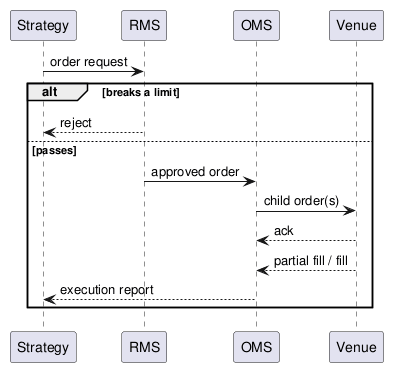

:PROPERTIES:
:ID:       b5b5401b-b2aa-4366-8a62-cffc07279893
:ROAM_ALIASES: "订单与风险管理系统" OMS RMS
:END:
#+title: Order and Risk Management Systems
#+filetags: :Trading:Quant:

* Order Flow
#+begin_src plantuml :file images/oms_rms_order_flow.png
@startuml
participant Strategy as S
participant "RMS" as R
participant "OMS" as O
participant "Venue" as V
S -> R : order request
alt breaks a limit
  R --> S : reject
else passes
  R -> O : approved order
  O -> V : child order(s)
  V --> O : ack
  V --> O : partial fill / fill
  O --> S : execution report
end
@enduml
#+end_src

#+RESULTS:

* Order Management System
The Order Management System (OMS) owns every order's life cycle: new → acknowledged → partially filled → filled, cancelled, or rejected. It is the source of truth for what is working in the market.
- *Routing*: it hosts one *adapter* per destination, which sends orders and receives execution reports in that venue's protocol, so strategies do not care where an order goes.
- *Execution strategies*: it can work a large parent order as many child orders over time, for example VWAP (follow the day's volume profile) or TWAP (equal slices over time), to reduce market impact. Venue choice and slicing are where [[id:7fdff970-42aa-4d49-975e-cff07eead309][Market Microstructure]] matters.

* Risk Management System
The Risk Management System (RMS) is a critical component: a bug or a bad parameter can send thousands of wrong orders in seconds. Knight Capital lost about $440M in 45 minutes in 2012 to a faulty deployment of its order router. US rules (SEC Rule 15c3-5) require brokers with market access to have pre-trade risk controls.

Risk is checked in two places:

| Where | Guards against | Examples |
|---|---|---|
| In the application, when parameters are set | A trader setting grossly wrong values (fat-finger errors) | Price bands around the market, maximum order size, sanity checks on strategy parameters |
| Before the order leaves, in front of the OMS | Everything else; the most critical check | Position and notional limits, order rate limits, duplicate-order detection, kill switch |

Limits exist at two levels:
- *Strategy-level RMS (SLRMS)*: limits per strategy, so one misbehaving strategy is stopped alone.
- *Global RMS (GRMS)*: limits across all strategies, such as total exposure per instrument or for the firm; two strategies that are each within limits can together exceed them.

Pre-trade checks sit on the tick-to-trade path, so they must be fast: keep limits in memory and update positions from fills incrementally.
