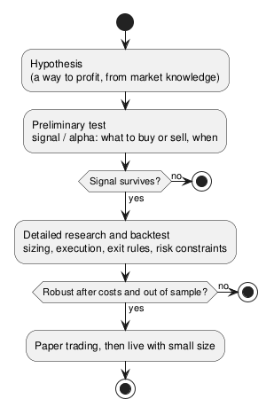

:PROPERTIES:
:ID:       6e4ae290-6a89-4208-8559-a97fd08e356e
:ROAM_ALIASES: "量化交易"
:END:
#+title: Quantitative Trading
#+filetags: :Trading:Quant:

* Research Workflow
#+begin_src plantuml :file images/quant_research_workflow.png
@startuml
start
:Hypothesis
(a way to profit, from market knowledge);
:Preliminary test
signal / alpha: what to buy or sell, when;
if (Signal survives?) then (no)
  stop
else (yes)
endif
:Detailed research and backtest
sizing, execution, exit rules, risk constraints;
if (Robust after costs and out of sample?) then (no)
  stop
else (yes)
endif
:Paper trading, then live with small size;
stop
@enduml
#+end_src

#+RESULTS:

1. *Hypothesis*: an idea for a way to profit. The more you know about how a market works, the better the ideas.
2. *Preliminary test*: test the idea quickly and crudely to see whether a signal (alpha) exists: what assets to buy or sell, at what time. Most ideas should die here, cheaply.
3. *Detailed research and backtest*: turn the signal into a full strategy: how much money to commit, how to execute, when to exit, which risk constraints apply.

* Data
- *Tick data* records every trade or quote as it happens, so the time between records varies (heterogeneous). It is needed for microstructure and execution research.
- *Bars* (minute, daily) are sampled at regular intervals (homogeneous) and summarize ticks into open, high, low, close, volume. They are enough for most signal research.

* Backtest Pitfalls
| Pitfall | How it gets in | Guard |
|---|---|---|
| Look-ahead bias | Using data not available at decision time: today's close for today's entry, restated fundamentals, an index's current members | Shift signals by one bar; use point-in-time data |
| Survivorship bias | Testing only on stocks that still exist; the delisted losers are missing | Include delisted securities |
| Overfitting | Trying many parameters and keeping the best | Hold out an out-of-sample period; prefer few parameters; walk-forward tests |
| Ignoring costs | No commissions, spread, slippage, market impact, or borrow fees | Model costs; a high-turnover edge often disappears after them |

Return statistics are computed on log returns (see below).

* [[id:dae7eefe-f83e-4426-8440-676d382c28b9][Log Returns]]
* [[id:77055920-d7f4-49a5-82b2-23cb35698f0b][Python Quant Ecosystem]]
