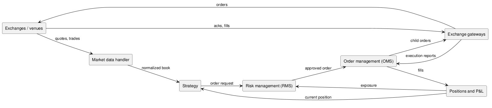

:PROPERTIES:
:ID:       5955446b-3073-4880-822f-83081da78d11
:ROAM_ALIASES: "交易系统架构"
:END:
#+title: Trading System Architecture
#+filetags: :Trading:Quant:

* Components
#+begin_src plantuml :file images/trading_system_components.png
@startuml
left to right direction
rectangle "Exchanges / venues" as ex
rectangle "Market data handler" as md
rectangle "Strategy" as st
rectangle "Risk management (RMS)" as rms
rectangle "Order management (OMS)" as oms
rectangle "Exchange gateways" as gw
rectangle "Positions and P&L" as pos
ex --> md : quotes, trades
md --> st : normalized book
st --> rms : order request
rms --> oms : approved order
oms --> gw : child orders
gw --> ex : orders
ex --> gw : acks, fills
gw --> oms : execution reports
oms --> pos : fills
pos --> rms : exposure
pos --> st : current position
@enduml
#+end_src

#+RESULTS:

| Component | Job |
|---|---|
| Market data handler | Decode each venue's feed and maintain a normalized order book |
| Strategy | Turn market data and positions into order requests |
| RMS | Reject orders that break limits before they leave the system |
| OMS | Track each order's life cycle, split and route it to venues |
| Gateway | Translate orders into each venue's protocol (often FIX or a binary protocol) |
| Positions and P&L | Update exposure from fills; feeds risk limits and the strategy |

The *tick-to-trade* latency, from a market data packet arriving to the resulting order leaving, runs through the top path: market data → strategy → RMS → OMS → gateway. Every component on it is on the critical path, including the risk checks.

* [[id:dbc6bea0-6803-45f0-8fa1-1f3aefc1731b][Low Latency Design]]
* [[id:b5b5401b-b2aa-4366-8a62-cffc07279893][Order and Risk Management]]
